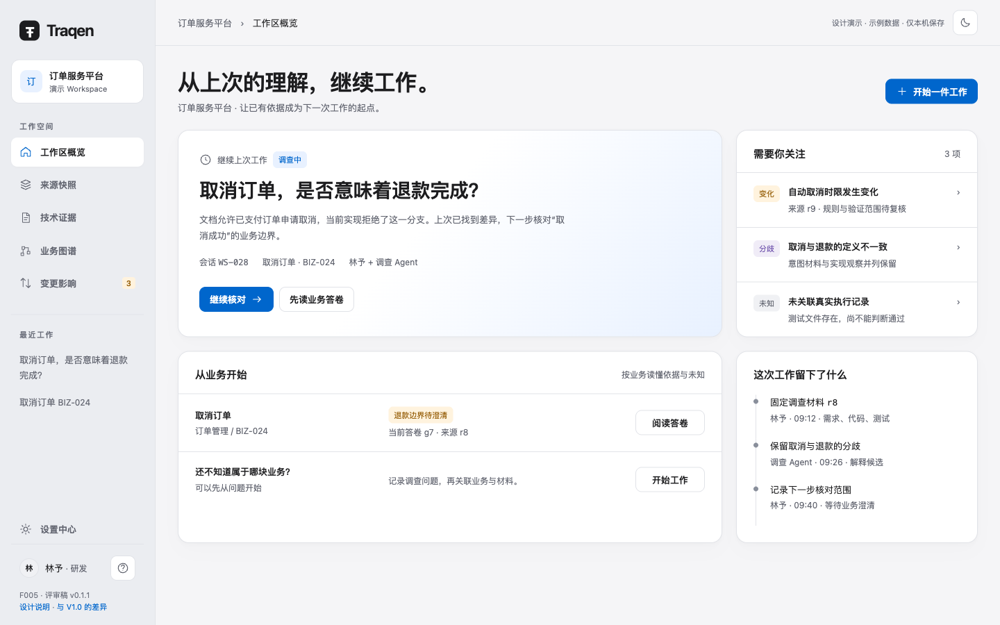
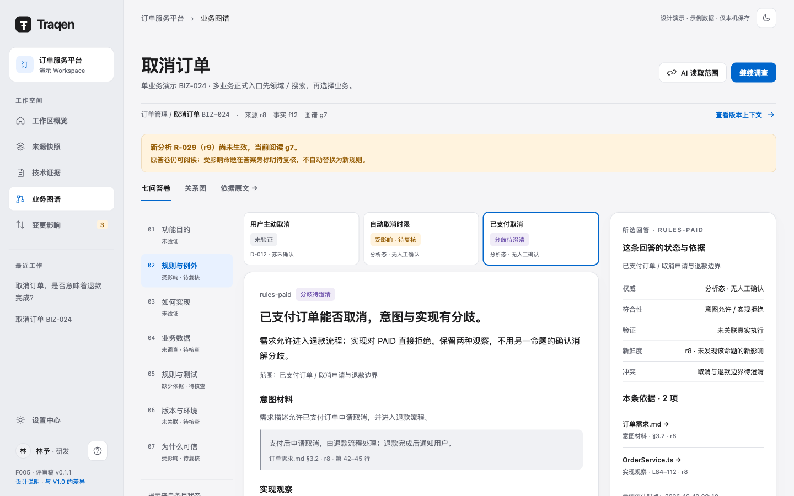
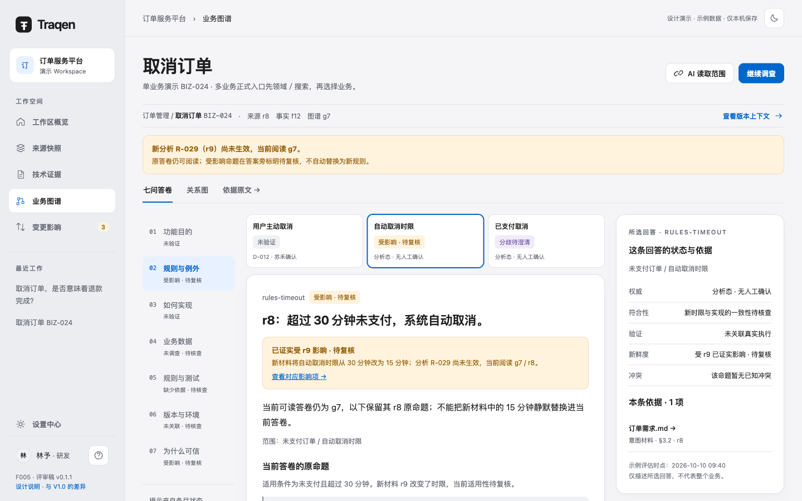
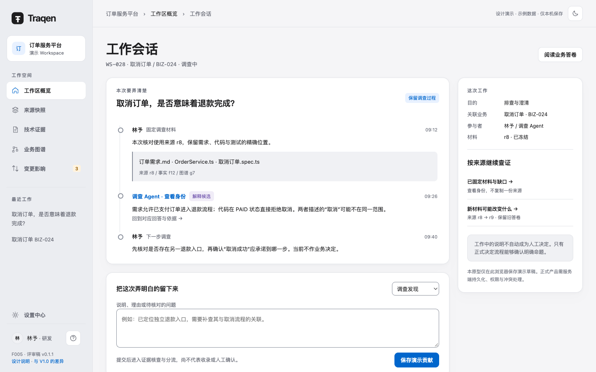
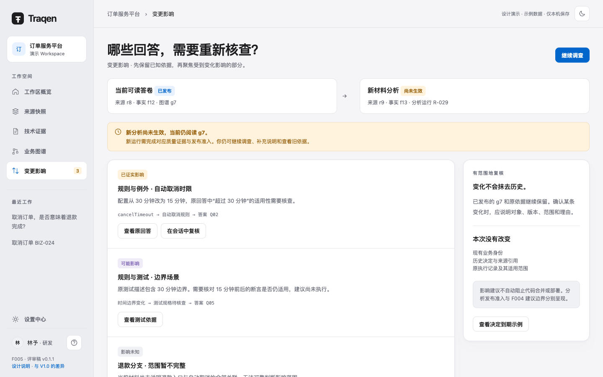
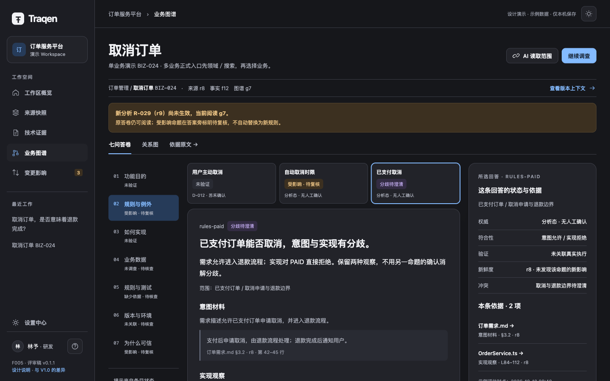
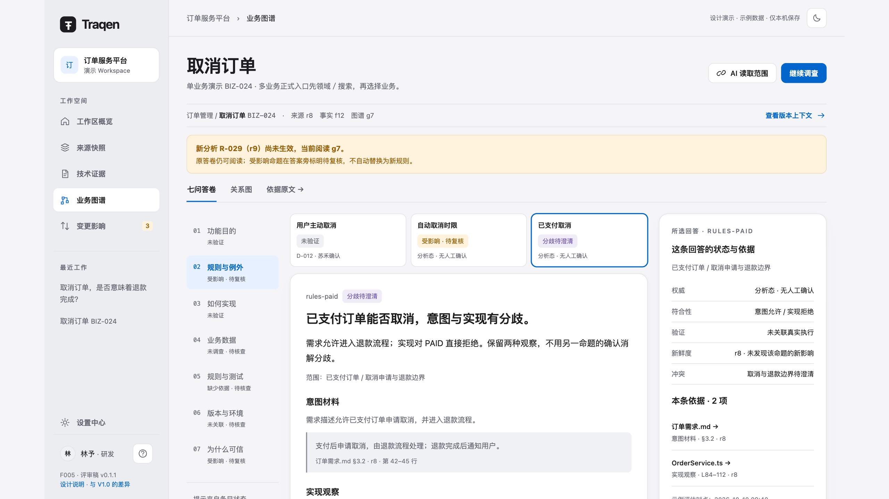

# F005 · Traqen 整体布局与导航设计规范 V1.1

**一套桌面设计，六个清晰入口；围绕业务答卷理解已有认识，在工作会话中留下依据，14 寸和 27 寸仅改变显示缩放。**

本文依据 co-creator 对已有整体方案的正式落盘要求，作为 F005 当前规范文本。各 Feature 的页面布局、导航、视觉和通用交互以本文为共同依据；业务规则、权限、数据身份与执行合同仍归各 Feature。文档发布不表示全部页面已经实现、上线或通过验收，也不关闭任何 Feature。

V1.1 根据 2026-10-12「将新的一版设计写到设计文档」的授权，将已审的业务工作台 v0.1.1 纳入本文。新增七问答卷、工作会话、四类回写、回答级影响与五维状态；六入口、单母版缩放、默认两主题及基础组件规范延续 V1.0。F007 尚未确定的业务合同与分期条件仍保持待定，不因文档落盘视为已决定。

V1.0 已取代 V2.1 提案的 224/244px 双侧栏、34/48px 双边距和大屏增加内容规则；这些旧图、Pencil 与样稿仍只作历史资料。业务工作台的 7 张图和交互稿作为本版设计示例使用，验证范围和已知限制见第 15 节。

- [与 V1.0 的独立差异清单：17 项](CHANGES.md)
- [本版效果图、交互稿与验证边界](#current-design-artifacts)
- [原 V1.0 不可变快照](https://github.com/qianfengXY/Traqen/blob/f98ad8eda55db9c0b04f5855ee5182c6de5d90ea/docs/design/F005-layout-navigation/README.md)

阅读顺序：第 1–4 节看整体与导航，第 5–8 节看缩放、主题与组件，第 9–12 节看复杂工作面和状态，第 13–16 节看实施边界、验收、历史材料与决定来源。

## 1. 设计目标与原则

Traqen 是持续理解业务、技术实现和变化影响的专业工具。用户应能迅速知道：我在哪个工作区、正在看哪个版本、结论凭什么成立、下一步能做什么。

页面围绕「理解业务 → 完成当前工作 → 留下依据 → 下次接续」组织。七问答卷是图谱、来源、主张、决定与执行证据的派生阅读面，不另立可随意修改的权威；工作会话连接真实问题与后续贡献。说得清不等于系统正常，失败、冲突、陈旧、缺证据和未验证分别可见。

按用户提出的 Apple 审美方向，采用清晰层次、克制装饰和稳定阅读面。大面积瓷白或石墨背景，内容面不透明，文字层级清楚；蓝色突出主要动作和选中。导航、浮动控制可有轻微材质感，长文、代码、表格和图谱节点避免大面积模糊、玻璃叠玻璃及装饰反光。这是 Traqen 的设计取舍，不是 Apple 官方尺寸或像素复刻；不放 Apple 标志、假系统窗口按钮或要求下载专有字体。

| 原则 | 页面上的要求 |
|---|---|
| 内容优先 | 标题明确任务，依据容易找到，装饰不争夺注意力 |
| 一个任务区一个主动作 | 危险操作不作为默认主动作；次要动作降级 |
| 同一对象保持上下文 | 返回保留选择、筛选、滚动、版本与可恢复编辑 |
| 状态跟随对象 | 失败、受限、过期、待确认出现在相关行、节点或任务旁 |
| 结论可回查 | 对象与关系均携带来源、版本、依据、状态和适用范围 |
| 未知如实表达 | 未提取不等于不存在；测试资产不等于执行通过；分析态不等于人工确认 |

每个页面按“依据—判断—动作—恢复”检查。首页好看不能代替表单、列表、失败恢复和长中文内容的验收。

## 2. 职责与业务边界

F005 负责整体外壳、导航、页面模板、视觉 token、通用组件、交互状态和体验验收；不重新定义业务流水线。

| Feature | 页面必须承接的事实 | 业务权威 |
|---|---|---|
| F001 | 来源、范围、八站过程、材料清单、缺口、冻结身份、旧版本与恢复 | [来源真相设计](../F001-workspace-source-truth/README.md) |
| F002 | 对象、声明、派生事实、确定性关系、原文和缺口 | [确定性事实设计](../F002-deterministic-facts/README.md) |
| F003 | 调查、分析态入库、例外确认、关系依据、图谱版本 | [业务图谱设计](../F003-traceability-graph/README.md) |
| F004 | 比较范围、影响路径、判断限制、建议验证 | [变更影响](../../features/F004-change-impact-analysis.zh-CN.md) |
| F006 | 全局资产、Workspace 范围、Agent 授权、草稿/应用/运行快照 | [能力设置设计](../F006-workspace-capability-settings/README.md) |
| F007 | 七问答卷、工作会话、贡献、AI 知识读取与分期依赖 | [整体架构与 MVP 设计 v0.4](../F007-function-architecture/v0.4/README.md)；原合同未明确替代的部分继续有效 |

证据充分的 F003 结果可作为 Agent 分析态记录，人工处理规则歧义等例外；不能恢复“所有候选先人工批准才能入图”的旧假设。人工决定只作用于明确命题或关系，不批准整张子图。

来源、事实集、业务图谱是三种身份。示例 r8、f12、g7 是显示名，不能压成通用 `version`。技术提取完成、业务材料已调查、测试已执行分别表达。业务设计后续更新时，旧截图不能反过来修改业务合同。

F005 规定这些能力的页面形态、交互与体验验收；会话、贡献和答卷投影的存储、API、权限与运行职责由 F007 及对应 Feature 落实。F007 §9 的执行证据独立更新和页面降级条件继续待细化；实际试点业务与关系类型清单也不在本文代选。后续导航重排、AI 回写、业务数据对象、正向登记及平台集成按 F007 分期推进，本期不预留不可用的一级菜单。

## 3. 整体外壳与区域职责

```text
┌──────────────────┬────────────────────────────────────────────────┐
│ Traqen           │ Workspace / 当前页面          搜索、主题、活动  │
│ Workspace 切换器 ├────────────────────────────────────────────────┤
│                  │ 页面标题 · 对象范围 · 分属各对象的版本与状态   │
│ 工作区概览       │ 页内视图 / 查询筛选                当前主动作  │
│ 来源快照         ├─────────────────────────────┬──────────────────┤
│ 技术证据         │ 列表 / 阅读面 / 图谱 / 流程   │ 依据或详情面板   │
│ 业务图谱         │                             │ 按当前任务展开   │
│ 变更影响         │ 相同任务使用相同结构          │ 身份、状态、原文 │
│                  │                             │ 与恢复动作       │
│ 设置中心         ├─────────────────────────────┴──────────────────┤
│ 帮助 / 当前账号  │ 就地反馈与溯源信息；完整页面可滚动阅读          │
└──────────────────┴────────────────────────────────────────────────┘
```

- **侧栏**：顶部品牌与可搜索的 Workspace 切换器；中部主导航；底部设置、帮助、账号。“最近查看”为辅助区域，最多 5 项并可清空，不挤走主入口。
- **顶部上下文栏**：工作区、当前页面、固定来源摘要及少量全局工具。版本切换在其所属页面标明种类；顶部来源摘要不冒充通用版本选择器。
- **页面头**：一个 h1、任务说明、作用范围、关键状态与主操作。页内 Tab、筛选工具与页面导航分层。
- **主工作面**：按任务使用列表、树、原文、流程、图谱或比较模板，不强行把每个页面做成指标卡片墙。
- **检查器**：所选对象或关系的身份、状态、依据、活动。关闭后恢复画布或列表位置；需要分享、长编辑时可进完整详情。

详情栏按任务和用户动作展开。不能因为“27 寸”自动多一栏，也不能因为“14 寸”删掉功能。长正文保持可读行宽，长内容使用指定区域滚动；焦点和错误不能藏在不可达的滚动区域。

## 4. 六入口、路由与导航交互

一级导航按用户目的命名，F 编号和内部处理阶段不进入日常菜单。八站是来源页内流程，不是八个一级导航。

| 一级入口 | 用户目的 | 页内内容 | 当前前端地址 |
|---|---|---|---|
| 工作区概览 | 判断状态，继续工作；开始问题 | 会话列表/详情、需要关注、从业务开始、会话级活动；当前依据放在业务行（D17） | `/?page=overview` |
| 来源快照 | 确定正在理解的材料 | 来源与范围、八站、冻结版本、清单、缺口、恢复 | `/?page=sources` |
| 技术证据 | 核验确定性事实 | 对象、事实、关系、覆盖/缺口、代码与原文 | `/?page=evidence` |
| 业务图谱 | 理解业务与实现关系 | 业务/实现/覆盖投影、调查、待确认问题、图/列表；领域/搜索选择业务后默认七问答卷，按需进入同业务关系图与原文 | `/?page=graph` |
| 变更影响 | 判断变化的影响；定位待复核回答 | 两端版本、路径、限制、建议验证；增加当前答卷/新分析分区、受影响回答及前后材料 | `/?page=impact` |
| 设置中心 | 配置作用范围与能力 | 账号、CLI 模型、Skill、Workspace 团队/能力；MCP 暂停与历史；增加 AI 入站读取范围与出站模型授权的区分 | `/?page=settings` |

地址可携带 `workspace` 身份；不是新增后端 API。已有 `page=review` 归属业务图谱，`page=templates` 是归属设置的兼容目的地，不新增一级入口。

会话归概览，七问答卷归业务图谱，不新增“会话”“答卷”或“AI”一级菜单。正式多业务入口仍先领域/搜索、再选择业务，业务详情默认进入七问阅读；不能把样稿的 BIZ-024 或 Q02 写死为生产默认对象。样稿 `view`、`q`、`answer`、`impact`、`session` 仅演示跳转，不冻结生产查询参数。

跨页接续携带当前工作适用的 Workspace、业务、会话、回答位置与各自版本；业务与会话可为空。原文或影响往返保留精确回答、选择和位置，跨 Workspace 不继承未经核验的引用。

### 4.1 导航、Tab、投影各司其职

主导航切换工作目的；Tab 切换同一对象/任务的内容域；分段控件切换同一数据的投影或图/列表形式。临时详情不增加主导航。设置范围切换器明确显示全局或具体 Workspace，不与页内选中态混用。

点击主导航必须同时改变 **URL、主内容/页面标题与唯一选中态**。当前项使用 `aria-current="page"`；导航采用链接，保存/应用采用按钮。支持复制地址、另开标签、刷新、前进和后退，不能只更新侧栏 active。旧样稿的 hash 仅为历史演示。

查询、筛选、排序、对象和版本在业务允许时可序列化到 URL；凭据与敏感原文不进 URL。返回列表恢复查询和位置，历史对象不可用时保留原身份并解释原因，不静默替换成最新版本。

### 4.2 工作区切换、连接与缺口

切换前处理未保存输入；取消则当前页面、URL 和内容保持。确认后进入目标 Workspace 自己的状态，清理无效跨区选择；旧异步响应不能写回新工作区。

| 入口状态 | 用户看到什么 | 禁止行为 |
|---|---|---|
| 未认证 / 凭据失效 | 所选目的地标题、认证原因、连接操作 | 伪装成没有 Workspace，诱导创建 |
| 网络/API 失败 | 保留目的地，给原因、诊断及可用的重试 | 以空列表冒充成功读取 |
| 成功读取且确实为空 | 首次创建入口与解释 | 填充假 Workspace |
| 无权访问 / 对象失效 | 被限制范围、原因、合法去向 | 泄露原文或静默换到别的 Workspace |
| 未接入能力 | 诚实的能力缺口与已可用的下一步 | 样例结果冒充真实运行 |
| 未知页面 | 无法识别页面说明和返回概览 | 默默切首页而保留错误 URL |

连接问题不能让整个导航失去目的地语义；前端隐藏操作不代替服务端权限检查。

## 5. 一套桌面母版与整体缩放

**14 英寸笔记本与 27 英寸显示器，功能、显示内容、布局结构、组件比例和效果一致，只有整体显示倍率不同。** 英寸不参与 CSS 断点或倍率计算，不代表某个固定分辨率。系统/浏览器缩放和窗口大小共同决定可用 CSS 视口。

### 5.1 唯一逻辑尺寸

| 项目 | 母版值（缩放前 CSS px） | 使用规则 |
|---|---|---|
| 应用画布 | 1440 × 900 | 一套逻辑工作区；长内容在指定区域滚动 |
| 主导航侧栏 | 224 | 不另设大屏 244px 版本 |
| 顶部上下文栏 | 常态 66 | 长文案或无障碍放大时可增长，不裁文字 |
| 主内容边距 | 32 | 不保留 34/48 两档设备边距 |
| 图谱检查器 | 默认 302 | 不同任务模板可指定自身宽度，但同模板在两设备一致 |
| 按钮 / 图标按钮目标 | 36 / 36 | 文字、点击目标、焦点和浮层同步缩放 |
| 列表行 | 单行 52、双行 72、紧凑 40 | 紧凑是用户偏好，不按设备自动切换 |

### 5.2 显示倍率与不变量

常规桌面可用空间 `W ≥ 1440` 且 `H ≥ 900` 时，以同一母版按 `s = min(W / 1440, H / 900)` 统一显示。显示范围为 `1440s × 900s`，横向居中、顶部对齐；宽高比不同时保留背景余量，不单轴拉伸，也不借余量增加专属内容区。

| CSS 视口示例 | 倍率 | 母版显示范围 | 外侧余量 |
|---|---|---|---|
| 1440 × 900 | 1 | 1440 × 900 | 无 |
| 1920 × 1080 | 1.2 | 1728 × 1080 | 左右各 96px |
| 2560 × 1440 | 1.6 | 2304 × 1440 | 左右各 128px |

这些是数学示例，不是硬件默认值或本次新增测试结果。导航、字号、图标、间距、边框、节点、连线、检查器与浮层按相同倍率呈现；屏幕切换不改变节点集、列数、密度、工作流或业务状态。

整体 UI 缩放与用户操作的**图谱探索缩放**是独立状态。切换屏幕不能重置图谱倍率、平移、选中与滚动。图谱指针坐标及外部 portal 中的菜单须按应用显示坐标换算，不能出现画面放大而命中区域或菜单仍留在原尺寸。

固定数据、主题、选择、密度、滚动与图谱视口后，移除余量并归一化显示倍率，两种屏幕应显示相同内容与相对布局。**禁止**大屏自动多列、多节点、多面板或更多默认可见行；禁止小屏删内容以伪造一致。

### 5.3 可读性保护

普通窗口任一可用尺寸小于母版（如 1400×860）时，整体倍率下限为 1，使用同一组件与内容重排/滚动，不自动缩为小于 1 的倍率。浏览器放大使可用逻辑空间不足时也保留自然可读字号，允许同样内容重排/滚动且全部操作可达；这是可访问性保护，不增加“笔记本版”或移动产品。不得反向抵消用户的浏览器放大。

1280×800 只作较小可用空间的可达性检查，不是第二套视觉基准。手机、平板、移动抽屉及移动专用交互暂不设计。可访问性重排与正常桌面统一缩放分别验收，不能用其中一项的通过代替另一项。

## 6. 主题、颜色与视觉 token

默认两套完整外观：`light` **瓷白浅色**、`dark` **石墨深色**，沿用既有配色和当前产品 ID；没有保存选择时使用瓷白。未另行选择的蓝/青碧等主色方案不在本版新增。

| 语义 | 瓷白 | 石墨 |
|---|---|---|
| 页面背景 | #F5F5F7 | #16171B |
| 内容表面 | #FFFFFF | #222329 |
| 次级表面 / 导航底色 | #F0F1F4 / #EBEDF1 | #292B33 / #1C1D23 |
| 主文字 / 次文字 | #1D1D1F / #626570 | #F2F3F6 / #B3B7C3 |
| 元信息 | #6B6F7B | #9A9EAB |
| 装饰分隔 / 控件边界 | #E1E3E8 / #898F9B | #3C3E48 / #72788A |
| 交互 / 选中浅底 | #0066CC / #E8F1FF | #84BBFF / #263B59 |
| 主按钮文字 | #FFFFFF | #162333 |
| 成立 / 可用 | #28714B | #8DCEAC |
| 注意 / 待处理 | #945C05 | #EAC283 |
| 分析 / 类型辅助 | #7054AD | #C2ACEF |
| 错误 / 危险 | #B43232 | #FFAAA4 |

状态色配低饱和底色与明确文字；颜色不能独自承载状态。深色主按钮为浅蓝底深字，不机械反相。主题不得把“人工确认”“测试执行通过”和“选中”变成同一种绿色成功含义。

主题切换只改变呈现，保留 Workspace、来源/事实/图谱身份、筛选、选中、图谱位置及未保存输入；选择可通过键盘操作并在刷新后恢复。保存稳定 `themeId`，不要把配置固定成只能表达两项的 `isDark`。

后续主题以集合注册：`id`、`label`、`colorScheme` 和完整语义 `tokens`。新增项覆盖背景、表面、文字、边界、交互、焦点、禁用、错误/警告/成功、代码、图谱节点/边及各交互状态。所有页面消费相同 CSS 变量，不能散落临时色值；新增主题不改变业务状态枚举或导航。自定义调色器和主题市场不在本期范围。

## 7. 排版、间距与层级

字体沿用系统栈：`-apple-system, BlinkMacSystemFont, "PingFang SC", "Segoe UI", "Noto Sans SC", sans-serif`。代码使用 `ui-monospace, Menlo, Consolas, monospace`；数字与版本使用 tabular-nums。中文正文不用负字距。

| 文字层级 | 字号 / 行高 | 字重 | 使用 |
|---|---|---|---|
| 页面标题 | 32 / 40 | 600–650 | 一个 h1 |
| 重点叙述 | 28 / 38 | 600 | 概览继续工作区域 |
| 区域标题 | 20 / 28 | 600 | 工作面主要分组 |
| 小标题 | 15 / 22 | 600 | 行标题、字段组 |
| 阅读正文 | 15 / 27 | 400 | 原文、解释、决定说明 |
| 工作正文 | 13 / 20 | 400–500 | 导航、表格、按钮 |
| 关键辅助 | 12 / 18 | 400–550 | 状态、版本、错误、帮助 |
| 非关键元信息 | 11 / 16 | 400 | 稀疏元信息，不放核心判断 |

连续阅读宽度保持约 64–76 个拉丁字符等效宽度。长标题可两行并有完整阅读入口；表格截断提供可展开/复制内容，不只靠鼠标悬停。缩放按第 5 节整体处理，不按设备各改字号。

间距阶梯为 4、8、12、16、20、24、32、40、48、64；页面边距统一 32，区块间 24–32，区块内 16–24。圆角为状态 6、按钮/输入 9、图谱节点 11–12、面板 16；不把所有矩形做成胶囊。

常规边框 1px；焦点环 3px 加 3px 外间隙；图谱选中 2px 边界配淡外圈。图标默认 18px、1.5–1.75px 线宽，核心操作使用同一图标体系和可访问名称。内容层低阴影，浮层和模态层逐级加强；z-index 统一管理，焦点不被遮罩或吸底工具挡住。

## 8. 基础组件与输入规范

组件覆盖适用的 default、hover、pressed、focus-visible、disabled、loading、invalid、readonly 状态；不适用状态明确排除。权限与版本由页面/业务层传入，组件不能猜权限、伪造成功或换版本。

| 组件 | 外观与结构 | 交互要求 |
|---|---|---|
| Button | primary / secondary / ghost / destructive，默认高 36 | loading 保宽、防重复提交；禁用原因邻近可读；危险动作不默认聚焦 |
| IconButton / Link | 18px 图标、36px 目标；链接表示目的地 | aria-label；tooltip 仅辅助；链接可另开标签，不嵌套交互控件 |
| TextField / TextArea | 常驻 label、输入、帮助、错误 | label 绑定；aria-invalid/aria-describedby；失败保留输入；中文组合态不误提交 |
| SearchField | 输入、清空、结果反馈 | 清空可键盘操作；未查询、无结果、失败不同；异步结果不抢焦点 |
| Select | 有限选项、当前值、展开指示 | 优先原生语义；占位不冒充默认值；不可选项说明原因 |
| Combobox | 输入与候选、分组、作用域 | 方向键选择、Enter 确认、Esc 返回；加载/无结果/错误清楚；旧响应不能盖新查询 |
| Menu / Popover | 动作分组或轻量信息 | Menu 不代替数据选择器；键盘移动与关闭；定位随整体缩放，关闭返回焦点 |
| Tabs / SegmentedControl | 内容域 / 2–4 种互斥投影 | 当前态明确；Tab 语义关联；长标签完整；低延迟内容才自动激活 |
| Checkbox / RadioGroup | 多选与 mixed / 互斥组 | 全选范围明确；组有名称；默认值须有业务依据 |
| Switch | 开关与作用范围 | 明确即时生效还是编辑草稿；失败恢复并解释 |
| StatusBadge | 文字、小符号、低饱和底 | 类型、确认、运行是不同维度，不能合成 success 布尔值 |
| Tooltip | 短辅助说明 | hover/focus 均触发、Esc 可关；不承载唯一关键说明 |
| Dialog / Sheet | 标题、对象、内容、动作 | 焦点约束、Esc、返回焦点；有未保存内容按业务约定保护 |
| Inspector | 身份、状态、概览/证据/活动 | 随选择更新，可独立滚动；关闭不丢探索位置，可打开完整详情 |
| EmptyState / InlineNotice | 原因、范围、下一步 | 初始空、无结果、权限、失败分别设计；阻塞不只发 toast |
| Toast / Skeleton / Progress | 短反馈 / 真实结构 / 当前阶段 | toast 不承担长期失败；未知分母不用假百分比；减少动态时取消闪烁 |
| DataTable / TreeView | 稳定对象身份、状态与操作 | 排序/选择/分页一致；树方向键展开并保留选择，提供检索替代 |
| CodeViewer / EvidenceQuote | 固定来源、路径、范围、原文 | 解释与原文分区；复制代码与引用分开；受限内容不预加载泄露 |
| VersionSelector | 种类、身份、时间、可用性 | 三种版本分开；换版本先处置未保存编辑；失效不自动换最新 |

字段首次离焦或提交后提示错误，之后可及时清除已修正错误；不要在中文尚未输入完时刷红。多字段错误提供可跳转摘要与逐字段说明，告诉用户哪里不满足、怎样修正。服务端业务校验仍为最终依据；敏感字段不进入错误正文和诊断日志。

选项显示完整名称及作用域；被权限/配置变化移除的选择保留失效解释，不能悄悄选第一项。自定义候选选择器按 [WAI-ARIA Combobox Pattern](https://www.w3.org/WAI/ARIA/apg/patterns/combobox/)核对键盘与焦点行为。

## 9. 页面模板与列表

| 页面 | 模板与阅读顺序 | 必须保持的边界 |
|---|---|---|
| 概览 | 继续工作 → 3–5 条需要关注 → 从业务开始 → 当前会话活动 | 恢复上下文优先于大数字；统计解释范围；非首次用户不重复入门营销；当前依据放在业务行，活动明确会话范围（D17） |
| 来源 | 已冻结版本与进行中新任务分区；八站与材料/缺口同行 | 新任务失败不覆盖旧来源；身份变化先展示差异；冻结不自动启动下游 |
| 技术 | 对象目录 → 事实/原文阅读 → 详情 | 声明与派生分开，派生标规则/前提；API 树不冒充全部事实 |
| 图谱 | 领域/搜索 → 选择业务 → 七问答卷 → 按需进入局部图及所选对象/关系依据、原文 | 逐步展开；投影和图/列表保留身份；例外确认不等于全图批准；回答有独立状态 |
| 影响 | 固定比较两端 → 当前答卷/新分析 → 受影响回答 → 已证实/可能/未知 → 路径、限制与建议 | 建议测试标未执行；缺边不能自动阻断发布；原回答保留并就地示警；影响建议不自动阻断合并或部署 |
| 设置 | 明确范围 → 全局资产/团队/能力 → 草稿与生效摘要 | Main/Child、CLI、显式授权以 F006 为准；MCP 暂停；保存不等于应用或运行 |

列表默认列为对象 → 关键状态 → 依据/限制 → 版本/时间 → 操作。数字右对齐，名称左对齐，时间可查看完整值。排序提供方向与 aria-sort；筛选条件始终可见，清空筛选不删数据。

后台刷新保留旧结果并标刷新中；失败不清空已知列表。分页说明总量定义，未知总量不用假数字。批量条仅在选择后出现，明确“当前页 N 项”或“全部匹配 M 项”；跨 Workspace/版本不继承选择，不用批量批准扩大人工决定范围。

舒适与紧凑密度由用户选择，两种屏幕保持相同选择。虚拟化不能破坏读屏标签、键盘定位和重要内容阅读；必要时提供分页替代。加载、空态、无结果、局部失败、受限、失效、冲突均有对应呈现。

### 9.1 概览与新工作

1. 已有工作：标题说明问题；次级信息包括材料、关联业务、参与者、最近进展和下一步。
2. 新工作：先输入问题，允许业务未归属、材料未关联。创建会话不自动建立业务对象，不启动采集、扫描或模型。
3. 关注事项：具体变化、冲突、缺口与决定到期；点击落到对应回答或工作，而非打开无范围的总量统计。
4. 正式产品会话服务持久化。跨设备恢复、并发编辑和失败保留属于产品验收，本地样稿不能证明这些能力。

### 9.2 工作会话与四种回写

会话正文按发生顺序展示材料固定、发现、理由、纠正与下一步；角色、行为、来源和阶段分开。Agent 贡献保留稳定行为者身份，并可在详情回查模型、Skill 和配置修订；日常阅读不堆配置细节。第 15 节样稿可点击“调查 Agent · 查看身份”读取合成行为者 ID、模型、Skill 和配置修订；新建会话只有实际创建者，不虚构 Agent 已参与。

| 回写内容 | 页面动作与反馈 | 成立条件与业务归属 |
|---|---|---|
| 调查发现 | 填说明、关联依据；保存后显示收到／待分流／后续处置 | F003 五档分流；充分支持自动收录为分析态；歧义交人工；无效隔离 |
| 正式决定 | 显示明确命题、范围、版本与理由，进入决定流程 | 权限与决定规则由业务端核验，不整图批准 |
| 新材料 | 转入来源接入，再带冻结身份回会话 | F001 准入；不得借文本回写绕过材料版本 |
| 执行结果 | 进入证据摄取，核对规格、执行、环境及版本 | 独立证据规则；调用方写 PASS 不构成可信执行 |

保存、分流、人工确认、发布生效是不同阶段。前端只能显示服务端返回的阶段与理由，不因按钮点击而自行推进状态。

同一会话的输入离开页面应可恢复；不同会话的草稿与贡献隔离。错误定位到字段，失败保留输入；取消、冲突、权限变化不得悄悄清空内容。设计示例中“正式决定／执行结果”仅展示边界说明，未模拟真实提交成功。

### 9.3 设置中的两类授权

外部 AI 入站读取与内部出站模型调用分开呈现：前者说明可读取的 Workspace、固定身份、回答范围和原文限制，后者沿用 F006 的模型、Skill 与配置授权。共享答卷不等于共享全部原文；原文默认拒绝，按授权范围过滤，缓存读取也复验权限。此处只定义可理解的页面表达，不新建授权接口或宣称 AI 读取已实现。

## 10. 七问答卷、图谱与证据阅读

### 10.1 回答条目的阅读结构

七问沿用愿景：功能目的；规则／角色／状态／例外；实现；业务数据；规则与测试；版本与环境；当前版本可信依据。

每个问题可有多条回答或多个适用范围，也可明确未知。七问是信息组织方式，不是七个必填字段、七张固定大小的卡片或七张数据库表。

每条回答应可查：稳定回答引用、业务身份、正文、适用范围、依据、实际版本上下文、来源、状态及评估时点。人工确认另列确认人、命题、范围、时间与有效期；没有人工确认时不填一个假确认人。

中部阅读顺序：**一句当前结论 → 适用范围 → 意图与实现观察 → 分歧或未知 → 下一步**。引用只展开足以判断的片段，全文在原文页读取。长回答仍用清晰正文，不把段落拆成满屏徽标。

右侧检查器必须跟随所选答案条目，显示其稳定引用、适用范围、五维状态、该条依据和评估时点；不能用固定业务级概览代替答案状态。以第 15 节示例为例，Q02 三条命题分别建模：D-012 仅确认用户主动取消；自动取消命题无人工确认且受 r9 影响；已支付取消为意图／实现冲突。

问题目录按条目中最需行动的原因提示：受影响待复核、冲突、未知、未验证等；这是导航提示优先级，不是五维状态总分。未知条目使用有类型的 UnknownReason（如未调查、能力不支持、缺少依据、未关联），同时显示原因及下一步。

图谱是查证同一业务的另一阅读视图，保留对象和关系身份。完整平移、缩放、展开、键盘与等价列表遵循下节；第 15 节样稿仅有固定一跳关系，不证明完整 GraphView 已实现。

### 10.2 关系探索与证据

| 维度 | 表达方式 | 不得混淆 |
|---|---|---|
| 对象类型 | 图标 + 类型标签 + 辅助色 | 蓝业务、紫技术、绿文档、琥珀测试仅辅助类型识别 |
| 结论状态 | Agent 分析、人工确认、待调查、需要确认、隔离等明确文字 | 绿色文档节点不代表人工确认或测试通过 |
| 关系语义 | 有向箭头 + 动词标签 | 双向查询不把调用/包含改成无向关系 |
| 关系状态 | 实/虚线、文字及详情 | 虚线不是唯一语义来源 |
| 选中 | 强边界、浅外圈、一跳高亮 | 选中不改变业务状态 |
| 受限 / 失效 | 占位与原因、修复入口 | 删除节点会制造“无关系”的假象 |

节点显示名称、状态和依据概况；长标题可两行。API 路径、代码和证据明细在检查器阅读。同类节点尺寸一致，不能为放进更多节点任意缩字。边有大于可见线宽的命中区域，支持键盘访问；大图聚焦附近标签，保持关系方向。

探索路径为领域/搜索 → 选择对象 → 一跳高亮 → 显式展开关联 → 查看原文 → 返回探索位置。展开显示新增数量、隐藏条件及撤销；避免整图随机重排。平移、缩放、适应画布和返回提供按钮，拖动不是唯一操作方式。筛选使当前对象不可见时给出原因和恢复条件。

图与列表消费相同节点、关系、身份、状态与筛选；均能阅读对象与关系依据。业务、实现、覆盖是投影，切换不改业务事实。覆盖分别呈现材料处理、业务调查、证据与测试执行；未关联执行记录就写“未关联执行”。

检查器顺序：身份与类型 → 当前状态 → 适用范围 → 来源/事实集/图谱身份 → 支撑与反证 → 原文定位 → 限制/待办 → 活动。关系详情额外含起点、终点、方向、类型和该关系独有依据。

证据充分进入分析态；证据不足继续调查；规则歧义进入具体命题确认；无业务解释的材料仍留覆盖待解释；引用、权限或版本非法进入隔离/修复。人工决定记录人、时间、对象、范围、版本、说明；新来源不能自动继承旧确认标签。

## 11. 状态、反馈与恢复

| 状态 | 显示与恢复 |
|---|---|
| 初始加载 / 局部刷新 | 真实骨架 / 保留旧内容；不闪现空态，筛选选择保留 |
| 运行 / 等待外部条件 | 阶段、处理对象、已知进度、最近活动 / 明确等什么，不伪装持续进度 |
| 采集失败 | 失败来源、保留数量、旧可用版本、恢复动作一起出现 |
| 权限 / 引用失效 | 范围、原因、原身份及合法修复，不泄露凭据，不拿新版替代历史证据 |
| 编辑冲突 | 保留本地内容，解释与服务端版本差异，用户显式选择恢复路径 |
| 无结果 / 完成 | 当前查询与清空入口 / 完成对象、范围与下一步；保存、应用、运行成功分别表达 |

同一错误由权威状态解释，组件不各猜一套。只有条件允许才提供重试，不能给不可恢复错误假重试。任务和用户可追溯决定按产品持久化合同保存；离线样稿 localStorage 不是正式后端持久化方案。离开页面不等于取消运行。

### 11.1 回答的五维状态与未知

| 维度 | 页面解释 | 禁止合并的含义 |
|---|---|---|
| 权威 | 谁在什么范围确认，是否仍有效 | 不由测试通过推导人工确认 |
| 符合性 | 实现是否符合该命题与范围 | 不由文档存在推导实现一致 |
| 验证 | 精确版本／环境下实际执行结果 | 不将测试资产计为执行通过 |
| 新鲜度 | 依据是否仍适用，哪些依赖改变 | 不把新材料一律解释为旧意图失效 |
| 冲突 | 相反材料或解释是否仍未解决 | 不自动用摘要消解分歧 |

列表突出当前最影响行动的原因，详情可展开五维；不展示综合绿灯或可信总分。

来源、事实、图谱分别显示，验证涉及执行快照、规格及 Execution 时另列。未知分量明确未关联；不拼装不兼容的新旧身份，不用执行快照代替真实执行记录。

未知原因至少区分缺依据、未调查、冲突、权限受限与能力不支持。权限受限首先解释访问边界，不向无权用户泄露被遮蔽对象名称或原文，更不能写成“业务不存在”。

### 11.2 变化后怎样继续工作

默认同时呈现“当前可读依据”和“新材料分析状态”。若新分析未获准，保留旧头，答卷上下文条持续提示尚未生效及当前阅读身份，例如“新分析 R-029（r9）尚未生效，当前阅读 g7”；受影响条目另在正文旁显示原因、前后材料差异和对应影响项入口。会话与人工回写仍可按自身权限使用。

影响条目包含回答、前后材料、影响分类、路径／理由、限制与下一步。已证实影响不得漏标；可能、未知允许保守提示，但必须给原因。F004 首期建议不自动阻断代码合并或部署，不能与分析发布准入混成同一个门禁。

决定到期即使版本不变也需重新评估权威适用性。保留历史确认与评估时点；到期不改写成测试失败。

新增执行证据独立生效后的答卷更新属于 F007 §9 待细化项。本文保留待细化场景：“图谱头不变，新失败执行生效，相关验证答案更新；旧执行仍可回查”。这是建议验收，尚非已批准的新更新合同。

### 11.3 就地反馈

```yaml
in_context_observability:
  primary_surface: "答案条目、回写表单、会话贡献和对应影响项"
  why_not_dashboard_only: "用户需要在当前判断处知道依据是否过期、回写是否生效，统计页不能替代"
  deep_dive_surface: "版本上下文、证据检查器和会话历史"
  noise_dedup_policy: "同一回答/依赖/原因聚合展示；可收起历史提醒，当前限制仍在对象旁可见"
```

受影响的阅读者在答案旁第一时间看到提示；贡献者在表单及时间线看到提交阶段；需要深挖时进入依据和历史。概览仅汇聚可操作事项，不能成为错误唯一出现的地方。无障碍通告只播报当前动作结果，不把所有后台状态变成 toast。

## 12. 动效与可访问性

微反馈建议 120–160ms，面板转换 180–240ms；动效解释空间变化，不伪装任务进度。减少动态偏好下取消弹性、平移、闪烁，保留静态状态；禁止持续发光节点和无意义漂浮。

目标为 WCAG 2.2 AA，不宣称已完成认证。普通文字至少 4.5:1，大文字至少 3:1，见 [W3C Contrast Minimum](https://www.w3.org/WAI/WCAG22/Understanding/contrast-minimum.html)。必要控件与图形轮廓单独核验，装饰分隔线不能代替控件边界。

至少检查全键盘主流程、可见焦点、没有意外焦点陷阱、弹窗命名及返回焦点、中文输入法、读屏状态、200% 文字放大及 400% 浏览器缩放下的可读性。二维图谱可保留平移，但周边控制与正文仍须可达；提供等价列表。参照 [W3C Reflow](https://www.w3.org/WAI/WCAG22/Understanding/reflow.html)，可访问性重排与设备专属设计分开。

## 13. 前端组件责任与状态契约

沿用现有 React 前端，先核验已有组件，不为设计文档另引 UI 框架。

| 层级 | 责任 | 例子 |
|---|---|---|
| Foundation | 语义 token、排版、间距、动效、层级 | color / space / type / radius |
| Primitive | 原生语义、基础交互与焦点 | Button / Field / Select / Dialog |
| Composite | 通用任务结构 | PageHeader / DataTable / Inspector / EmptyState |
| Domain | 业务意义、版本与权限身份 | EvidenceReference / ClaimStatus / RunProgress |
| Page | 数据查询、路由和任务编排 | 来源 / 证据 / 图谱 / 影响 / 设置 |

组件责任契约：Button 接收 variant、loading、disabled、名称与动作，不在内部算权限；Field 保证标签与错误关联；DataTable 接收稳定 rowId、列、查询/排序、selectionScope、分页、加载/错误；Inspector 接收所选对象、上下文和关闭动作，不能从最近响应猜对象。

EvidenceReference 携带 Workspace、sourceIdentity、materialIdentity、locator、accessState；事实与图谱引用分别增加其身份和对象 ID。ClaimStatus 保留 analysis/confirmation/evidence/scope 多维状态。GraphView 接收有向数据、投影、筛选、选择、展开集及画布位置；画布与列表同源。RunProgress 仅在分母已知时计算百分比。SettingsEditor 分清 draft、savedDraft、appliedVersion 和运行快照。

这些是前端责任边界，不新增 endpoint 或覆盖后端 schema。组件展台用隔离 fixture 覆盖长中文、长 ID、错误、焦点、空/加载等状态，不读取生产数据做设计演示。

### 13.1 业务工作台组合组件

以下是设计责任名称，不是新增后端字段或已实现组件 API。

| 组件 | 必须接收并呈现 | 错误／空态重点 |
|---|---|---|
| AnswerEntry | 回答引用、正文、范围、来源、版本、状态、依据 | 无回答、局部未知、过期、冲突分开 |
| UnknownReason | 原因、可披露范围、可用下一步 | 受限不泄露；未调查不宣告不存在 |
| VersionContext | 来源／事实／图谱／执行的独立身份 | 缺失显式为空；不静默换最新 |
| AnswerStateDetails | 五维状态与各自依据 | 概览与条目范围明确，不合成总分 |
| WorkSession | 问题、范围、关联业务与材料、可恢复输入 | 未归属合法；与真实运行状态分离 |
| ContributionComposer | 内容类型、依据、权限与处理阶段 | 提交失败保留；不能自行宣布确认／生效 |
| ContributionTimeline | 行为者、动作、材料、引用、阶段与时间 | 更正追加，历史引用可回查 |
| AffectedAnswer | 回答、from/to、分类、原因与下一步 | 不确定有原因；建议不冒充已执行 |

基础 Button、Field、Select、Dialog、Table、Inspector、EvidenceReference、GraphView 继续复用。页面负责任务与查询编排，基础组件不猜权限、版本或业务状态。

## 14. 验收标准与用户旅程

| 验收主题 | 可观察条件 |
|---|---|
| 导航 | 六入口 URL/标题/选中态同步；刷新、直接链接、键盘、前进后退有效；认证失败保留目的地 |
| 统一缩放 | 同数据、主题、密度、滚动与选择；1440×900 与 2560×1440 去余量并归一化后结构、内容、比例一致；1920×1080 补查 |
| 可读性保护 | 1280×800 和用户放大下全部动作可达；不能以该项代替正常桌面的统一缩放证据 |
| 双主题 | 同一页面切换仅改配色，保留草稿、版本、选择与位置；刷新恢复；错误/焦点/弹层均可读 |
| 组件与表单 | 无效字段可定位且输入不丢，中文与长内容不破坏布局，提交防重，禁用有原因 |
| 列表与图谱 | 类型/确认/运行状态独立；图和列表可完成等价关系阅读；引用身份与原文定位可追查 |
| 恢复 | 来源失败后旧版本仍可读；配置冲突保留输入；失败、受限、无结果不互相冒充 |
| 状态诚实 | 未接入功能、未执行测试、旧版本、历史截图都有明确边界 |
| 性能与无障碍 | 提供实际测量及操作记录；截图不能证明性能或完整认证 |

必须走通：

1. 打开来源入口 → 未认证仍见来源目的地 → 连接成功 → 正确工作区；导航、刷新、返回都一致。
2. 来源草稿输入无效地址 → 字段错误且输入保留 → 修正保存 → 回读；采集失败 → 核对身份 → 恢复，旧冻结版本可读。
3. 搜索业务对象 → 选节点/边 → 固定原文 → 返回原位置；处理歧义只更新当前命题，保留决定记录。
4. 固定两端版本 → 阅读影响与未知 → 查看路径 → 得到标明未执行的验证建议。
5. 设置范围 → 编辑草稿 → 保存 → 主动应用；清楚区分生效版本与旧运行快照，MCP 暂停无假执行。
6. 同一图谱与依据面板切换瓷白/石墨 → 切显示尺寸 → 刷新 → 验证业务状态、选择、位置与草稿保持；核对图谱与菜单命中位置。

工程预算延续既有提案：常规反馈目标小于 100ms；先测 100 节点/200 关系的局部图，大规模聚合并按需展开。这是待验证目标，不是已达到的 benchmark；不能靠静默丢节点满足数字。

### 14.1 业务工作台验收

新增以下可观察条件：

| 主题 | 验收条件 |
|---|---|
| 回答条目 | 切换同一问题的不同命题时，检查器、依据、权威与范围跟随条目；人工决定只覆盖其明确命题与适用范围，不扩散到其他回答 |
| 变化就地提示 | 从影响页返回精确原回答，保留当前已生效版本的原命题，同时就地显示新材料变化、待复核原因及当前阅读身份；不把新分析当已生效规则 |
| 状态与未知 | 目录理由由条目派生；未知/未验证不贴通用“带依据”标签；UnknownReason 有类型、原因和下一步 |
| 上下文接续 | 原文、影响项、主题切换后保持所选回答和当前工作；新分析未生效在答卷上下文持续可见 |
| 会话与回写 | 未归属会话可创建；不同会话草稿隔离；四类回写遵守各自成立条件；阶段反馈不伪造成功 |
| 内容一致性 | 侧栏与详情的会话标题一致；新会话不虚构 Agent 参与；影响计数有明确对象范围；行为者详情可回查 |

样稿示例：第一项用 Q02 的主动取消、自动取消、已支付取消三个命题检查，D-012 仅覆盖主动取消；第二项用 g7 / r8 的“30 分钟”原命题与 r9 的“15 分钟”变化检查。上述 ID、分钟数与业务规则只用于第 15 节合成示例，不是产品规范的固定值。

在第 14 节原有旅程之外，业务工作台需覆盖：

1. 接手者打开业务，读答案，沿引用查依据，并说清未知原因。
2. 未知归属的问题也能创建工作，固定材料后再关联业务。
3. 从答案进入原文、再回到原回答；会话草稿不丢。
4. 调查贡献经过正确分流；正式决定只影响明确命题与范围。
5. 新分析未获准时旧答卷可读；获准后才推进分析对应当前头。
6. 材料变化定位受影响回答；决定到期触发重评估；历史可查。
7. AI 读取按固定身份与范围过滤，缓存也复验权限；与出站模型授权分开。
8. 隔离恢复后，会话、决定与材料引用可用，并说明恢复未覆盖时间段。

上述第 7、8 条依赖 F007 的真实权限和恢复能力，静态样稿没有完成它们。执行证据独立更新仍按第 11.2 节待细化场景处理；文档纳入不等于验收通过。

## 15. 设计材料、实现定位与限制

<a id="current-design-artifacts"></a>

### 15.1 本版业务工作台效果与样稿

以下 7 张图原样复用已审业务工作台 v0.1.1（`bbf3b65289d661d25c77fe08cdbac818146a355f`，发布于 `f98ad8e`），与同一 HTML/CSS/JS 样稿同源。素材继续保留原目录和版本标识，避免复制出第二份可编辑真相源；**当前规范文本为本文**。所有业务、人物、版本与执行数据都是合成示例，“取消订单”不是已经确定的试点业务。

样稿侧栏把辅助区标为“最近工作”并展示会话，是此次演示的标签与内容差异；不取代第 3 节“最近查看、最多 5 项并可清空”的通用辅助区规范，也不构成新增一级入口。本文没有将该样稿标签提升为正式导航改名。

- [可操作样稿](../../design-reviews/F005/business-workbench-v0.1/assets/index.html) · [离线单文件（下载后用浏览器打开）](../../design-reviews/F005/business-workbench-v0.1/assets/offline.html)
- [50 项浏览器检查记录](../../design-reviews/F005/business-workbench-v0.1/assets/answer-state-verification.json) · [可重复的回答状态检查脚本](../../design-reviews/F005/business-workbench-v0.1/assets/verify-answer-state.js)
- [已审原文不可变快照](https://github.com/qianfengXY/Traqen/blob/bbf3b65289d661d25c77fe08cdbac818146a355f/docs/design-reviews/F005/business-workbench-v0.1/README.md)

#### 概览：恢复工作、看到具体关注项



#### 七问答卷：选中命题的范围、依据和状态



#### 受影响回答：原规则与新材料变化同屏



#### 会话：贡献有来源、有分类、有处理阶段



#### 影响：从变化定位原回答



#### 同内容的两种外观与统一缩放





1440×900 母版与 2560×1440 视口使用相同 fixture、命题和内容；截图 deviceScaleFactor 为 1。主题与倍率不改变业务状态。v0.1.1 的记录包含 50 项通过、零 pageerror；宪宪独立复现原版 0/11、新版 11/11。JSON 的 `red` 字段是对原版单独运行的摘要，不是该脚本每次执行会自动重跑原版。原初稿 34 项记录没有覆盖条目状态，不作为此项证据。本次仅整合文档，没有重新运行产品或重新生成截图。

| 样稿能证明的范围 | 不能据此宣称 |
|---|---|
| 七问/命题切换、条目五维状态、未知原因、影响与原文往返 | 真实对象查询、后端分流、生产权限或发布回路已完成 |
| 同内容双主题、1440/2560 整体缩放、局部键盘与弹窗操作 | 所有生产页面通过无障碍或性能验收 |
| 本机演示草稿恢复、新会话和贡献 | 跨设备持久化、并发、授权、备份恢复已经实现 |
| 固定一跳关系视图 | 完整 GraphView、缩放展开、等价列表及多业务目录已经实现 |

**两项已知样稿限制仍未修复：**

1. 回答页点击“查看对应影响项”时，画面定位正确，但键盘焦点被页面标题覆盖；不能将此样稿行为视为已满足第 12 节焦点要求。
2. Q07 因依赖自动取消命题而待复核，在答卷有就地说明，但影响页只列 Q02、Q05 和一项未知，没有同步列出 Q07；其“3 个影响项”不能解释为全部受影响回答的完整清单。实现时应核对列表范围、依赖提示及计数的一致性。

小于母版时，样稿只提供整页滚动，尚未完成规范所需的全部可访问性重排；不以它证明 400% 浏览器放大或 WCAG 认证。来源、技术、设置只是跨页示意，不取代各 Feature 完整设计；执行证据独立更新等待定场景继续保留待定身份。

### 15.2 历史效果图

[V2.1 图文提案](../../design-reviews/F005/README.md)继续保留，但只作为历史过程资料。下列链接便于复用视觉思路，不作为本文的统一缩放验收结果。

| 材料 | 可参考 | 不可据此宣称 |
|---|---|---|
| [组件展台](../../design-reviews/F005/assets/previews/07-components.png)、[浅色错误](../../design-reviews/F005/assets/previews/08-form-error.png)、[深色错误](../../design-reviews/F005/assets/previews/17-form-error-dark.png) | 控件层次、校验、焦点与主题 | 当前产品所有状态已经实现 |
| [浅色图谱](../../design-reviews/F005/assets/previews/18-graph-laptop-light.png)、[深色图谱](../../design-reviews/F005/assets/previews/19-graph-laptop-dark.png) | 同一业务示例的明暗配色与依据 | 整张画面满足本文母版尺寸 |
| 18–21 旧桌面对照图与 desktop-themes-verification.json | 当时渲染、可达性与切换记录 | 统一缩放通过；旧检查没有验证归一化布局 |
| 12–16 移动图、V2 Pencil、旧离线样稿及内嵌总纲 | 历史探索和构造交互 | 移动端纳入本期，或旧总纲仍是当前规范 |

V1.0 发布时只交付正式 Markdown 与入口指针；V1.1 复用已审业务工作台效果图和样稿，不重绘或修改其行为。新效果图应从同一实现/母版和相同 fixture 状态生成，标明逻辑画布、CSS 视口、主题、倍率、浏览器缩放和 deviceScaleFactor。不能把两张不同布局的图缩成同宽后称为“一套设计”。

### 15.3 实现对应

V1.0 的代码参考点是 `ac946cca92172029c38d438fe09cac149fb48755`（PR #40）。下表保留为当时的实现定位，不声称它是最新实现或已支持业务工作台；本次未重新运行产品验收。新增体验的样稿证据单列于第 15.1 节。

| 规范 | 代码/检查入口 | 说明 |
|---|---|---|
| 六入口与历史 | [product-navigation.ts](../../../web/app/product-navigation.ts)、[traqen-product.tsx](../../../web/app/traqen-product.tsx) | 该参考提交含 page/workspace 路由和目的地状态 |
| 默认主题 | [product-themes.ts](../../../web/app/product-themes.ts) | 该参考提交含两种稳定 ID 和 token；后续新增仍须逐状态验证 |
| 母版 | [product-shell.css](../../../web/app/product-shell.css)、desktopScale | 1440×900、224px 侧栏、32px 内容边距；小可用空间有可读性保护 |
| 浏览器旅程 | [f005-navigation-browser.mjs](../../../test/support/f005-navigation-browser.mjs) | 现有检查入口，不代表本次重新执行或覆盖全部规范 |

既有实现继续按共享 token/AppShell → 基础组件完整状态 → 来源/技术阅读恢复 → 图谱与例外确认 → 影响与配置核对差距；本版增加答卷、会话、回写和回答级影响的设计要求及验收，具体后端依赖由 F007 落实。文档落盘不推倒已验证功能，也不直接推进 Feature 实施状态。

其他设计若仍写“大屏增加内容”或“两尺寸不是整页缩放”，全局呈现以本文第 5 节为准；各 Feature 自己的业务合同保持。跨 Feature 源文修订交给对应 owner，本次不改其 Spec、生命周期、后端、权限或生产环境。

## 16. 授权、来源与修订记录

| 本 F005 线程的直接来源 | 本文消费的决定 |
|---|---|
| `0001789458139802-000323-ea91580b`，2026-09-15 | 高质量整体风格、Apple 审美方向、效果与 UX、组件规范，F005 为页面体验总纲 |
| `0001789614562911-000019-617589c4`，2026-09-17 | 暂不设计窄屏；14 寸/27 寸；默认两种主题，保留扩展 |
| `0001789625647741-000129-b8f4379d`，2026-09-17 | 功能、显示、效果相同，仅缩放不同，不做两套设计 |
| `0001789791324169-000017-f1ef17fc`，2026-09-19 04:15 UTC | “请把之前分析的整体布局及导航栏设计，落一份正式的设计文档。”V1.0 写入依据 |
| `0001791616725970-000567-7bf52b61`，2026-10-10 | “那你先设计一版吧，然后单独列出与之前的不一样的地方。”业务工作台评审稿与独立差异清单的来源 |
| `0001791788552798-000613-cd93da7f`，2026-10-12 07:02 UTC | “将新的一版设计写到设计文档。”将已审 v0.1.1 纳入 F005 V1.1 的明确授权 |

业务权威链接见第 2 节；可访问性来源见第 8、12 节 W3C 原文。具体 Traqen 色值、尺寸、分组和组件责任是本规范的设计决定，不冒充外部标准。

V1.0 校正的根因是把“覆盖两种显示设备”误解成“设计两种响应式布局”。后续先固定功能、内容、结构、比例与状态，再核倍率；“无溢出/可达”与“同一画面”分别提供证据。

| 版本 | 日期（UTC） | 变化 |
|---|---|---|
| V1.0 | 2026-09-19 | 正式整理整体布局、六入口、双主题、组件与验收；纳入单母版缩放决定，建立当前入口与历史边界 |
| V1.1 | 2026-10-12 | 纳入已审业务工作台 v0.1.1：七问答卷、会话、四类回写、条目五维状态与变化提示；复用 7 张图，单列 17 项差异；保留原视觉、缩放与基础组件规范，披露样稿限制 |
