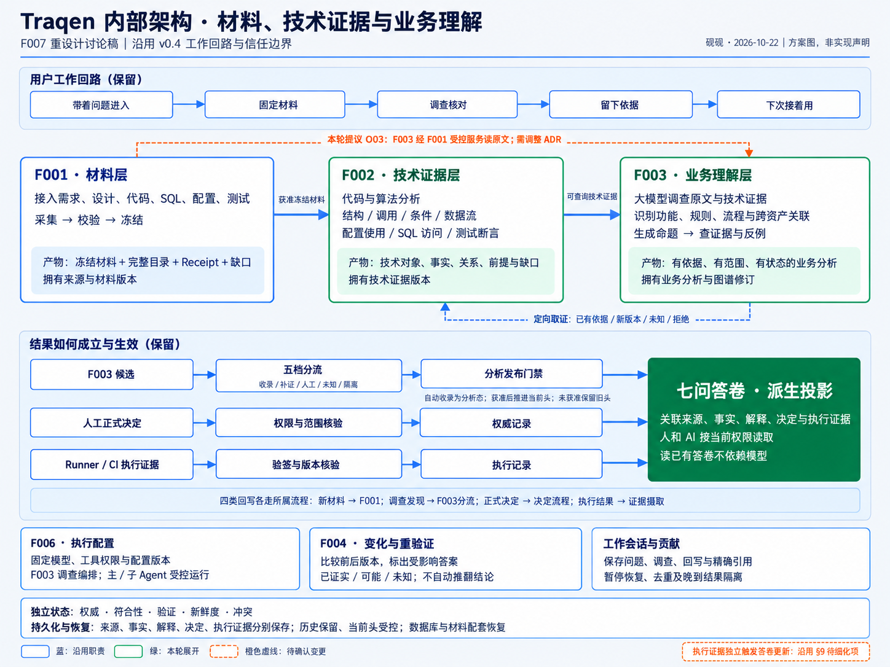
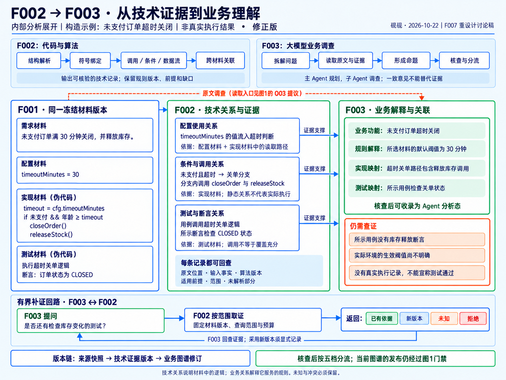

# F007 · Traqen 内部架构重设计 v0.5

**F001 管材料，F002 通过代码和算法建立技术证据，F003 通过大模型形成有依据的业务理解。** 本文记录 co-creator 于 2026-10-22 认可的内部架构方案，重点展开业务、代码、配置、SQL 与测试之间的关联如何产生、核查与生效。

本版独立保存。[原 F007 v0.3.2](../README.md)、[F007 v0.4](../v0.4/README.md)及其历史图稿保留。v0.4 的七问答卷、真实工作回路、五层记录分离、五维状态、发布门禁、MVP 与分期继续适用；本文细化内部分析主线，不另起一套产品目标，也不把两张内部架构图当成五个架构视角的替代。

co-creator 的确认与写入授权为：“这一版没有问题，可以落新的一份设计文档”。方案已获认可，**不表示相应功能已经实现，或待定接口已经冻结**。图稿原样保留绘制时的“讨论稿”“提议”和橙色虚线标记：F001 统一受控读取的方向纳入本版设计，但 ADR-0003 与跨层接口仍需按第 9 节同步，本次没有修改它们。

| 阅读目的 | 入口 |
|---|---|
| 看整体形状与本轮变化 | [1. 总图与职责](#overview)、[2. 与既有设计的关系](#delta) |
| 看原材料如何成为可核查的技术证据 | [3. F001 材料层](#f001)、[4. F002 技术证据层](#f002) |
| 看大模型如何建立业务关联 | [5. F003 业务理解层](#f003)、[6. 关联示例](#example) |
| 看结果生效、工作接续与异常处理 | [7. 工作回路与信任边界](#lifecycle) |
| 看验证范围与待细化合同 | [8. MVP 与验证](#validation)、[9. 待定项](#open-items) |
| 回查授权与原图 | [10. 溯源与图稿](#sources) |

## 1. 总图与职责

三层回答不同的问题：F001 回答“本次拿到了哪些材料”；F002 回答“程序规则能从这些材料中提取哪些对象、事实与技术关系”；F003 回答“这些材料与关系共同表达了什么业务，依据是否足够，还不知道什么”。

| 层／职责 | 输入 | 处理 | 产物与版本归属 |
|---|---|---|---|
| F001 · 材料层 | 需求、设计、代码、SQL、配置、测试等获准来源 | 采集、核对、校验、冻结和受控读取 | 冻结材料、完整目录、Receipt、缺口；拥有来源与材料版本 |
| F002 · 技术证据层 | 合格的冻结材料与明确的分析范围 | 结构解析、符号绑定、调用／条件／数据流分析、跨材料关联、证据校验 | 技术对象、属性事实、关系、前提和缺口；拥有技术证据版本 |
| F003 · 业务理解层 | F001 原文及目录、所采用的 F002 技术证据、F006 生效配置 | 业务调查、命题生成、证据与反例核查、有界补证、五档分流 | 有依据、有适用范围、有状态的业务分析及图谱修订 |

F001 向 F002 提供冻结材料；F003 同时调查 F001 原文和 F002 结果。F003 遇到可由程序解决的技术问题时，向 F002 发起定向取证，返回已有依据、新版本、未知或拒绝。采用新的技术证据版本必须显式记录，不能悄悄替换旧结论的依据。

这些是逻辑职责，**不要求拆成三个进程、微服务或数据库**。技术证据图与业务图谱表达两种关系语义，可以共用存储设施；它们也不能取代人工决定、执行观察等其他记录层次。

## 2. 与既有 F007 的关系

| 主题 | v0.4 及其继承设计 | 本版处理 |
|---|---|---|
| 产品重心 | 七问答卷与真实工作回路 | 保留；三层分析为答卷提供依据 |
| 材料读取 | O03 留待确定 F001→F003 的受控入口；旧 ADR 限定 F002 为唯一直接消费者 | 明确目标职责：F001 提供统一受控读取，F002、F003 分别消费；ADR 与接口同步仍待完成 |
| F002 分析能力 | 已有事实、关系、缺口与定向取证要求，首批能力属于 O05 | 展开结构、调用、条件、数据流、配置使用、SQL 与测试断言分析；支持矩阵不因本图自动确定 |
| F003 调查方式 | 原材料主分析、F002 辅助核查、主／子 Agent、有界补证 | 保留并展开业务语义关联，不把双路输入或补证宣称为本轮新创 |
| 结果生效 | 分流、独立人工决定、执行证据、受控图谱头 | 在总图中保留三条通路，避免“模型产生输出＝当前答案更新”的误读 |
| MVP 与分期 | 地基、四核心、读取通道、七个验收场景 | 保留；本版的关联示例用于细化技术验证，不能替代产品 MVP |

本轮变化集中在**内部职责清晰化、F002 分析深度展开，以及 F001 原文读取的归属方向**。本次不调整 F005 导航，不重新分配全部新增服务的 Feature owner，不把概念记录转换成已定 API 或数据库表。

## 3. F001：获取并保存可反复使用的材料版本

F001 接入需求、设计、代码、SQL、配置、测试及已有报告等材料，负责保存原文、来源、精确版本、完整目录与已知缺失。冻结、准入与内容持久化继续遵循现有来源设计；草稿或不合格来源不能作为下游已就绪输入，冻结完成也不等于自动启动 F002 分析。

### 3.1 统一受控读取的目标边界

F002 与 F003 从 F001 获得同一份冻结材料的稳定引用和获准内容，读取时核对当前权限、版本、完整性和缺口。F003 可以调查 F002 尚不能解析的材料，不必把 F002 已提取的内容误当成全部材料。

这里的原文入口是 **F001 控制的已冻结材料入口**，不是允许 Agent 直接读取变化中的仓库、任意文件系统或未纳入 Receipt 的材料。来源清单、未读取范围与权限限制必须可辨，不能把“无权读取”解释成“材料不存在”。

### 3.2 与 ADR-0003 的衔接

[ADR-0003](../../../decisions/ADR-0003-source-truth-boundary.zh-CN.md) 第 8 条现行文字规定：只有 F002 可直接消费合格 Receipt／来源包，F003、F004 通过 F002 输出继承来源信息。本版明确记录了对其中 **F003 读取路线**的调整方向。

后续需同步 ADR 和 O03：把受控读取职责落到 F001，定义消费者身份、完整目录、权限复验、精确版本绑定及失败语义。冻结、准入、审计与缺口继承要求保持；本图没有为 F004 增加直接读取入口。**本次文档记录不构成运行时权限放开，也没有静默改写现行 ADR。**

## 4. F002：通过代码与算法建立技术证据

F002 的主线是“结构解析 → 符号绑定 → 逻辑分析 → 跨材料关联 → 校验与发布”。它用可说明的程序规则分析材料中的结构和逻辑，提供 F003 可查询、可回查、可独立核验的证据。

### 4.1 分析能力目录

| 材料／分析面 | 技术分析方式 | 能表达的关系与限制 |
|---|---|---|
| 代码结构 | 语法树、符号与类型解析、入口和调用分析 | 声明、引用、路由／处理函数、调用目标；不能唯一解析的目标保留候选和原因 |
| 程序逻辑 | 支持范围内的控制流、条件与数据流分析 | 哪个条件控制动作，参数从哪里来、结果流向哪里；保留成立前提与未覆盖路径 |
| 配置 | 声明、读取位置、引用与可解析覆盖关系 | 配置值如何进入判断或调用；材料中的值不等于真实环境的生效值 |
| SQL／数据结构 | SQL 解析、字段引用和数据访问分析 | 哪段实现读取或修改哪些表、字段；动态表达式或缺失模式不能强行解析 |
| 测试 | 用例、调用目标、准备数据和断言分析 | 测试调用什么、设定什么、断言什么；调用不等于覆盖充分，更不等于实际执行通过 |
| 业务文档 | 章节、显式规则编号、接口标识、链接和原文定位 | 文档明确引用哪些对象；“这段实现满足哪条业务规则”的语义解释由 F003 核查 |

这是目标能力目录，**不是已实现清单，也不是一期必须支持所有语言和算法的承诺**。O05 仍需逐项确定支持的材料、语言、框架、关系、分析前提、能力外未知和独立参考依据。

### 4.2 技术证据的语义要求

技术产物包括对象、属性事实、关系和缺口；不要求每条事实都成为图中的一条边。每条可消费记录应能回查：

- 对象身份、来源版本与原文精确位置；
- 输入依据、所用算法／规则版本和适用条件；
- 解析确定度、未解析部分和不能成立的范围。

例如“某配置项的值流入超时判断”属于技术关系；“这个判断实现未支付订单超时关闭规则”属于 F003 的业务解释。缺少技术边不能证明行为不存在；同一算法重复算出相同结果，也不能代替独立正确性验证。

F003 可以提出线索或补证问题，但不能直接改写技术事实。F002 的补提、修正与发布保留输入和规则来源，产生可显式采用的技术证据版本。

## 5. F003：用大模型形成业务理解与跨资产关联

F003 围绕业务问题调查，而不是把技术关系换成自然语言报告。它基于获准原文和技术证据，识别业务功能、角色、规则、状态、流程、业务对象与异常路径，再解释它们与代码、配置、SQL、测试的关系。

### 5.1 调查与核查

1. **拆解问题。** 固定本次材料范围、采用的技术证据版本以及模型／工具配置；由 Main 规划，Child 按分工调查。
2. **读取原文与技术证据。** 分开表达需求意图、实现观察与测试检查内容；材料冲突时并列保留，不默认文档比代码更权威。
3. **形成业务命题。** 例如某条件对应哪条规则、配置控制什么业务参数、测试的断言实际检查了什么。
4. **核查证据和反例。** 核对引用是否真正支持命题、适用范围是否匹配、是否存在反例或遗漏；Agent 一致意见不能代替证据。
5. **按已有五档分流处理。** 足够支持的结果收录为 Agent 分析态，需要补证的进入有界调查，业务歧义交人工，未知保留，违规或不合格结果隔离。

自动收录与人工确认是两种不同来源。人工决定继续独立留存权限、适用范围、理由和确认来源；不要求每条可解释结论都先得到人工确认，也不把 Agent 分析自动升级为人工权威。

### 5.2 F003→F002 的有界补证

补证请求围绕一个技术问题，固定来源版本、查询范围与预算。F002 可以返回已有依据、新的技术证据版本、能力内无法确定的未知，或因权限／准入／范围限制而拒绝。

F003 回查返回的依据；如采用新版本，记录采用关系，保留旧结论的依据。预算、停止条件、去重、暂停恢复和晚到结果隔离沿用原 F007／F006 的运行约束；具体请求与返回格式仍在 O03、O05、O12 中细化。

### 5.3 生效不止一个阶段

模型输出、五档分流后的分析记录、当前发布图谱是不同阶段。F003 候选经过分流后，仍受分析发布门禁约束；满足既有独立质量证据要求才可推进 `CurrentGraphHead`。未获准时旧头继续可用，并显示“新分析尚未生效”。

不能把有界补证、模型自检或多个 Agent 的一致结论当作发布门禁的替代。

## 6. 示例：技术关系如何支撑“未支付订单超时关闭”

图中是**构造示例，不是真实运行结果或试点选定记录**。采用最后交付的“修正版”：材料作为一个整体输入 F002，各证据在框内注明来源；实现伪代码包含配置读取，避免错连材料和证据。

### 6.1 同一版本的输入材料

| 材料 | 示例内容 |
|---|---|
| 需求 | 未支付订单满 30 分钟关闭，并释放库存 |
| 配置 | `timeoutMinutes = 30` |
| 实现伪代码 | 从配置读取 `timeout`；若未支付且年龄达到阈值，调用 `closeOrder()` 与 `releaseStock()` |
| 测试伪代码 | 执行超时关单逻辑，断言订单状态为 `CLOSED` |

### 6.2 两层得到不同含义的关联

| F002 技术证据 | F003 可形成的业务解释 | 仍不能据此断言 |
|---|---|---|
| `timeoutMinutes` 经读取路径进入超时判断 | 所选示例材料声明的默认关单阈值为 30 分钟 | 实际部署环境生效值必定为 30 分钟 |
| 未支付且超时条件控制关单分支，分支调用关闭与释放库存函数 | “超时关单”业务路径包含释放库存调用 | 实际运行一定执行了释放，或库存已经正确变化 |
| 所示测试调用关单逻辑，所示断言检查 `CLOSED` | 这个用例检查关单状态 | 测试已执行通过、所有业务规则已覆盖、库存释放已验证 |

F003 因此能解释功能、规则、实现与测试之间的联系，同时保留三处缺口：所示用例没有库存释放断言；实际环境阈值未明；没有真实执行记录。

针对第一处缺口，F003 可以问“是否还有检查库存变化的测试？”，由 F002 按固定材料版本与预算取证。若返回未知，答卷保留未知；若返回新版本，F003 明确采用、重新核查，当前图谱发布仍经过第 5.3 节门禁。

## 7. 保留完整工作回路与信任边界

### 7.1 答卷与工作会话

用户仍按“带着问题进入 → 固定材料 → 调查核对 → 留下依据 → 下次接着用”工作。七问答卷联合来源、技术事实、业务解释、人工决定和执行证据，是派生投影；不是可独立改写的另一套真相。七问是组织视角，不冻结为数据表。

工作会话与贡献属于平台应用层的持续上下文，保存问题、调查过程和精确引用。会话和调查发现可以先不归属业务功能，后续再关联。它们不等同于模型的一次运行，也不由 F001 或 F002 临时补建为另一套权威 store。稳定 ID、物理映射、返回定位与回执等仍需 O04/O16 接续合同。

### 7.2 四类写入与三条生效通路

| 工作中产生的内容 | 所属流程 | 生效边界 |
|---|---|---|
| 新材料 | F001 采集、准入与冻结 | 只有合格冻结版本可被下游采用 |
| 调查发现／解释候选 | F003 五档分流 | 分析态与当前发布图谱区分，分析发布仍须门禁 |
| 人工正式决定 | 现有决定流程 | 核验权限与范围后形成权威记录，不伪装为算法事实 |
| 真实执行结果 | 既有执行证据摄取流程 | 签名、版本与绑定校验后形成执行记录，不凭测试源码生成“通过” |

图中三条生效通路分别是“分析候选→分流→分析发布门禁”“人工决定→权限与范围核验→权威记录”“Runner／CI 证据→验签与版本校验→执行记录”。人工决定与执行记录不需要经过一次新的 F003 分析发布。

**执行证据独立触发答卷重算的具体合同仍沿用 v0.4 §9 待细化项**：总图表达其独立来源与目标关联，不表示相应事件接线已经落地。各领域记录变化如何通知、重算及恢复投影，仍须明确到接口与验收场景。

### 7.3 独立状态与复合版本

权威、符合性、验证、新鲜度、冲突保持独立，不合并成一个总绿灯。“说得清”表示能够有依据地解释，不等于系统正常。

一次分析固定来源快照、所采用的技术证据版本及模型／工具配置；答卷上下文还需包含图谱修订，涉及真实执行时携带对应执行快照和评估时点。各版本身份不互相替代，未知分量显式表达，不把不同上下文内容拼成一份看似完整的答案。

F004 比较前后版本，标记已证实、可能与未知的影响，提出重验证建议；变化或决定到期触发复核，不自动推翻原结论。读取默认受控当前头并注明版本；新的分析尚未生效、权限受限与依赖陈旧须能够辨认。

### 7.4 运行、权限与恢复

F006 提供生效的模型、工具权限与配置版本，业务调查编排属于 F003。主／子 Agent 的运行要保留任务状态、检查点、暂停／取消／重试、去重以及晚到结果隔离；本文不重新启用已经暂停的 MCP 执行接线。

外部 AI 读取知识与 Traqen 调用内部模型是两种边界。人和 AI 按当前权限读取答卷，派生答案及缓存也受权限约束；读取已有答卷不依赖实时模型。v0.4 的自用试点策略与通用外发前置要求继续适用，不能用“仅自用”代替内容和权限控制。

来源、事实、解释、决定、执行观察分层持久保存；历史保留，当前头受控更新。数据库与材料须配套备份、隔离恢复；会话只引用冻结材料，不能以临时运行结束或缓存过期删除应持久保存的用户工作。

## 8. MVP 与验证：补全技术链，不替代产品验收

[v0.4 的 MVP 与分期](../v0.4/README.md#mvp)继续是产品范围依据：一期只在自用 Workspace 选择一块真实业务，具备持久化与首次恢复、独立留出真值集、真实 F006→F003 运行和材料准入；保留入图分流、七问答卷、工作会话与人工回写、变化举手四核心，并至少保留一条读取通道，优先 AI 只读。

本版把其中的内部分析验证展开为：**一条业务规则 → 实现条件与代码路径 → 配置影响 → 测试断言 → 依据、适用范围与缺口**。先确定试点所需能力及未知范围，再扩展语言、框架和算法；第 6 节的构造示例不替代真实试点。

| 验证面 | 需要观察的结果 |
|---|---|
| 同源与可回查 | F002 记录和 F003 引用能回到同一获准材料上下文；材料清单及缺口仍可见 |
| 技术证据正确性 | 技术关系与原文、规则前提相符；不支持或无法解析的部分明确保留，不能只检查重复运行一致 |
| 业务语义支持 | 区分意图、实现和测试检查；引用能够支持所声明范围，冲突与反例不被合并抹去 |
| 有界补证 | 范围与预算可追溯，已有依据／新版本／未知／拒绝可区分；采用新版本留下记录 |
| 信任与生效 | 静态测试关系不冒充执行通过；模型候选不越过分流与发布门禁，也不改写算法事实 |

这条技术链是 MVP 的验证内容之一。v0.4 的七个产品验收场景——接手、回写复用、变化举手、门禁回路、决定到期、先读后改、隔离恢复——仍全部保留。独立评审、运行质量证据和生产发布门禁不因本次重设计降低标准。

二至四期仍按 v0.4 的依赖扩展：更多关系与业务、AI 回写和工作入口改进；正向登记、通用外部 AI 与测试执行产品流程；运行信号集成、外部 Runner、企业部署与规模化。本文没有把能力目录整体提前到一期，也没有删除后续正向登记。

## 9. 待定合同与后续同步范围

沿用 v0.4 的 O 编号，不因图中有框和箭头就认为接口、owner 或实现已经存在。

| 对应项 | 本版明确的方向 | 仍须细化或同步 |
|---|---|---|
| O03／ADR-0003 | F001 统一提供受控冻结材料读取，F003 同时读原文与 F002 证据 | 消费者权限、目录与缺口、版本绑定、失败语义、读取接口及 ADR 条文同步 |
| O05 | F002 用程序与算法建立可核查技术关系 | 首批语言／框架／材料／关系支持矩阵，规则前提，能力外未知与独立正确性依据 |
| O04 | 技术证据与业务语义区分，统一引用、分层保存 | 关系类型和入图协议、稳定身份、会话／贡献／答卷物理映射、并发与恢复；不直接定为物理表 |
| O12 | F003 有界调查、主／子 Agent、五档分流与发布门禁 | 预算、停止条件、收录判据、配置到运行的真实接线、检查点、晚到结果与独立质量评估 |
| O06／O10 | 分开技术测试关系与执行记录，保留变化和决定到期复核 | 执行证据独立更新投影、自动关系如何进入影响传播、重算与评估时点 |
| O04／O16 | 工作会话承载接续，四类回写各进所属流程 | 当前授权读取、精确返回定位、上游采用版本和写入回执；页面内容及稳定可消费合同 |
| O01／O07／O14 | 沿用单块自用试点、固定读取策略与首次恢复 | 试点最终选择、通用风险阈值、恢复目标和 RPO／RTO 数值仍待定 |

v0.4 §9 的裁剪后人工作业入口、真值集溯源、试点关系清单、人可读输出等细化项继续保留。本文不把它们转述为已经批准的接口实现。

文档整理只记录当前已认可方案；实现归属、具体交付范围及跨 Feature 接口采用，应由 co-creator 在对应设计／范围决策中确认，不能由消费方据图补建另一套答卷、会话或权威存储。

## 10. 溯源、图稿与维护

### 10.1 讨论与授权

以下消息均位于 thread `thread_mtqkycp918zlran6`。

| 来源 | 精确消息与作用 |
|---|---|
| 内部职责重设要求 | `0001792651793257-000095-34acadcd`：F001 获取数据，F002 代码／算法提取技术证据，F003 大模型业务分析 |
| 文字方案 | `0001792651795327-000096-d66ffa66`：三层职责、受控原文入口、技术能力目录与补证 |
| 与既有 F007 的差距核对 | `0001792653237025-000099-97bff4f5`：区分新增、细化与继承，补回工作回路、门禁、恢复及完整 MVP |
| 两张有效图稿 | `0001792654161541-000102-67e55658`：总图及最后一张“修正版”展开图；中间错误版本不采用 |
| 方案确认与写入授权 | `0001792668620217-000104-051cd912`，2026-10-22 11:30 UTC：“这一版没有问题，可以落新的一份设计文档” |
| 整理基线 | `caf4631b56d5337366e485fd3bba92adc8b8b8ef`；用于回查现行文档，不表示目标能力已实现 |

### 10.2 继承依据

| 文档 | 本文使用的内容 |
|---|---|
| [中文 README](../../../../README.zh-CN.md) | 产品愿景、七问、工作回路与生产发布质量边界 |
| [F007 v0.4](../v0.4/README.md) | 五视角、答卷与会话、MVP、分期、O01–O16 及待细化项 |
| [原 F007](../README.md) | C01–C07、分析生命周期、版本身份、五层与五维分离 |
| [F001](../../F001-workspace-source-truth/README.md)／[ADR-0003](../../../decisions/ADR-0003-source-truth-boundary.zh-CN.md) | 冻结、Receipt、准入、来源引用；本版明确记录待同步的读取边界 |
| [F002](../../F002-deterministic-facts/README.md) | 确定性事实、证据与缺口；能力目录仍需支持范围验证 |
| [F003](../../F003-traceability-graph/README.md) | 业务调查、五档分流、分析态与人工决定 |
| [F004](../../../features/F004-change-impact-analysis.zh-CN.md) | 变化影响分类与建议性重验证 |
| [F005](../../F005-layout-navigation/README.md) | 现有产品入口，本次不改导航与页面合同 |
| [F006](../../F006-workspace-capability-settings/README.md) | 主／子 Agent、模型与工具配置、生效与运行边界 |

### 10.3 原图归档

| 图稿 | 归档文件 | 采用版本 |
|---|---|---|
| 内部架构总图 | [PNG](images/0-internal-architecture.png) | 2026-10-22 总图原稿 |
| 技术证据到业务理解 | [PNG](images/1-technical-to-business.png) | 2026-10-22 最后一张“修正版” |

图稿由砚砚／gpt-6-astra 编排并通过原生图片生成工具生成。本次逐字节复制获认可的 PNG，不重画、不改文字和连线。文件大小、像素尺寸、SHA-256、原始生成文件标识及采用消息见 [assets.json](assets.json)。本版没有 HTML／SVG 图源；不能将上一版的可编辑源文件视为这两张图的源。

本文、图稿和素材清单均位于独立 v0.5 目录。原 F007、v0.4、其他 Feature 文档、ADR 与索引原样保留；后续合同落地或主入口调整应另行记录修订及采用范围。
