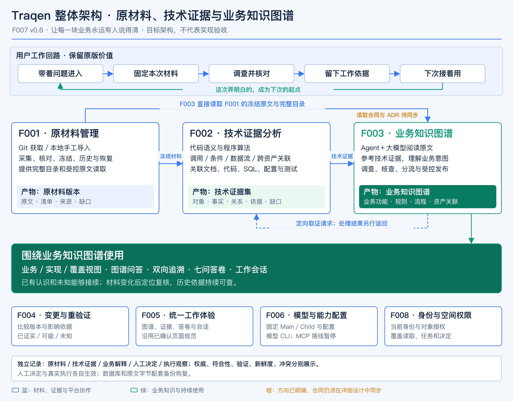
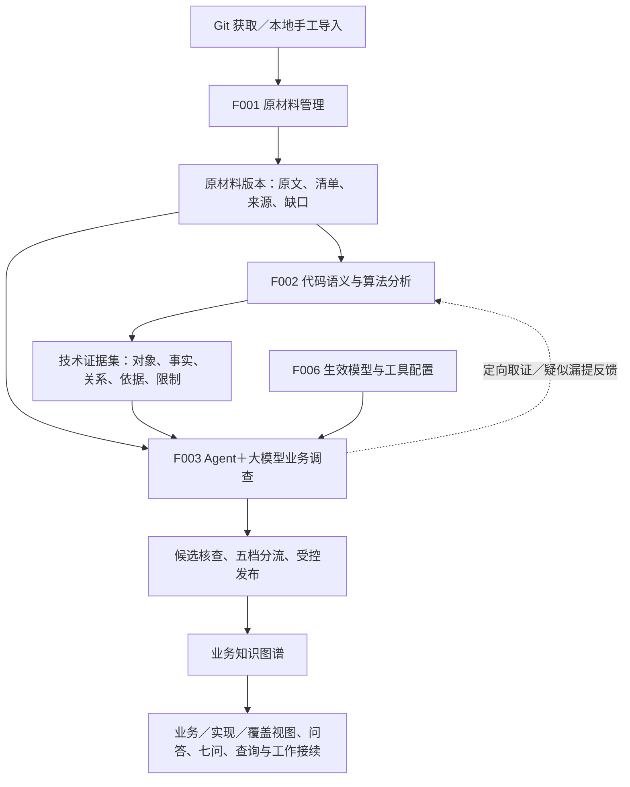
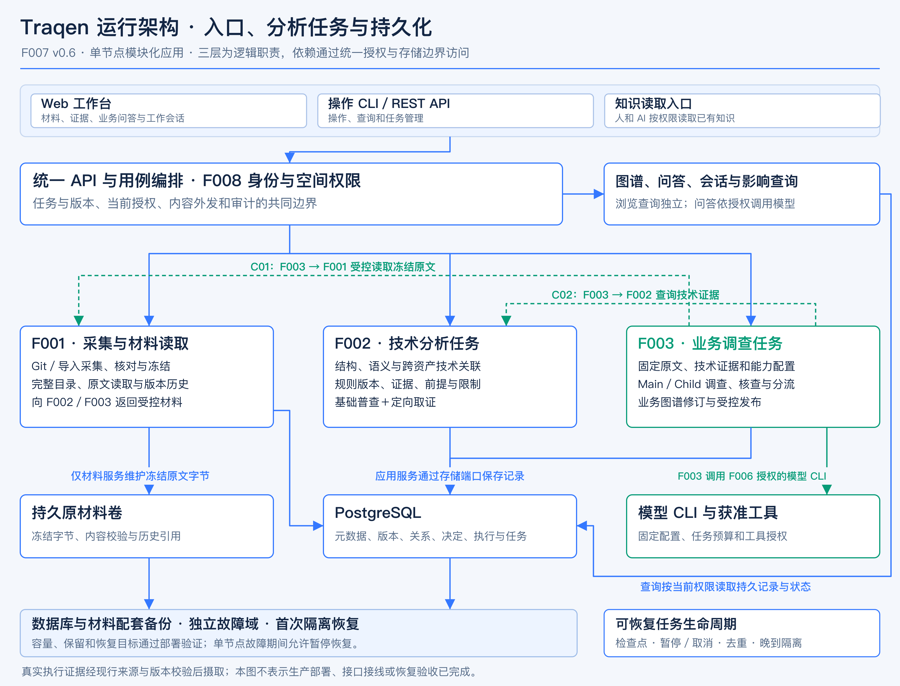
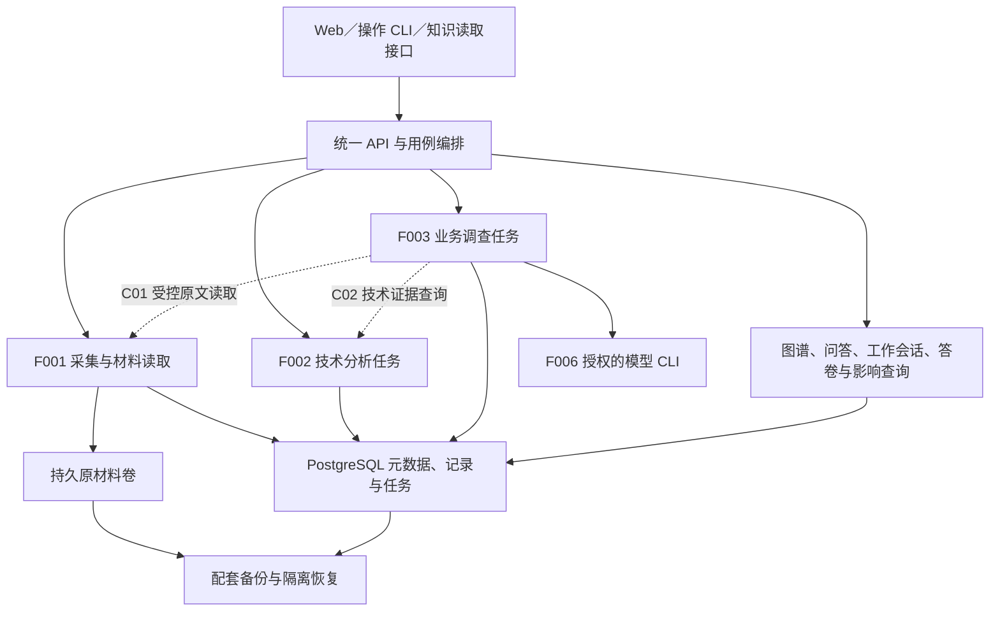

# F007 · 整体功能与三层架构设计 v0.6

**让每一块业务，永远有人说得清。** 本版以这一已认可的愿景为设计目标：后来的人和 AI 能理解业务、回查依据、看清未知，并在系统变化后继续维护这些认识。

核心分析架构由三层构成：**F001 保存版本化原材料；F002 通过代码语义与程序算法建立跨资产技术证据；F003 由接入大模型的 Agent 阅读原材料、参考技术证据，形成业务知识图谱。**

本版是当前整体功能架构入口。它承接 v0.4 的知识接续、七问、真实工作回路和质量约束，以及 v0.5 的内部职责重设计；旧文档与图稿保留为历史参考。三层职责和整体协作已确认，首批支持矩阵、具体 API／Schema、量化验收值及子功能详细设计仍按第 10–12 节落实。**架构确认与文档写入不表示代码改造、运行验收或生产切换已完成。**

## 1. 愿景、使用者与设计结果

Traqen 面向持续维护和演进的软件系统。业务功能是共同理解的组织锚点；业务知识图谱是 F003 的核心产物；浏览、追溯、图谱问答、七问答卷和工作会话让这些知识能够参与真实工作。

| 使用者与工作 | 必须获得的帮助 | 可观察的设计结果 |
|---|---|---|
| 业务／产品负责人澄清规则 | 对照意图、实现、测试和例外，识别歧义 | 规则有来源和适用范围，冲突并列，人工决定可回查 |
| 研发或接手者调查、修改 | 找到规则对应的实现、配置、数据访问及未知 | 从业务反查资产，也能从资产反查业务 |
| 测试与质量人员制定回归 | 区分测试资产、断言和真实执行 | 展示已检查与未验证部分，保留执行版本和条件 |
| 交付与运维人员核查版本 | 解释当前判断的依据、剩余风险和恢复范围 | 版本明确，失败、陈旧、缺失与未验证分别可见 |
| AI 协作者继续已有工作 | 使用同一批可溯源知识和工作记录 | 改动前能够读取依据，后续工作能引用前次调查成果 |

七问继续用于组织阅读和验证：功能做什么；规则、角色、状态和例外是什么；由哪些资产实现；涉及哪些业务数据；哪些测试检查哪些规则；对应什么版本和环境；当前判断有哪些依据与缺口。答卷是相关记录的派生视图，不另立可独立修改的业务真相。

## 2. 三层总体架构

[查看完整图片](assets/01-functional-architecture.png) · [可编辑 SVG 图源](assets/01-functional-architecture.svg)。图片沿用旧版的浅灰蓝背景、白色圆角卡片、深蓝标题和蓝绿关系线；绿色强调业务知识与持续使用，橙色说明仍需同步的详细合同。

查看关系定义（Mermaid）

三层是逻辑职责，不要求拆成三个微服务或数据库。F003 有两路输入：直接读取 F001 控制的冻结原文，同时参考明确采用的 F002 技术证据。技术提取范围不能成为原材料可发现范围的上限。

F001 的完整材料清单、F002 的技术处理覆盖、F003 的业务调查覆盖分别记账。首次来源采集和参考分析仍遵守现行完整性及首次 `FULL` 边界；调查重点与按需补证不构成首次局部采集已经实现的声明。

### 2.1 F001：获取并保存原材料版本

输入包括需求、设计、业务说明、代码、SQL、配置、测试用例、测试方案和已有报告，来源为 Git、手工导入目录，或两者的组合。沿用既有组件身份和来源包规则。

功能包括：

1. 在 Workspace 权限边界内登记来源、选择版本和接入材料。
2. 完整枚举声明范围，核对内容、来源、缺失与限制。
3. 将一次导入或显式获取新变化的结果冻结为可引用的材料版本；旧版本保留。
4. 提供完整目录、搜索定位、受控原文读取和已知缺口，分别服务 F002 和 F003。
5. 比较版本中的新增、修改、删除及组件沿用，复用已验证字节而不损失完整逻辑版本。
6. 支持任务恢复、历史引用、配套备份和隔离恢复。

“原材料版本”指固定下来的这一批材料及其来源、清单和版本信息，是对既有 Bundle／Receipt 等概念的产品表述，不在本版另建一套竞争身份。冻结不修改原仓库，也不自动启动模型分析；读取继续检查当前权限、完整性和准入资格。

### 2.2 F002：建立跨资产技术证据

F002 使用代码语义分析和程序算法，对固定材料及声明范围建立可检查的技术记录。它同时包含基础普查、已就绪范围交付和问题驱动补证。

| 分析面 | 需要建立的技术联系 | 交付要求 |
|---|---|---|
| 代码结构与上下文 | 文件、类型、符号、声明、引用、模块与调用目标 | 保留作用域、来源位置、绑定方式和歧义 |
| 程序逻辑 | 条件与分支、调用上下文、参数和结果的数据流 | 说明关系的成立前提、适用路径及未覆盖范围 |
| 配置 | 声明、读取、引用及流入判断或调用的位置 | 区分材料声明值、可解析覆盖关系和环境未知 |
| SQL 与数据访问 | 实现与 SQL、表、字段、读写操作之间的关系 | 保留解析依据、动态表达式和缺失模式的限制 |
| 测试用例与方案 | 被测目标、准备条件、调用、断言及报告中的声明 | 测试资产、静态检查关系与真实执行分别表达 |
| 业务文档与其他说明 | 章节、规则或接口标识、显式引用及有范围的匹配，与代码、配置、SQL、测试交叉关联 | 关联可回到原文和算法依据，歧义保留候选与原因 |

F002 不调用大模型或 Agent。文档与工程资产的关联限于显式标识、显式引用和按固定规则可重放的匹配，并标注为技术匹配，输出能由材料版本与规则版本复现。向量相似或模型解释不升级为算法事实；“这段需求表达的就是这段实现”由 F003 结合原文和技术证据判断，避免模型用自己的推断循环证明自身。

目标能力目录由 F002 详细设计落实为语言、框架、语法、关系和分析前提的支持矩阵，不因本表而承诺一期全语言、全路径或全动态行为覆盖。

技术证据集包含对象、属性事实、关系、证据与前提、缺口与覆盖、版本清单及词义。事实不必都表示为图边。每条可消费记录须能回查材料版本、精确位置、规则版本和输入依据。可复现性、正确性、声明能力内漏提和业务调查可用性分别验证。

F003 可以提出问题或疑似漏提，但不直接改写算法事实。F002 返回已有依据、独立验证后的新证据版本、仍不确定／不支持，或因权限／版本／范围限制而拒绝。

### 2.3 F003：形成业务知识图谱

F003 使用 F006 已生效的一个 Main 和至少一个 Child，通过受支持的模型 CLI 调查材料。Main 规划、分派并回读核查；Child 接收明确任务并返回结论、依据和未知。

功能包括：分析准备与固定输入；原文和技术证据调查；业务功能、规则、角色、状态、流程、异常及业务对象识别；候选归并与冲突整理；证据及反例核查；有界补证；五档分流；例外人工决定；图谱发布、基于图谱的问答、查询、版本与恢复。

业务知识图谱连接业务含义与工程资产，支持业务视图、实现视图和覆盖视图，以及围绕这些知识进行问答。节点和关系保留来源、范围、依据、版本、分析状态及不确定性。业务数据对象是目标语义范围，首期类型及后续扩展仍由试点关系清单约束。

充分支持的结果进入 Agent 分析态；缺证据进入有界调查；业务歧义交人工；未知保留；无效、越权或混用版本的结果隔离。Agent 分析与人工确认分别记录，不恢复所有结论逐项人工审批的路径。候选生成、分析收录、当前图谱生效是不同阶段，发布继续遵守独立质量证据要求。

## 3. 整体功能与 Feature 协作

| 功能 | 主责及产物 | 与三层的协作 |
|---|---|---|
| F001 原材料管理 | 原文、目录、材料版本、准入与缺口 | 为 F002／F003 提供统一受控读取和精确来源 |
| F002 技术证据分析 | 程序规则产生的对象、事实、技术关系、依据与限制 | 为 F003 提供参考和定向补证，为影响查询提供技术关系 |
| F003 业务知识图谱 | 带依据的业务认识、关系和图谱修订 | 双路调查、核查分流、基于图谱的问答；连接业务和工程资产 |
| F004 变更影响与验证 | 版本差异、真实执行关联、影响分类及重验证建议 | 消费三层关系与实际执行，输出已证实／可能／未知及理由 |
| F005 整体体验 | 统一工作入口、图谱与证据阅读、七问和工作会话呈现 | 组织三层成果；本轮不直接重排既有六入口或确认新页面视觉 |
| F006 能力配置 | 模型、Main／Child、Skill、工具权限及生效配置版本 | F003 固定使用获准配置；沿用 CLI 执行和 MCP 暂停决定 |
| F008 身份与空间权限 | 账号、会话、空间成员和统一授权 | 覆盖材料读取、任务、图谱查询、人工决定与管理入口 |

工作会话和贡献属于平台应用层的持久上下文，可以先于业务功能存在；它们引用三层成果，不另建材料或事实权威。外部 AI 读取知识的入站授权，与平台调用模型的出站授权分别处理。至少保留一条人和 AI 可读的知识读取通道，优先保留已有计划中的 AI 只读通道。

## 4. 跨层协作合同

沿用 C01–C07 的引用编号，明确目标职责与后续设计责任；本表不预设 HTTP 路径、数据库表或字段 Schema。

| 合同 | 目标职责与最低语义 | 详细设计责任 |
|---|---|---|
| C01 原材料准入与读取 | F001 面向 F002／F003 提供完整目录和获准冻结内容；绑定 Workspace、材料版本、组件与定位，复验权限和完整性，返回明确缺口或拒绝 | F001；联合 F002／F003，同步 ADR-0003 |
| C02 技术证据交付与查询 | F002 提供版本化对象、事实、关系、依据、前提和覆盖信息；返回明确能力与范围，保留原材料引用 | F002；联合 F003／F004 |
| C03 定向取证 | F003 提交问题、材料版本、范围和预算；F002 区分已有依据、新版本、未知和拒绝；采用新版本显式留痕 | F002／F003 |
| C04 运行能力 | F006 提供生效模型、团队及工具配置；F003 固定运行上下文并处理失效、恢复和停止 | F006／F003 |
| C05 业务分析与图谱发布 | F003 保存候选、核查、分流及图谱修订；人工决定独立核验权限和范围；维护受控当前头与并发条件 | F003 及既有决定应用服务 |
| C06 真实执行与证据摄取 | 保留精确 TestSpec、执行版本、环境、命令、结果和来源；按现行签名及绑定规则摄取 | F004 与既有 Runner／证据应用服务 |
| C07 影响与知识查询 | 按版本上下文返回业务、技术依据、执行和状态；影响比较绑定前后版本并解释覆盖范围 | F004；联合图谱查询／答卷投影 |

本版实现基线 `ee1b8e3` 的 ADR-0003 第 8 条限定 F002 为唯一直接来源包消费者。本版确认的目标是 F001 统一受控读取、F003 同时读取原文与技术证据；后续 F001–F003 详细设计须同步该 ADR、访问合同及消费者接线。**本次 F007 落盘不修改 ADR，也不放开现有运行时权限。**

## 5. 业务与应用运行流程

### 5.1 首次建立业务知识

1. 选择 Workspace，从 Git 或本地导入材料；F001 形成完整、可引用的材料版本。
2. F002 固定来源与分析配置，完成基础目录和声明能力内的分析；按就绪范围交付证据及限制。
3. 用户声明调查重点，F003 固定原材料、采用的技术证据和 F006 配置，检查当前准入。
4. Main／Child 阅读原文、跟踪技术关系、形成业务候选，回查证据与反例；需要时定向取证。
5. 候选核查、分流并按发布条件形成生效业务图谱。未调查、受限、冲突及未知保留。
6. 人和 AI 从图谱、追溯查询及七问视图完成接手、排查、修改或验证，保存本次工作依据。

基础普查与按需补证共同存在；不要求全部技术关系提取完才启动业务调查，也不把 F002 缩成只有 Agent 问到才登记的临时工具。

### 5.2 材料变化后继续工作

用户显式创建新材料版本，F001 提供前后变化；F002 在支持范围内复用未变化成果并建立新版本所需证据；F003 根据具体依赖复核业务认识；F004 解释已证实、可能及未知影响并建议重验证。

每个新版本保持完整逻辑上下文。跨版本对象匹配的依据和歧义显式保存；不能仅靠名称或路径假定对象永远相同。新分析尚未获准时，旧当前头继续可查，并显示准确版本与适用状态。

### 5.3 四类贡献各自生效

| 新内容 | 进入流程 | 生效与后续更新 |
|---|---|---|
| 文件、说明、日志或报告材料 | F001 采集和冻结 | 新材料版本供后续明确采用，文件内容不直接变成业务权威 |
| 调查发现或解释 | F003 核查与分流 | 分析态、候选和已发布图谱分别保存 |
| 人工正式决定 | 既有决定流程 | 核对身份、命题和范围后追加权威记录，触发相关状态重评估 |
| 真实测试或运行结果 | 既有证据摄取／F004 | 核验来源和绑定后保存执行观察，更新相关验证和答卷状态 |

人工决定和真实执行结果的生效不等待一次新的 F003 分析发布。相关投影可独立重算，历史图谱和执行记录仍保留各自版本与评估时点。具体事件、幂等、并发及恢复协议由相应详细设计落实。

## 6. 数据架构、版本与查询

| 记录类别 | 主责 | 版本依据与修正方式 |
|---|---|---|
| 原材料版本 | F001 | 来源组件、固定内容、清单与限制；新材料创建新版本，旧引用保留 |
| 技术证据版本 | F002 | 原材料、规则／算法和分析配置；材料未变而算法修正，也可以发布新证据版本 |
| 业务图谱修订 | F003 | 采用的原文、技术证据、模型／工具配置及核查结果；发布新修订，保留旧依据 |
| 人工决定 | 既有决定域 | 明确命题、版本、适用范围、来源和有效性；修正追加记录 |
| 真实执行 | 既有执行证据域 | 实际规格、被测版本、环境、命令、时间和来源；与测试源码分别保存 |
| 工作会话／贡献 | 平台应用层 | 问题、过程、精确引用及行为者；关闭页面或模型运行结束不删除应保存的工作 |
| 答卷及查询投影 | 查询／投影服务 | 按业务与版本上下文派生，可重建；不独立改写材料、事实、决定或执行真相 |

三层均须保留可回查依赖：某项业务认识采用了哪些原文和技术证据；技术记录由哪些材料与规则产生。具体身份算法和物理映射由子功能设计落实，不在此把概念表格冻结成数据库表。

一次调查采用的来源和技术证据版本明确固定。补证产生新版本时显式记录采用与后续核查，不静默替换旧结论的依据。涉及前后版本的比较由独立比较上下文表达。

权威、符合性、验证、新鲜度、冲突五维独立展示，不合成一个总绿灯。测试文件、报告声明、静态调用、真实执行及人工确认分别表达。决定到期、依赖变化和新失败执行都可使相关状态重新评估；历史记录保留原时点。

业务图谱支持从功能查规则和工程依据，以及从资产反查业务。浏览与结构化查询不依赖实时模型在线；内部问答由 Traqen Agent 按 F006 已生效的模型配置生成回答，引用所采用的图谱节点、原材料和技术证据，并显示未知与冲突。模型不可用时保留结构化查询与证据浏览，并明确告知本次问答未生成。

问答调用模型属于出站外发，继续受 F006 能力许可、F008 空间权限和内容外发策略约束，查询与缓存命中均重验权限。问答输出是派生结果，不直接成为业务权威；有价值的发现经工作会话和 F003 的核查分流入图。外部 AI 使用既有只读知识通道，按其入站身份和读取许可访问已保存知识；不借此获取内部问答的出站许可，也不新增独立的外部问答编排产品。

## 7. 系统、运行与部署职责

[查看完整图片](assets/02-runtime-architecture.png) · [可编辑 SVG 图源](assets/02-runtime-architecture.svg)。图中表达运行职责和依赖，当前实现与目标设计的边界仍以下文及第 10 节为准。

查看关系定义（Mermaid）

一期沿用持久单节点、模块化应用的方向。Web 和 Node API 提供入口；采集、技术分析和业务调查由可恢复后台任务推进。CPU 解析、模型进程与 API 请求按资源边界隔离，预算、超时、取消、检查点及晚到结果由任务生命周期控制。领域规则不直接依赖外部 I/O。

技术图与业务图谱可以共用物理存储，分别保存关系语义、版本和依据。首期不以引入专用图数据库、多节点或微服务代替当前合同的落实。

F008 身份与授权贯穿各入口；F006 配置固定到运行。原文读取限定于 F001 已纳入版本并获准的材料，模型外发遵守既有内容与能力授权。MCP 执行接线继续暂停；外部 AI 只读通道与出站模型调用分开授权。

数据库及引用字节必须配套备份到独立故障域，并完成首次隔离恢复。单节点故障期间允许暂停恢复；网络落点、容量、预算及 RPO／RTO 以部署验证确定，不以架构图代替可用性承诺。

## 8. 贯穿示例：订单超时关闭

以下继承 v0.5 的构造示例，只解释职责，不代表真实试点或已通过结果。

| 层次 | 本例形成的内容 |
|---|---|
| F001 | 同一版本的需求、超时配置、关单／库存实现、SQL、测试用例和方案，连同目录与已知缺失 |
| F002 | 配置如何进入超时判断；未支付且超时条件控制哪些调用；实现访问哪些数据；测试准备什么并检查哪些断言；与说明材料的技术引用和匹配依据 |
| F003 | 将原文与技术证据解释为超时关单的业务功能、条件、状态变化、异常及资产关系，形成带依据的业务图谱 |
| F004 与执行证据 | 按实际版本／环境保存运行结果，评估超时阈值或实现变化影响哪些规则与重验证项 |

测试只检查订单关闭时，库存释放验证仍有缺口；配置材料声明的阈值不直接冒充真实环境生效值。F003 可以要求补查库存断言，F002 按固定来源和能力返回依据、新版本或未知。

## 9. 首期范围与验收

首期继续在自用 Workspace 选择一块真实业务验证完整回路。具体试点和支持矩阵在详细设计中确定，本例不代替试点选择。地基、入图分流、七问答卷、工作会话与人工回写、变化举手，以及至少一条读取通道均保留。页面可以按既有裁剪线降级，但须保留人可操作的工作与回写入口。

地基包括完整材料准入、真实 F006→F003 运行链、持久化与首次恢复，以及独立留出真值集。真值集有范围和溯源，评估前不直接进入被评估答卷。运行绑定的审核测量和等价证据继续遵守现行发布门槛，不能以开发参考分析或模型一致意见代替。

| 验收场景 | 必须观察的结果 |
|---|---|
| 接手与先读后改 | 未参与调查的人或 AI 能理解业务、沿结论回查原文与技术依据，并在改动前引用已有知识 |
| 技术证据质量 | 对声明能力分别验证正确性、漏提、可复现性和调查可用性；范围外返回明确限制 |
| 分歧与未知 | 文档、实现或测试不一致时并列说明；受限、未调查、未支持和缺证据分别可见 |
| 图谱问答 | 回答引用图谱与来源证据、保留未知与冲突；模型不可用时保留查询入口；输出不直接变成业务权威 |
| 回写复用 | 一次会话补充的依据或理由能被下一次工作引用，四类写入各经所属流程 |
| 变化举手 | 真实材料变化后定位已证实影响，解释可能与未知；保留旧依据而不全部静默替换 |
| 发布门禁回路 | 新分析未获准时旧头可查且标明未生效；获准发布后相关图谱和答卷更新 |
| 决定到期 | 材料未变而决定到期时，相关权威状态重新评估 |
| 执行独立更新 | 图谱头不变时，新失败执行入库仍能更新相关验证状态；报告存在不冒充执行通过 |
| 重启与隔离恢复 | 材料、任务、图谱、决定、工作会话和精确引用可恢复，未覆盖时间段明确可见 |

更广泛的关系／语言支持、通用 AI 接入与回写、正向登记、业务数据对象扩展、运行信号平台集成、外部 Runner 和企业规模化继续按依赖分期；首期的真实读取、证据、授权与恢复要求不后移。

## 10. F007 确认后的设计和代码分解

本表是后续消费本架构的设计包与依赖，不标记子功能已经改造完成，也不替代各子功能的完整方案确认。

| 顺序／设计包 | 设计须明确的内容 | 代码改造落点与可保留成果 |
|---|---|---|
| P 前置验证与地基 | 与 A–D 详细设计并行，选择真实业务测量发布所需的审核证据成本；完成持久单节点、配套备份、首次隔离恢复及独立留出真值集／质量证据流程 | 复用已验证能力，先做真实运行与失败恢复试点；在 D 受控发布和 E 会话持久写入前形成可核对结果 |
| A 共享引用与协作合同 | C01–C07 的完整引用、范围、词义、访问、版本采用及失败语义；ADR-0003 同步方案 | 保留现有来源和领域身份；先确立消费者共同使用的引用与验证边界 |
| B F001 详细设计 | Git／导入版本、完整目录、统一原文读取、变化比较、历史和恢复 | `src/source-truth` 及相关 API／存储；保留采集、清单、Receipt、字节复用与恢复能力 |
| C F002 详细设计 | 支持矩阵、代码语义算法、跨资产技术关系、证据交付、补证及独立验证样本 | `src/deterministic-facts`；复用已验证解析器、规则版本、查询和任务能力，补齐目标能力差距 |
| D F003 详细设计 | 双路输入、Main／Child 调查、业务图谱模型、核查分流、发布、基于图谱的问答、查询与恢复 | `src/analysis`、`src/application`、`src/domain` 及存储；保留决定、历史和发布边界，贯通真实模型运行 |
| E 变化与使用入口对齐 | F004 影响依赖、执行和决定独立更新；F005 图谱／答卷／会话消费；F006／F008 接线 | 相关应用服务、Web 和已有知识读取通道；围绕同一版本化成果组合，不新增竞争真相 |
| F 本地集成与验收 | 完整真实业务旅程、权限、质量与恢复回归；核对前置地基证据覆盖最终集成版本 | 按仓库 SOP 在隔离环境实施、独立 Review 后合入验收；生产切换单独执行 |

先将 F001／F002／F003 详细设计和共享合同对齐；前置验证 P 与设计并行开展，再按材料→技术证据→业务图谱→消费回路的依赖实施。每次运行的审核测量与等价证据是首期主要成本风险，须在真实试点测出成本和失败模式。持久部署、配套备份、首次隔离恢复与独立质量证据流程必须先于受控发布及真实会话写入，不能等最后集成时才首次验证。现有 `F002MaterialService.read` 以事实集版本定位材料；目标 F001 统一读取需要显式迁移这项依赖，保留授权、完整性、脱敏和访问记录，不以改图替代代码接线。

## 11. 待细化项的归属

保留原 O01–O16 编号，以便追溯；整体方向已确认不等于所有详细合同均已关闭。**O03（联合读取）、O10（变化与状态重算）、O12（发布所需证据）、O14（持久化与恢复）是首期完整闭环的阻塞项，须在对应能力开放前验收，不作为不影响一期的尾项。**

| 编号 | 本版明确的方向 | 后续落实 |
|---|---|---|
| O01 | 单块真实业务验证完整三层与工作回路 | 试点选择、关系清单与可运行验收路径 |
| O02 | 业务功能身份和人工决定持续可追查 | 身份演进、拆分合并、正向登记产品合同 |
| O03 | F001 统一受控读取；F003 双路输入 | 联合读取合同、当前权限、目录、版本及 ADR 同步 |
| O04 | 材料、技术证据、业务知识及其他记录分别持久保存 | 具体类型、物理映射、并发发布、会话引用与恢复 |
| O05 | F002 负责代码语义与跨资产技术分析 | 首批语言／框架／算法／关系支持矩阵与独立验证依据 |
| O06 | 静态测试分析与真实执行分开 | 执行规格、批准和报告接入；独立驱动验证状态更新 |
| O07 | F008 统一身份，沿用人工决定和外发授权 | 试点策略、通用风险阈值及企业治理配置 |
| O08 | 缺口和未知可见、可定位、可继续调查 | 分派、补证、关闭／重开和通知 |
| O09 | 图谱、七问与依据支持质量解释和交付查证 | 统计口径、导出、脱敏及交付产品流程 |
| O10 | 依据级依赖支持有范围的变化举手 | 跨版本映射、影响分类、到期、执行更新与重算合同 |
| O11 | 真实外部执行沿用签名和精确绑定 | 后期 Runner 调度、传输、取消、去重与部署 |
| O12 | F003 真实 Main／Child 调查、核查分流和受控发布 | 预算、停止、检查点、晚到隔离、独立测量与运行接线 |
| O13 | 单节点模块化运行，模型调用与知识读取边界分开 | 网络、TLS、凭据和运行隔离的部署验证 |
| O14 | 数据库和材料配套备份并首次隔离恢复 | 计划、容量、保留及 RPO／RTO 的实测目标 |
| O15 | 作业和读取有资源边界 | 代表性材料规模、延迟、预算和容量验证 |
| O16 | 既有入口消费三层成果，工作可以持续接续 | F005 具体页面、返回定位、回写入口及可读输出 |

## 12. 本轮变化、授权和后续边界

### 12.1 与旧方案的关系

保留已认可的愿景、角色价值、七问、真实工作回路、五类记录与五维状态、人工决定及真实执行的独立性、独立质量验证、历史和恢复要求。将三层产物、F002 跨资产技术分析、F003 业务图谱核心产出及双路输入，作为当前整体功能组织主线；在本版集中列出跨层合同和后续设计／代码分解。

原 v0.3.2、v0.4、v0.5 和全部历史图稿保留。按用户本轮视觉要求，本版总图和运行架构图采用旧版的配色、卡片、层次和连线风格，内容使用已确认的新架构，另存 PNG 和可编辑 SVG；Mermaid 折叠保留为关系定义。图稿说明见 [素材与风格依据](assets/README.md)。F001–F006、F008 的详细文档、API、数据库和产品代码本次不变更；已确认的局部约束继续适用，跨层差异按上述设计包同步。

### 12.2 本轮授权来源

来源为 2026-10-22 当前 Codex 远程会话；不为该会话编造 Cat Café 消息编号。

1. 用户明确三层：Git／手工导入形成 F001 原材料版本；F002 使用代码语义和算法建立文档、代码、测试、配置等技术关联；F003 的 Agent／大模型阅读 F001、参考 F002，形成业务知识图谱。
2. 用户确认：“可以，你这样的理解是正确的”。
3. 用户要求重新设计 F007 整体功能架构，定稿后再分到 F001、F002 等详细设计与代码实现。
4. 用户补充：已落盘旧方案中“让每一块业务永远有人说得清”的核心愿景和价值应继续作为参考。
5. 在完整重设计稿及“确认方案并授权修改 F007 及相关阅读入口”的请求后，用户回复：“好，可以继续吧”。本轮据此写入 F007 与相关阅读入口，不扩展为生产部署或子功能代码改造。
6. 用户随后再次明确：“我确认，你继续吧”。
7. 用户要求图片展示参考之前设计文档的风格、内容采用新方案，并确认“是的，按这一版继续设计吧”。本轮据此重绘两张独立的新图，不覆盖旧图。

### 12.3 依据与实现状态

- [产品愿景与当前实现边界](../../../../README.zh-CN.md)。
- [F007 v0.4](../v0.4/README.md)：角色、七问、工作回路、MVP、分期和 O01–O16。
- [F007 v0.5](../v0.5/README.md)：内部三层、原文读取方向与技术／业务关联示例。
- [F001](../../F001-workspace-source-truth/README.md)、[F002](../../F002-deterministic-facts/README.md)、[F003](../../F003-traceability-graph/README.md)：既有局部设计。
- [F004](../../../features/F004-change-impact-analysis.zh-CN.md)、[F005](../../F005-layout-navigation/README.md)、[F006](../../F006-workspace-capability-settings/README.md)、[F008](../../F008-unified-login-space-permissions/README.md)：协作与支撑边界。
- [ADR-0003](../../../decisions/ADR-0003-source-truth-boundary.zh-CN.md)：待在联合详细设计同步的现行读取合同。
- 实现观察基线为 `ee1b8e3927901f92e3d35a8c87d47620bff70ded`；既有代码和测试是可复核基础，不作为本版目标架构已实现的证明。
