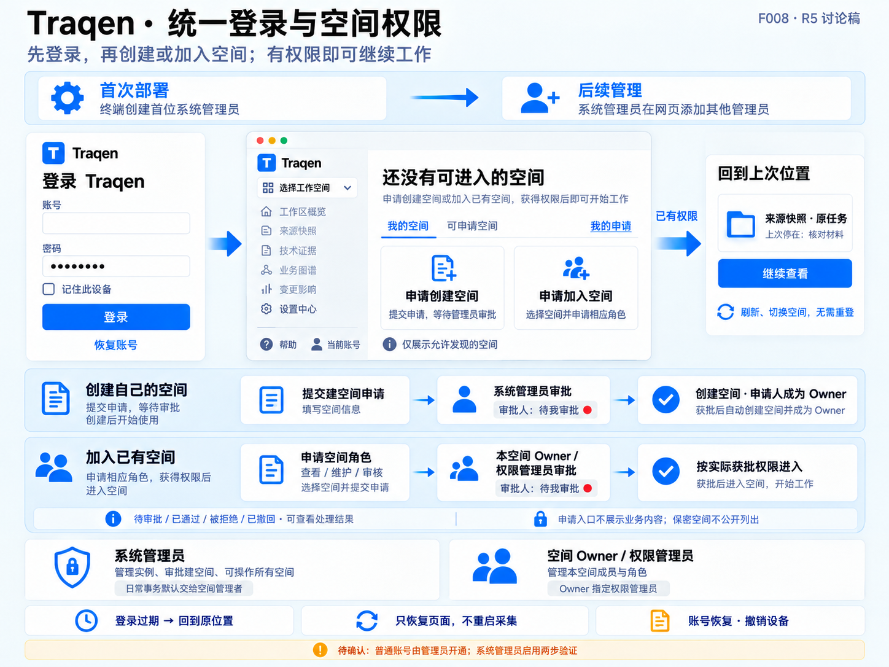

# F008 · 统一登录与空间权限：功能与架构设计 V1.0

**一句话：登录一次就回到上次工作的位置；空间（Workspace）是授权单位，没有权限就地申请，由该空间的管理者审批。**

本文是 co-creator 于 2026-10-15 确认的 F008 完整方案的设计合同。确认原文为“按推荐确认完整方案，授权修改上述设计及配套文档，同时前端设计要参考F005整体标准”（`0001792034005352-001470-1a04a00f`）；被确认的方案正文为 `0001792032041754-001460-30163edb`，其中待确认项 D1、D2、D3 均按推荐采纳。本文不是实现、部署或验收记录；本次文档授权不包含编码实施。

**阅读顺序：** 先看方案总览和流程示意图；第 1–2 节是现状与范围，第 3 节是角色与权限，第 4 节是用户旅程，第 5 节是遵循 F005 的前端设计，第 6–7 节是服务端架构与安全，第 8–10 节是迁移、交付与验收，第 11–12 节是被替换的旧建议与决定来源。

## 方案总览

| 主题 | 已确认的方案 |
|---|---|
| 登录体验 | 一次登录后，刷新、切换空间、进入来源快照（F001）都不再粘贴令牌；登录过期后重新登录回到原位置，不重复启动采集 |
| 系统管理员 | 首位在部署终端初始化；之后任一系统管理员可在网页添加其他系统管理员；系统管理员必须启用两步验证（D2） |
| 账号 | 由系统管理员在网页开通，不开放注册；开通账号不附带任何空间权限（D1） |
| 创建空间 | 任何账号都可以申请；系统管理员批准后创建空间，申请人成为该空间的 Owner |
| 空间角色 | Owner 管理本空间的其他角色，可以指定权限管理员处理日常授权；成员角色为查看、维护和审核角色 |
| 审核角色 | 采用角色集合，每次审核显式选择以哪个角色操作；同一空间内，业务组与合规组角色不能由同一账号兼任（D3） |
| 系统管理员范围 | 可以操作所有空间；日常空间事务默认交给空间管理者 |
| 授权实现 | 一套服务端身份、一份权威空间授权记录，覆盖所有接口、下载、审核、程序调用和后台任务 |
| 与 F006 的关系 | 能力继承、空间禁用、Agent 显式授权和 Ready 模型选择规则不变；建空间审批不附带资源配置 |
| 交付 | A 身份与权限基础 → B 空间申请与管理；两段都完成才算 F008 完成 |



> 上图是讨论阶段的 **R5 流程示意图**，用于说明两类申请和角色分工。它不是 F005 §15.2 意义上的效果图，不能作为像素、尺寸、组件或文案的验收依据；页面效果图按第 5.11 节的要求另行生成。图底部的“待确认”横幅已由 co-creator 按推荐确认。

## 1. 现状与问题（已核实）

以下事实在方案讨论中由代码核实，核实基线为 `33248d2`：

1. **页面靠部署令牌进入。** 令牌只保存在页面内存，刷新即丢失；页面身份固定显示为 `WEB-OPERATOR`（[traqen-product.tsx](../../../web/app/traqen-product.tsx)）。
2. **部署令牌是大多数业务接口的通用凭据。** `API_BEARER_TOKEN` 通过后即可调用除来源快照、已配置专用凭据的审核接口和签名入口之外的业务接口（[http-server.js](../../../src/api/http-server.js)）。CI 的 quality-gate 命令行也使用它（[evaluate-quality-gate.js](../../../src/cli/evaluate-quality-gate.js)）。
3. **调用者身份由客户端自报。** 工作空间列表不按人过滤，`userId` 只用于读写个人隐藏偏好；`userId`、`actorId`、`tenant`、`organization`、`principals` 都来自请求（[http-server.js](../../../src/api/http-server.js)、[workspace-product-foundation.js](../../../src/application/workspace-product-foundation.js)）。创建空间时，客户端还能直接写入 USER、SERVICE_ACCOUNT、RUNNER 身份记录（[postgres-traceability-store.js](../../../src/storage/postgres/postgres-traceability-store.js)）。
4. **来源快照另有一套成员凭据和授权。** F001 用服务端绑定的成员凭据认证，按 `source_truth_access` 的 READ / MAINTAIN / REVOKED 授权，授权写入刻意只走主机终端（[authentication.js](../../../src/source-truth/authentication.js)、[repository.js](../../../src/source-truth/repository.js)、[administration.js](../../../src/source-truth/administration.js)）。
5. **业务审核是第三套身份。** 审核人由环境变量中的 token 绑定角色（`REVIEWER_*`、`IMPLEMENTATION_REVIEWER_*`）；只配置 `REVIEWER_ID` 而不配专用凭据时，每个通过 API 门禁的请求都被当成该审核人（[application-bootstrap.js](../../../src/api/application-bootstrap.js)）。网页把部署令牌同时当作审核凭据发送（[product-foundation-client.ts](../../../web/app/product-foundation-client.ts)）。
6. **部署形态。** 现有部署通过同源网关（`/api` 转发到 API）提供网页，并经 cpolar 隧道公网可达。`cpolar.cn` 不在[公共后缀列表](https://publicsuffix.org/list/public_suffix_list.dat)上（2026-10-14 核对），同一域名下的其他隧道与 Traqen 属于“同站”。
7. **跨站防护依赖请求头凭据。** 主接口的跨域配置只设置响应头、不拒绝请求，部分写操作不要求 JSON 内容类型；目前安全是因为凭据放在跨站页面无法附加的请求头里。

因此 F008 要同时统一“谁在操作”（认证）和“能做什么”（授权），而不只是把令牌输入框换成登录页。

## 2. 目标、范围与非目标

### 2.1 验收目标（来自原始需求）

- 一次登录后，刷新、切换空间、进入 F001 都无需手工粘贴令牌。
- 无权限仍然拒绝：列表与具体资源都在服务端拒绝，不能只隐藏按钮。
- 登录过期后回到原位置，不自动重复启动采集。

### 2.2 本期范围

账号与会话、部署终端初始化、网页身份管理（D1、D2）、建空间申请与审批、空间角色与审核角色（D3）、统一授权与全部入口检查、程序身份、迁移与备份恢复，以及遵循 F005 的全部相关页面。

### 2.3 非目标

- 公开注册；企业统一身份（OIDC、SAML、LDAP 等）；以 passkey 作为唯一登录方式。
- 自定义角色引擎。角色目录与审核策略仍是实例级配置，本期只把“谁持有哪个角色”改为按空间授予。
- 邮件服务与外部通知渠道。
- 按空间限制模型、能力或预算，以及计费系统；这些属于 F006 的独立变更。
- 外部 AI 入站读取授权（F005 §9.3、F007），它与人员权限分开设计。
- 手机、平板专用界面（沿用 F005 §5.3）。

## 3. 角色与权限模型

### 3.1 身份层次

| 身份 | 范围 | 产生方式 | 概要能力 |
|---|---|---|---|
| 系统管理员 | 实例 | 首位由部署终端初始化；之后由任一系统管理员在网页添加 | 管理实例与账号、审批建空间、可操作所有空间（默认交给空间管理者） |
| 普通账号 | 实例 | 系统管理员在网页开通（D1） | 登录；申请创建或加入空间。开通时没有任何空间权限 |
| “全局配置”资格 | 实例 | 系统管理员授予 | 管理 F006 的全局模型、模型供应商账号与能力 |
| 空间 Owner | 空间 | 建空间申请获批的申请人；转让或由系统管理员指定 | 本空间的查看、维护与全部空间管理 |
| 权限管理员 | 空间 | Owner 或系统管理员指定 | 处理本空间的成员与角色申请，授予或撤销普通空间角色 |
| 查看 / 维护 | 空间 | 申请获批或直接授予 | 读取，或读取并维护本空间内容；对应 F001 的 READ / MAINTAIN |
| 审核角色 | 空间 | 申请获批或直接授予 | 按实例审核策略执行业务确认、合规批准、紧急放行、实现复核等 |
| 程序身份 | 实例＋空间 | 系统管理员创建；空间管理者授予其空间权限 | 脚本与集成调用；不能完成需要人参与的业务批准 |

“普通空间角色”指查看、维护和审核角色；“空间管理者”指 Owner 与权限管理员。Runner、Scanner、SourceSlice Worker 等签名入口和任务凭据保持原合同，不并入人员账号。

### 3.2 操作与角色总表

没有明确匹配规则的操作默认拒绝。前端隐藏或禁用操作不能代替服务端检查（F005 §4.2）。

| 操作 | 允许的身份与条件 |
|---|---|
| 管理自己的会话、设备、密码、两步验证、偏好和申请 | 当前账号本人 |
| 申请创建空间 | 任一有效的人类账号；申请本身不创建可用空间、不启动任务 |
| 批准建空间 | 系统管理员；批准、创建空间、绑定 Owner、写审计原子完成 |
| 申请加入空间或申请角色、撤回自己的申请 | 任一有效的人类账号 / 申请人本人 |
| 查看空间内容、来源、图谱、任务、原文及导出 | 本空间查看或维护成员、Owner |
| 编辑材料、采集、维护配置、接受 Gap、冻结来源 | 本空间维护成员或 Owner，并满足各功能原有的确认及完整性条件 |
| 业务确认、合规批准、紧急放行、实现复核等审核动作 | 持有对应审核角色，并满足实例审核策略 |
| 审批成员申请、直接授予或撤销普通空间角色 | Owner、受委派的权限管理员；系统管理员也可处理 |
| 任免权限管理员、指定或转让 Owner | Owner 或系统管理员 |
| 设置空间可见性（可发现 / 保密） | Owner；系统管理员也可处理 |
| 生成保密空间的申请入口 | Owner、权限管理员；系统管理员也可处理 |
| 空间改名及删除生命周期操作 | Owner 或系统管理员，并执行原有确认规则 |
| 开通、停用账号，账号恢复，重置两步验证，任免系统管理员 | 系统管理员；敏感操作需近期重新验证 |
| 授予或收回“全局配置”资格；创建、停用程序身份 | 系统管理员 |
| 授予程序身份本空间权限 | Owner、权限管理员；系统管理员也可处理 |
| 全局模型、模型供应商账号及能力配置 | 系统管理员或持有“全局配置”资格的账号 |
| 程序调用、Runner / Scanner / Worker 操作 | 已登记的程序身份、明确的空间与操作范围，以及原有签名或任务凭据 |

权限管理员不因管理身份自动获得维护、审核权，也不能任免其他管理者；涉及权限管理员本人的角色变更交由 Owner 或系统管理员处理，不能通过审批自己的申请提升权限。

### 3.3 Owner、权限管理员与审核角色

- **Owner。** 每个空间有且只有一个 Owner。Owner 自带本空间的查看、维护与全部管理能力，但**不自动持有审核角色**；需要时可以给自己显式授予，授予留痕，成员可看到角色变更摘要。转让需要有效接任者确认，并原子替换，不留空档。
- **权限管理员。** 由 Owner 或系统管理员指定，负责日常审批和授权；不能任免权限管理员，也不能转让 Owner。
- **审核角色集合。** 同一账号可以在同一空间持有多个审核角色。每次审核请求必须显式指定“以哪个角色操作”，服务端核验当前授权后记录 `actorRole`，不能替用户挑选最有利的角色。原因是双签按每条批准记录的 `actorRole` 判断它属于业务组还是合规组（[decision-governance.js](../../../src/domain/decision-governance.js)）。
- **D3 业务组与合规组互斥（已确认）。** 授予审核角色时原子检查：同一账号在同一空间不能同时持有实例策略中业务组（`businessRoles`）与合规组（`complianceRoles`）的角色；其他审核角色允许组合持有。Owner 的管理身份本身不等同于业务组成员，因此这条规则约束的是显式审核角色的兼任，不能宣称为组织层面的完全独立。迁移时遇到的既有冲突授权必须显式处理，不能静默丢弃。

### 3.4 审核策略与职责分离

- “哪些角色能做什么、哪种模式需要双签”继续是实例级审核策略，例如 `DECISION_BUSINESS_ROLES`、`DECISION_COMPLIANCE_ROLES`、`DECISION_BREAK_GLASS_ROLES` 等配置。F008 改变的只是角色的**持有人**改为按空间授予。
- 提议人不能批准自己的业务提议；双签需要两个不同的统一账号。同一个人不能通过更换角色、令牌或历史 principal 完成双签，系统管理员也受此约束。
- 程序身份不能执行需要人参与的业务批准。

### 3.5 系统管理员操作所有空间

- **管理动作直接执行。** 审批、授权、撤权、指定 Owner 和恢复无人管理的空间，系统管理员在任何空间都可以直接处理。
- **业务动作先显式取得角色。** 读取业务内容或执行业务动作时，提供一键“以系统管理员身份取得所需角色”的明确操作，无需等待 Owner 批准；系统先记录这条**管理员派生授权**，再走统一的业务权限检查。空间管理者能看到介入记录。
- **使用时校验。** 管理员派生授权在每次使用时同时检查账号是否有效、当前是否仍为系统管理员。降权或停用之后，新请求和后台任务的下一阶段都必须失效，不能依赖异步删除授权。独立取得的普通成员授权按其自身规则处理。
- **默认委派。** 空间申请默认只通知该空间的 Owner 和权限管理员；该空间没有在职管理者时，申请转入系统管理员待办。这是默认的**通知分流**，不是访问限制：系统管理员即使不是该空间成员、且 Owner 在职，也可以随时进入该空间的管理面主动处理（第 5.6 节）。
- **信任边界。** 拥有部署主机和数据库权限的人处于系统信任边界之内。应用审计提供可见性和追责，不能被描述为对主机管理员的绝对技术隔离。

## 4. 用户旅程

1. **首次部署。** 部署者在终端交互式设置首位系统管理员的账号和密码；密码不进入命令参数、命令历史或日志。自动化部署可以读取受保护的 secret 文件。初始化只执行一次，重启、升级不重置账号，备份恢复也不能重新打开初始化。初始化前，网页只显示“完成部署设置”的提示，除健康检查和最小初始化状态外，业务接口全部拒绝。首位系统管理员首次登录后须完成两步验证绑定才获得管理权限（D2）。
2. **开通账号（D1）。** 系统管理员在网页开通账号，系统生成一次性设置密码凭据，由系统管理员通过可信渠道交给本人。该凭据建议有效期 24 小时，单次使用，只存摘要，不附带任何空间权限。
3. **登录并继续工作。** 登录后按“当前链接 → 本账号上次的工作位置 → 空间选择”的顺序恢复，并重新检查权限；明确指定的空间或版本不可用时就地说明，不静默换成别的空间或最新版本。工作位置按账号在服务端持久保存；浏览器中旧的全局键 `traqen.activeWorkspaceId` 不直接归给下一位登录者。登录后的回跳只接受经过校验的站内位置，外部地址一律丢弃并回到默认位置。
4. **新成员还没有空间。** 进入“我的空间 / 可申请空间 / 我的申请”，可以申请创建空间，也可以申请加入已有空间。
5. **申请创建空间。** 填写名称和用途，进入系统管理员待办；批准后系统在同一事务中创建空间并绑定申请人为 Owner。系统管理员自己的建空间申请允许自行批准并留痕，避免单管理员实例无法创建空间；业务审核仍禁止自批。
6. **申请加入空间。** 选择空间和具体角色（查看、维护或审核角色），由该空间管理者审批。审批可以降级授予，例如申请维护、只批准查看，页面明确显示实际获得的权限。被拒绝或撤回后可以重新申请，历史保留。
7. **Owner 管理空间。** 查看成员与角色、审批申请、直接授予或撤销普通角色、指定权限管理员、设置可见性、转让 Owner。
8. **空间无人管理与系统管理员介入。** Owner 和权限管理员全部不可用时，申请转入系统管理员待办；系统管理员可以指定新的 Owner 或直接处理申请。Owner 在职时，系统管理员同样可以主动进入该空间的管理面处理（第 3.5 节）。
9. **登录过期、退出与设备撤销。** 多个请求同时失败时只出现一个重新登录提示；重新登录先查询原任务和操作结果，绝不自动重发采集、接受 Gap、冻结或发布。“退出此设备”与“退出其他设备”分开提供，退出或撤销立即阻止该会话的新请求。
10. **账号恢复。** 普通成员忘记密码时由系统管理员处理，系统生成一次性恢复凭据（建议 15 分钟、单次使用）；恢复成功后撤销旧会话和未使用的恢复凭据。空间 Owner 不因此获得重置他人账号的权限。所有系统管理员都无法登录时，在部署终端执行**恢复操作**，不能重新开放首次初始化。
11. **系统管理员任免。** 任一系统管理员可添加其他系统管理员；新管理员完成两步验证绑定后才获得管理权限。增删系统管理员、重置密码或两步验证需要近期重新验证，记录操作者与目标，并通知其他系统管理员。最后一位有效系统管理员不能被移除或停用，并发操作也不能绕过。

## 5. 前端设计（遵循 F005 V1.1）

### 5.1 总原则

- **不新增一级入口。** 六个一级入口、侧栏、顶部上下文栏、页面头和检查器全部沿用 [F005](../F005-layout-navigation/README.md) §3–4。“我的申请”放在侧栏底部的当前账号菜单，“成员与权限”“系统管理”放在设置中心的相应范围。
- **登录前在外壳之外，登录后在外壳之内。** 登录页、两步验证页和“尚未完成部署设置”提示页不显示业务导航或任何业务内容；登录后的页面全部使用 F005 的单一母版、双主题与统一缩放（§5–7）。
- **权限由服务端决定。** 页面按服务端返回的能力显示或禁用操作，禁用时就近说明原因（F005 §8 Button）；页面不自行推断权限。
- **状态分开表达。** 未初始化、未登录、会话过期、无权限、对象不存在或失效、网络失败、账号停用、恢复检查中各自独立呈现，不能互相冒充（F005 §4.2、§11）。

### 5.2 登录页与两步验证

```text
┌──────────────────────────────────────────────────┐
│ Traqen                                           │
│ 登录以继续：来源快照                               │  ← 只显示目的地页面名，不显示空间名或业务内容
│ ┌──────────────────────────────────┐             │
│ │ 账号  [______________________]   │             │
│ │ 密码  [______________________]   │             │
│ │ □ 记住此设备（最长 30 天）        │             │
│ │ [ 登录 ]                          │             │
│ │ 忘记密码：请联系系统管理员         │             │
│ └──────────────────────────────────┘             │
└──────────────────────────────────────────────────┘
```

- 遵循 F005 §4.2“未认证”状态：保留用户要去的目的地，但登录前只显示页面名称（如“来源快照”），不读取或显示空间名称、业务内容。登录成功后再按权限解析目的地。
- 表单使用常驻标签；支持密码管理器和粘贴，账号、密码、验证码分别声明 `username`、`current-password`、`one-time-code` 自动填写语义。中文输入法组合态不误提交（F005 §8）。
- 登录失败统一提示“账号或密码不正确”，不区分账号不存在与密码错误；触发限速时说明需要等待的时间。登录按钮在提交期间保持宽度并防止重复提交。
- 两步验证为第二步：输入验证器中的 6 位验证码，或改用单次恢复码。系统管理员必须完成；其他账号启用后同样适用。
- 实例未初始化时只显示“此实例尚未完成部署设置，请在部署终端完成初始化”，不提供注册表单。实例处于恢复检查时（第 8.4 节），非恢复管理员看到“实例正在恢复检查，暂不开放登录”。
- 登录页同样提供瓷白与石墨两种主题，并满足 F005 §12 的对比度与键盘要求。

### 5.3 空间切换器与零空间页

- 侧栏顶部的 Workspace 切换器只列出当前账号可以进入的空间，底部提供“浏览可申请空间”。
- 账号没有任何可进入的空间时，概览页呈现 F005 §4.2 中“成功读取且确实为空”的入口态：

```text
┌ 侧栏（F005） ┬──────────────────────────────────────────────┐
│ Traqen       │ 还没有可进入的空间                            │
│ 选择空间 ▾   │ 申请创建空间或加入已有空间，获批后即可开始工作 │
│ 工作区概览   │ [我的空间] [可申请空间] [我的申请]            │
│ 来源快照     │ ┌──────────────┐  ┌──────────────┐            │
│ …            │ │ 申请创建空间 │  │ 申请加入空间 │            │
│ 设置中心     │ │ 由系统管理员审批│  │ 由空间管理者审批│          │
│ 帮助/当前账号│ └──────────────┘  └──────────────┘            │
└──────────────┴──────────────────────────────────────────────┘
```

- 页面头只有一个 h1“还没有可进入的空间”，主动作是“申请创建空间”，“申请加入空间”为次要动作（F005 §1“一个任务区一个主动作”）。
- 依赖空间的页面在没有可进入空间时显示同一入口态说明：工作区概览、来源快照、技术证据、业务图谱、变更影响，以及设置中心的“当前空间”范围。这些页面不展示假数据，也不诱导用户以为空间不存在（F005 §4.2）。
- 设置中心的“全局”范围不依赖空间，按实例资格独立可达：零空间的系统管理员仍可开通账号、审批建空间（包括自己的建空间申请）、管理系统管理员与程序身份；持有“全局配置”资格的账号仍可进入 F006 全局设置。系统管理员看到的零空间页同时提示这些入口。
- “可申请空间”是目录，默认向已登录账号显示可发现空间的名称和 Owner，不显示任何业务内容；保密空间不出现在目录中（D1 下的默认值，见第 6.9 节）。

### 5.4 无权限、保密与对象失效

- 通过链接进入一个没有权限的**可发现**空间时，页面头保留目的地页面名称，主区用 EmptyState 说明受限范围和原因，提供“申请权限”和“返回我的空间”。
- 直接用 ID 访问**保密空间**或**不存在的空间**时，显示同一句“无法访问此空间”，不确认保密空间是否存在。保密空间只能通过管理者生成的申请入口到达申请页；该入口只用于定位申请，不授予任何权限。
- 空间被删除、来源版本失效或目标对象不可用时就地说明原因与合法去向，不静默切换空间，也不把历史版本替换成最新版本（F005 §4.1、§11）。

### 5.5 侧栏底部“当前账号”

- 显示姓名和账号；系统管理员另带“系统管理员”标记。现有顶部栏中的 `WEB-OPERATOR` 身份标识移除，账号入口统一放在侧栏底部（F005 §3）。
- 菜单项：我的申请（状态变化时显示角标）、登录设备与会话（含“退出其他设备”）、修改密码、两步验证、退出此设备。
- 修改密码、更改两步验证等敏感操作在最近 10 分钟内未验证身份时，先要求重新验证。

### 5.6 设置中心的两种范围

设置中心沿用 F005 §4.1 的范围切换器，明确显示“全局”或“当前空间”。

| 范围 | 分区 | 谁能看到 |
|---|---|---|
| 当前空间 | 成员与权限：成员、角色、授予来源（申请 / 直接 / 管理员介入）、授予人、时间、操作 | 空间管理者、系统管理员；其他成员看到角色变更摘要 |
| 当前空间 | 待审批：本空间的加入与角色申请 | 空间管理者、系统管理员都可查看和处理；角标默认只提醒空间管理者，无在职管理者时提醒系统管理员 |
| 当前空间 | 空间信息：名称、可见性、Owner 转让、删除生命周期 | Owner；系统管理员 |
| 当前空间 | 介入记录：管理员派生授权与管理动作 | 空间管理者、系统管理员 |
| 当前空间 | F006 的 Workspace 团队与能力 | 按 F006 与第 3.2 节：Owner、维护成员可编辑，查看成员只读；系统管理员按第 3.5 节取得角色后可编辑 |
| 全局 | 全部空间：名称、Owner、可见性、成员数、待审批数，可进入任一空间的管理面 | 系统管理员 |
| 全局 | 人员账号：开通、停用、恢复、两步验证重置 | 系统管理员 |
| 全局 | 系统管理员、建空间审批、全局配置资格、程序身份 | 系统管理员 |
| 全局 | F006 全局资产：模型供应商账号、CLI 模型、Skill、MCP | 系统管理员或“全局配置”资格持有者 |

命名上，人员管理统一称“人员账号”，F006 的模型账号统一称“模型供应商账号”，Agent 团队保持原名，避免三者混淆。没有相应权限的分区不出现在导航中；直接访问时按第 5.4 节说明受限原因。

**系统管理员进入任意空间的管理面。** 系统管理员不需要是目标空间成员，也不要求该空间无人管理：可以从全局范围的“全部空间”，或在范围切换器中选择任意空间，直接进入成员与权限、待审批、空间信息和介入记录。管理面只显示管理所需的信息（空间名称、成员、角色、申请），不显示业务内容；读取业务内容或执行业务动作仍需按第 3.5 节显式取得角色并留痕。默认通知分流（第 3.5 节）只决定提醒谁，不限制系统管理员进入。

```text
┌ 侧栏（F005） ┬──────────────────────────────────────────────────────┐
│ …            │ 设置中心   范围：[当前空间 · 订单平台 ▾]               │
│ 设置中心 ●   │ 成员与权限                          [ 添加成员 ]      │
│              │ 成员        角色           授予来源    授予人   操作    │
│              │ 张三        Owner          建空间审批  系统     —       │
│              │ 李四        维护、业务确认  申请获批    张三     …       │
│              │ 王五        查看           管理员介入  管理员A  …       │
│              │ 待审批（2） · 介入记录 · 空间信息 · 团队与能力          │
└──────────────┴──────────────────────────────────────────────────────┘
```

线框中的人名、空间名和数量都是示例，不是固定内容。

### 5.7 申请与审批界面

- **申请表单。** 建空间：名称、用途。加入空间：目标空间、申请角色（查看、维护或审核角色）、理由。字段错误在离焦或提交后提示，并提供可跳转的错误摘要（F005 §8）。
- **申请状态。** 使用 StatusBadge 区分：待审批、已通过（同时写明实际授予的角色）、被拒绝（附原因）、已撤回。审批结果不使用“成功”这类会与其他维度混淆的通用措辞。
- **审批视图。** DataTable 列出申请人、申请角色、理由、申请时间、当前角色；审批时就近提示 D3 冲突。操作为“批准”“降级批准”“拒绝（附原因）”，提交期间防重复点击。并发审批时以服务端结果为准，另一位管理者已处理的申请直接显示最终状态。
- **没有邮件也能完成。** 待办通过侧栏底部账号与设置中心的角标呈现；申请人可以“复制申请链接”发给审批人，链接只用于定位申请，不授予权限。申请理由只对申请人和有权处理者可见。

### 5.8 会话过期与重新登录

- 多个请求同时返回未认证时，只出现一个重新登录提示；页面保留当前位置和已经服务端保存的草稿，不承诺恢复尚未保存的输入。
- 重新登录为同一账号时刷新数据并回到原位置；换成另一个账号时清理上一位账号的页面数据和缓存，再按新账号在服务端保存的位置恢复。旧的全局浏览器位置键不作为任何账号的恢复依据。
- 登录与重新登录后的回跳地址只接受经过校验的站内位置（本站页面与参数）；外部地址、协议相对地址或无法解析的地址一律丢弃，回到默认位置。
- 重新登录后只查询原任务和操作结果，提供“查看原任务”，不自动重发任何写操作。本地目录访问权失效时，按 F001 提示重新选择目录。

### 5.9 状态与文案对照

| 状态 | 用户看到 | 禁止 |
|---|---|---|
| 实例未初始化 | “请在部署终端完成初始化” | 网页注册或抢注管理员 |
| 未登录 | 登录页，保留目的地页面名 | 显示空间名称或业务内容 |
| 会话过期或已撤销 | 一个重新登录提示，保留位置 | 多个弹窗、自动重发写操作 |
| 无权限（可发现空间） | 受限范围、原因、申请入口 | 泄露内容、静默切换空间 |
| 保密或不存在的空间 | 统一“无法访问此空间” | 确认保密空间存在 |
| 账号已停用 | “账号已停用，请联系系统管理员” | 继续显示旧数据 |
| 网络或服务失败 | 原因、诊断和可用的重试 | 冒充空列表或冒充登出 |
| 恢复检查中 | 非恢复管理员：暂不开放 | 开放普通业务访问 |

### 5.10 可访问性与界面验收要点

- 全键盘完成登录、两步验证、申请、审批和成员管理；焦点可见，弹窗有名称、能用 Esc 关闭并返回焦点（F005 §12）。
- 读屏能读出申请状态变化和错误摘要；状态不只靠颜色表达（F005 §6）。
- 同一页面切换瓷白 / 石墨主题，保留输入、选择和位置；1440×900 与 2560×1440 统一缩放结构一致；1280×800 及浏览器放大下全部操作可达（F005 §5、§14）。

### 5.11 效果图与样稿边界

F008 的页面效果图在实施阶段按 F005 §15.2 生成：从实现母版和固定 fixture 截取，标明逻辑画布、CSS 视口、主题、倍率、浏览器缩放和 deviceScaleFactor。至少覆盖登录、两步验证、零空间、无权限、申请、审批、成员与权限、系统管理、会话过期，以及同一页面的石墨主题。本文的文字线框和 R5 流程示意图不能代替这些效果图，也不证明页面已经实现。

## 6. 服务端架构

### 6.1 认证链路

```text
浏览器 ──同源 HTTPS──► 网关 /api ──► 认证层
                                     ├─ 会话 Cookie（人员账号）
                                     ├─ 程序凭据（程序身份）
                                     └─ 签名 / 任务凭据（Runner、Scanner、Worker，原合同不变）
                                                   │
                                                   ▼
                                可信身份上下文（账号、principal、实例角色）
                                                   │
                                                   ▼
                           授权服务（统一空间授权记录 ＋ 实例审核策略）
                                                   │
                       ┌───────────────────────────┼──────────────────────────┐
                       ▼                           ▼                          ▼
                 主应用用例                  来源快照 handler           后台任务（每步复验）
```

- 浏览器会话在 F001 路由分发之前完成认证，可信身份直接传给来源快照 handler；来源查询、预览、下载和写操作全部使用同源会话，不再签发第二张浏览器来源令牌。
- 同一请求同时携带会话 Cookie 和程序凭据时明确拒绝，不能混合身份。
- 任何环境都不因请求来自本机回环地址而放行：经 cpolar 隧道进入的公网请求同样从本机到达网关。

### 6.2 持久记录

| 记录 | 内容要点 | 保存规则 |
|---|---|---|
| 账号 | 显示名、登录名、状态（有效 / 停用）、密码哈希及参数版本 | 持久保存；停用不删除历史 |
| 账号与 principal 绑定 | 一个账号可绑定既有 principal，保留历史署名 | 不按显示名自动合并 |
| 实例角色 | 系统管理员、“全局配置”资格 | 变更留痕；系统管理员任免通知其他系统管理员 |
| 会话 | 随机凭据摘要、设备说明、创建与最近活动时间、绝对期限、是否记住设备 | 服务端执行期限与撤销 |
| 一次性凭据 | 设置密码、账号恢复 | 只存摘要、单次使用、限时 |
| 两步验证 | 验证器密钥（加密保存）、单次恢复码摘要 | 重置需系统管理员且重新验证 |
| 程序身份与凭据 | 所属身份、操作范围、有效期 | 可撤销、可轮换 |
| 空间授权记录 | 成员、管理角色、审核角色、授权来源、状态、版本 | 本空间唯一权威，见第 6.3 节 |
| 工作位置 | 账号、空间、页面与对象定位、版本身份 | 按账号持久保存；恢复时重新检查权限，不沿用旧的全局浏览器键 |
| 申请 | 类型、目标、申请角色、理由、状态、处理人、实际授予结果 | 持久保存，重复提交与重复审批均幂等 |
| 待办与通知 | 待审批、状态变化、管理员介入 | 持久保存，用于角标 |
| 审计 | 认证、管理、授权、审批、介入事件 | 持久保存，不随会话或凭据到期删除 |

用户可见、可追溯的记录默认持久保存（TTL=0）。验证器密钥的加密密钥由部署配置提供、不进入数据库，管理方式与来源快照现有的密钥文件一致；恢复后无法解密时，经部署终端的恢复操作重新绑定。

### 6.3 唯一授权来源与 F001 衔接

1. 账号绑定已有 principal，保留历史署名。当前身份、租户和空间归属由服务端解析，客户端不能自报操作者。
2. 现有来源授权迁入统一的空间授权记录。需要兼容 `source_truth_access` 时，它只能是从统一记录**派生的只读视图**（Owner 与维护成员映射为 MAINTAIN，查看成员映射为 READ），不能保留第二套独立写入。
3. 对已有空间，授予、撤销和审批写入都**先锁 `project` 行，再访问统一授权记录**；F001 继续保持 project → 来源空间 → 任务的既有锁顺序（`withWorkspace`、`withLease`）。建空间审批则锁定申请记录，在同一事务中创建空间与首任 Owner，避免重复创建。
4. 关键写入在事务中复验账号状态、当前角色和审批资格；审批提交时还要重新检查申请人状态、空间状态和申请版本；后台任务每推进一步重新验证原发起人的当前权限；管理员派生授权同时检查当前系统管理员资格。撤权生效不能依赖缓存或异步清理。
5. 网页审批、直接授权和终端管理命令调用同一个授权服务，审批结果和授权记录不能分开成功。
6. 授权撤销与最终发布按事务提交顺序判定，不能出现“撤销已经生效，旧检查结果仍允许发布”的窗口。

### 6.4 程序身份

- 使用已有的 `SERVICE_ACCOUNT` 身份类型：系统管理员创建程序身份，空间 Owner 或权限管理员授予其空间权限；系统管理员仍可依照全空间管理规则介入。
- 凭据绑定身份和操作范围，支持撤销、轮换和有效期；只存摘要。
- CI quality-gate 等调用方随切换一起迁移到程序身份。部署 API Token 不再作为普通业务接口的通用身份；切换后不保留“认证失败就回退到共享身份”的路径。

### 6.5 审核身份

- 删除审核人及实现复核人在缺少专用凭据时使用固定身份的回退。审核人只能来自当前账号及其在目标空间的审核角色。
- `REVIEWER_ID`、`REVIEWER_ROLE`、`REVIEWER_BEARER_TOKEN`、`REVIEWER_IDENTITIES_JSON` 和 `IMPLEMENTATION_REVIEWER_*` 中“持有人绑定”的部分由空间授权替代；`REVIEWER_ROLE` 作为策略默认值的部分改为显式的实例级审核策略配置。
- 独立性检查比较的是统一账号：迁移前已开启、提议人记录为旧 principal 的审核案例，也要通过 principal 到账号的映射判断是否同一人。

### 6.6 全部入口与对象归属

- 授权放在应用和业务服务层，按实际 workspaceId 执行，覆盖 `/v1/workspaces/*`、`/v1/projects/*` 旧别名、下载、审核和后台任务；不能只在某个 URL 前缀上加拦截。
- 对象 ID 必须核对其实际所属空间，不能只校验 URL 外层的 workspaceId。
- 全局配置接口（`/v1/global-*` 等）按第 3.2 节要求实例级资格。

### 6.7 客户端身份字段退场清单

| 现有入口 | 退场的字段 | 替代 |
|---|---|---|
| 空间列表、空间详情、创建空间响应、隐藏偏好写入（4 处） | `userId`、`x-traqen-user-id` | 当前账号 |
| 创建空间、改名、请求删除、取消删除、完成删除（5 处） | `actorId` | 当前账号 |
| 两条创建路径（`/v1/workspaces`、`/v1/projects`） | `tenant`、`tenantId`、`organization`、`organizationId`、`principals` | 服务端解析；创建空间不能顺带创建身份 |

旧调用者身份字段明确拒绝，不静默忽略；管理操作中合法的“目标成员”字段另行定义并校验。偏好只能修改本人的。

### 6.8 接口与合同说明

具体路径、字段和错误代码由实施计划定义，并同步更新 [OpenAPI 合同](../../../contracts/openapi.json)；在实现发布前，现有合同继续描述现行行为。实施必须满足：

- **认证方式。** 浏览器使用会话 Cookie；程序使用程序凭据；签名与任务凭据保持原样。共享部署令牌不再通行普通业务接口。
- **错误语义分开。** 未认证、会话过期或已撤销、账号停用、需要近期重新验证、需要两步验证、无权限、实例未初始化或处于恢复检查、跨站请求校验失败，分别返回可区分的结果，供第 5.9 节的页面使用。对没有权限的保密空间与不存在的空间返回同一结果。
- **新增能力族。** 会话（登录、两步验证、退出、设备列表与撤销）、本人（资料、偏好、工作位置、我的申请）、申请（建空间、加入与角色、撤回、审批）、空间成员与角色、系统管理（人员账号、系统管理员、建空间审批、资格、程序身份）。
- **兼容边界。** 既有业务接口的路径可以保留，但调用者身份一律来自认证；`/v1/projects/*` 旧别名执行同一授权。
- **终端管理命令。** 首次初始化（仅一次）、全部系统管理员失效时的恢复、备份恢复后的可信恢复管理员确认。这些命令调用同一授权服务，不经过网页接口。

### 6.9 空间可见性与申请入口

- 默认值（D1 下）：空间对已登录账号可发现，目录只显示名称和 Owner；Owner 可以设为保密，系统管理员也可处理。若将来改为开放注册，默认值必须改为不列出。
- 申请入口不展示业务内容。保密空间通过管理者生成的申请入口到达；知道空间 ID 或获得链接不等于能读取内容。

### 6.10 与 F006 的关系

F006 的既有合同完整保留：

```text
空间生效能力 = 全局启用能力 − 本空间禁用能力 + 本空间本地能力
Agent 实际能力 = 空间生效能力 ∩ Agent 显式授权
```

模型仍从 Ready 全局模型中选择。建空间审批不增加逐项模型或能力配置，也不会启动分析、调用模型或发送源码。实际运行仍使用 F006 的生效配置、执行快照和必要确认，并记录发起账号、空间和模型配置。将来若要按空间限制模型或预算，应作为 F006 的独立变更讨论。F008 只规定谁能修改哪一层设置（第 3.2 节）。

## 7. 会话、凭据与安全

### 7.1 会话期限（产品默认值）

| 场景 | 绝对期限 | 空闲期限 |
|---|---|---|
| 普通登录（默认） | 12 小时 | 2 小时 |
| 主动勾选“记住此设备” | 30 天 | 7 天 |
| 敏感操作（改密码、两步验证、系统管理员任免、账号恢复等） | 要求最近 10 分钟内重新验证 | — |

- 服务端持久保存会话与随机凭据摘要，服务重启不丢失尚有效的会话；登录和权限提升时轮换会话标识。
- 后台轮询不续期；明确的用户交互可以节流上报活动，但服务端始终执行绝对期限，客户端活动信号不作为真人证明。
- 退出或撤销设备立即阻止该会话的新请求；普通登录过期不取消已提交的任务；账号停用或业务撤权影响任务的后续阶段。
- 会话到期不删除任何业务记录、草稿或审计。

### 7.2 Cookie 与跨站防护

- 生产环境使用同源 HTTPS。会话 Cookie 采用 `__Host-` 前缀，设置 `Secure`、`HttpOnly`、`Path=/`、不设 `Domain`，并配合 `SameSite`。前缀规则见 [MDN Set-Cookie](https://developer.mozilla.org/en-US/docs/Web/HTTP/Reference/Headers/Set-Cookie)。
- 所有使用 Cookie 的写请求，包括登录、退出、审批和上传，都严格校验配置中的精确 Origin 和防伪令牌；缺失 Origin 或 Origin 为 `null` 时拒绝。CORS 响应头不能代替这项检查。参见 [OWASP CSRF 防护指引](https://cheatsheetseries.owasp.org/cheatsheets/Cross-Site_Request_Forgery_Prevention_Cheat_Sheet.html)。
- 原因：部署经 `cpolar.cn` 下的隧道公网可达，同一域名下的其他隧道与 Traqen 同站，`SameSite` 挡不住它们的请求，对方还可能从父域写入 Cookie；`__Host-` 前缀阻止父域 Cookie 冒充会话，Origin 与防伪令牌阻止跨站写操作。
- 程序凭据请求走独立的认证规则，不读取 Cookie。

### 7.3 密码

- 使用 Node 内置的异步 `crypto.scrypt`，兼容项目现有的 `node >=20` 声明，不新增原生依赖。参数为 `N=2^17`、`r=8`、`p=1`，独立随机盐至少 16 字节，保存算法与参数版本以便日后升级；显式设置足够的 `maxmem`（例如 256 MiB），并限制哈希并发与登录尝试频率。参见 [OWASP 密码存储指引](https://cheatsheetseries.owasp.org/cheatsheets/Password_Storage_Cheat_Sheet.html#scrypt)。
- Node 内置的 Argon2 自 v24.7.0 才提供（[Node crypto 文档](https://nodejs.org/api/crypto.html)），因此不作为现有运行时的方案；若将来提升最低 Node 版本，可按参数版本平滑迁移。
- 支持密码管理器与粘贴。密码只能由本人通过一次性设置凭据或恢复凭据设定，因此不存在默认密码或万能恢复密码。
- 最小长度、是否定期更换等密码策略值不在本次确认范围内：实施计划提出具体数值，经 co-creator 确认后再写入本节。R1 曾建议“至少 15 个字符”，只作为待确认的输入，不是本设计的已确认规则。参见 [OWASP 认证指引](https://cheatsheetseries.owasp.org/cheatsheets/Authentication_Cheat_Sheet.html)。

### 7.4 两步验证（D2）

- 系统管理员必须启用基于验证器 App 的两步验证（TOTP）；普通账号可以自选启用。新的系统管理员完成绑定后才获得管理权限。
- 验证器密钥加密保存（第 6.2 节），另提供单次使用的恢复码；验证码与恢复码不能重放。
- 管理界面使用多因素认证的依据：[OWASP ASVS 4.0.3 第 4.3.1 条](https://github.com/OWASP/ASVS/blob/v4.0.3/4.0/en/0x12-V4-Access-Control.md)（三个级别均适用）。

### 7.5 登录限速与错误信息

- 按账号和来源限制登录尝试频率与哈希并发，避免在公网入口被暴力尝试或耗尽资源。经隧道或网关转发时，来源地址只能取可信网关写入的转发信息；无法可信识别来源时以账号维度为主，不能因为请求都来自本机回环地址而让限速失效或变成全局锁死。
- 登录失败不区分账号不存在与密码错误；锁定或限速提示不透露账号是否存在。

### 7.6 开发环境

HTTP 开发环境必须显式隔离：使用不同的 Cookie 名、限定 Host 与 Origin、使用开发数据；不自动降级生产配置，也不根据代理的回环地址放行。

### 7.7 威胁模型与信任边界

- 登录页经 cpolar 公网可达，因此登录限速、两步验证（系统管理员）、跨站防护是本期必需项，不是加固选项。
- 部署主机与数据库管理员在信任边界之内。系统管理员能开通账号也能授予角色，因此双签独立性在面对系统管理员时依赖可见性：角色授予、管理员介入和账号开通都留痕并对相关管理者可见。

## 8. 迁移、切换与恢复

### 8.1 盘点

切换前盘点并确认：

- 身份：历史记录中的 `WEB-OPERATOR`、`SYSTEM` 等操作者；来源快照私有配置中的成员；`REVIEWER_*`、`IMPLEMENTATION_REVIEWER_*` 与真值集评审人等审核身份；程序调用方（如 CI quality-gate）。
- 授权：`source_truth_access` 中的 READ / MAINTAIN / REVOKED；每个现有空间的 Owner 映射；D3 下的既有冲突角色。
- 运行中的任务与发起人。

本轮讨论没有查询生产数据，迁移规模以实际盘点为准。

### 8.2 映射与确认

- 由系统管理员确认账号与旧身份的对应关系及权限变化后执行；未映射的身份默认没有权限，不猜测授权，不按显示名自动合并。
- 旧来源授权不能未经确认扩大为全部功能权限；D3 冲突必须显式解决。
- 历史署名、来源版本和审计不改写。小规模部署可以用一次有审计的批处理完成 Owner 映射。

### 8.3 切换

- 授权数据与所有调用入口同步迁移，关闭旧的回退路径；所有人重新登录。
- 部署 API Token 不再作为普通业务接口的通用身份；程序调用方换用程序身份。
- 多人访问只在全部入口完成权限检查之后开放（第 9 节）。

### 8.4 备份恢复：受限恢复状态

来源快照的配套备份是整库导出，恢复会把账号与授权一并回到备份时点，备份之后的撤权和停用会“复活”。因此：

1. 恢复后实例先进入受限恢复状态：旧会话与恢复凭据全部失效；普通登录、程序业务访问和后台写入暂缓。
2. 部署终端先确认可信的恢复管理员，只有这些管理员可以进入管理面，复核账号、停用状态和授权。
3. 复核以及 F001 的完整性检查通过后，才重新开放普通访问。
4. 受限状态由恢复流程重新施加，不能信任备份中保存的“已经开放”标记；也不能因为恢复后没有账号就重新开启初始化。

### 8.5 回滚

回滚不能重新暴露没有授权保护的接口，也不能让已撤销的会话重新有效。

## 9. 交付分段与受影响文档

| 阶段 | 内容 |
|---|---|
| A 身份与权限基础 | 账号、会话、终端初始化、网页身份管理（D1、D2）、统一授权与全部入口检查、审核身份绑定（D3）、程序身份、安全与迁移 |
| B 空间申请与管理 | 建空间及成员申请、审批、空间目录与可见性、成员管理、待办与通知 |

- 两段都完成并通过整体验收，F008 才算完成。任何阶段都不能先开放多人访问、再补剩余接口的授权。
- 本次随设计更新的配套文档：[F001 设计](../F001-workspace-source-truth/README.md)的授权与恢复衔接、[F006 Feature 入口](../../features/F006-workspace-capability-settings.zh-CN.md)与[设计](../F006-workspace-capability-settings/README.md)的管理资格说明、[README](../../../README.zh-CN.md) 生产配置中的部署令牌与 `REVIEWER_*` 说明，以及[设计索引](../README.md)和[路线图](../../ROADMAP.zh-CN.md)的登记。
- 实施阶段需要同步的：OpenAPI 合同、README 中的配置正文（行为上线时改写）、F001 实施计划中的认证接线，以及 F005 范围内的效果图。F005 继续作为布局依据。

## 10. 验收标准

整体验收至少覆盖以下可观察结果：

1. 一次登录后，刷新、切换空间、进入来源快照都不需要粘贴令牌，身份一致；重开浏览器、重启服务后按会话规则恢复。
2. 零空间账号申请创建空间，经系统管理员批准成为 Owner；加入已有空间经空间管理者审批，降级授予时页面显示实际权限。
3. 拒绝、降级、撤回、重复提交和并发审批不会产生错误授权；历史“已通过”不覆盖后来的撤权。
4. 无人管理的空间可以由系统管理员接手；Owner 转让与最后一位系统管理员保护有效；管理员任免可追溯并通知其他系统管理员。
5. 实例管理入口不受空间状态遮挡：零空间的初始系统管理员能进入设置中心的全局范围，开通账号并批准第一个建空间申请；没有任何空间权限、但持有“全局配置”资格的账号能进入 F006 全局设置。
6. 目标空间 Owner 在职时，不是该空间成员的系统管理员仍能进入其管理面管理成员和审批；读取业务内容或执行业务动作前必须显式取得角色并留痕，空间管理者能看到介入记录。
7. 查看成员不能维护或审核；每次审核显式选择角色；禁止自批，禁止同一账号换角色、换令牌或借历史 principal 完成双签；D3 冲突授予被拒绝。
8. 所有接口别名、下载、跨空间对象 ID 和身份字段篡改都执行同一授权规则；旧调用者身份字段被拒绝。
9. 撤权、管理员降权、账号停用与发布或后台任务并发时，按事务顺序生效。
10. 恶意 Origin、同站其他子域、缺失防伪令牌、验证码与恢复凭据重放都被拒绝；登录限速生效。
11. 多标签页过期、退出或撤销设备时，服务端拒绝旧会话，页面只出现一个提示，不显示上一位账号的内容；重新登录不重复启动采集或其他写操作。
12. 换账号登录不会恢复上一位账号的工作位置或显示其内容，旧的全局浏览器位置键不归给新登录者；构造的外部地址或协议相对地址作为回跳目标时被丢弃，只回到站内位置。
13. 备份恢复后旧会话不可用，未经复核的授权不会恢复普通业务访问；回滚不暴露无保护接口。
14. 迁移后原有授权和历史署名可以核对；程序调用方换用程序身份；未映射身份没有权限。
15. 页面满足第 5 节与 F005 §12、§14：认证失败保留目的地、状态分开表达、双主题与统一缩放、全键盘可达。

## 11. 已推翻或被替换的旧建议

| 旧建议 | 本设计的处理 |
|---|---|
| 复制一次性部署凭据，再到网页创建首位管理员 | 部署终端直接初始化 |
| 拥有者邀请并预绑定空间作为默认加入方式 | 账号开通与空间申请分开 |
| 有资格的人直接建空间并成为 Owner | 逐个申请，经系统管理员批准 |
| 全部空间申请由拥有者或系统管理员集中审批 | 由该空间的 Owner 或权限管理员审批；系统管理员可随时介入，无人管理时接手 |
| 系统管理员一律不得接手业务空间 | 可以操作所有空间，默认委派日常管理 |
| 身份管理只放部署终端 | 网页管理，终端保留初始化与恢复 |
| 每人每空间只能有一个审核角色 | 角色集合，D3 规定业务组与合规组互斥 |
| “创建空间不自动获得来源维护权” | Owner 自带查看、维护与管理能力，审核角色另行授予 |
| 建空间时另行审批资源范围 | 删除，沿用 F006 |
| 现有运行时直接使用内置 Argon2 | 改为内置 scrypt |
| 右上角账号入口 | 按 F005 放在侧栏底部 |

账号恢复、设备撤销与审核独立性始终保留；变化的是恢复由谁执行，而不是取消恢复能力。

## 12. 决定来源与修订记录

| 来源（`thread_mv7ika5a02jrsca7` 等） | 本文消费的决定 |
|---|---|
| 源会话诊断 `0001791945081301-001144-c57bb680`、建任务授权 `0001791945805409-001157-035ca888`（`thread_mv6o0ld2c0na2cd4`） | 问题与目标体验：登录 Traqen → 自动恢复工作空间 |
| `0001791961722770-001243-afa08a3c` | 以空间为授权单位；登录后进入有权限的空间，无权限则就地申请 |
| `0001791963189552-001252-b52bd916` | 空间申请由该空间的 Owner 或权限管理员审批，系统管理员只管实例 |
| `0001791964083584-001266-ceee8400` 及随后的 R4 | 去掉一次性初始化凭据，改为部署终端初始化 |
| `0001792030454860-001436-41895c0e` | 建空间申请由系统管理员审批并产生 Owner；Owner 管理其他角色；系统管理员可操作所有空间；系统管理员可在网页添加其他系统管理员 |
| `0001792032041754-001460-30163edb` | 完整方案正文、D1–D3 推荐、已推翻清单 |
| `0001792034005352-001470-1a04a00f` | 按推荐确认完整方案，授权修改设计及配套文档，前端设计参考 F005 整体标准 |

| 版本 | 日期（UTC） | 变化 |
|---|---|---|
| V1.0 | 2026-10-15 | 首次落盘：统一登录、空间权限与申请、系统管理员与两步验证、审核角色与 D3、统一授权与 F001 衔接、程序身份、迁移与受限恢复、遵循 F005 的前端设计与验收 |
