# F008 · 页面设计与效果图 v1.0

本附件将 F008 已确认的功能合同展开为页面设计。co-creator 于 `0001792226979532-000006-471be03a` 要求先补齐页面设计再开发，并于 `0001792227333546-000009-1b602840` 明确要求“你把效果图放到设计文档里面”。页面方案的完整补充清单在前一条作者消息 `0001792226981298-000007-fd3ee6b1`。本次授权制作并写入效果图；**页面样稿仍待 co-creator 视觉确认，不代表功能实现或批准恢复开发**。

[返回功能与架构设计正文](../README.md#5-前端设计遵循-f005-v11) · [打开设计样稿](assets/index.html) · [渲染记录](assets/verification.json)

## 母版、主题与实物边界

- 以 [F005 V1.1](../../F005-layout-navigation/README.md) §3–8、§12、§14 为唯一布局规范；复用其已发布业务工作台样稿的配色、排版与基础表面。母版 1440×900，侧栏 224px，业务顶部栏 66px，内容边距 32px，检查器 302px。
- 认证页位于业务外壳之外：顶部品牌／主题入口，下方 440px 表单卡片；首次绑定用 568px 卡片承载验证器与恢复码。认证顶部为 82px，卡片顶部留白 66px，是本轮页面布局提案，不改业务外壳的 66px 上下文栏。
- 六个一级入口不增加。登录后空间与个人页面沿用同一外壳；实例管理、当前空间管理以范围切换器和页内分区区分。账号入口在侧栏底部。
- 瓷白／石墨只改变配色，输入、选择、当前场景保持；样稿的主题切换在同一文档内执行，不刷新输入。实际产品还须按 F005 验证草稿、版本、位置及刷新恢复。
- 2560×1440 以同一母版 1.6 倍呈现、两侧各留 128px；1280×800 倍率为 1，保留相同控件与内容，主区滚动，必要时表格横向滚动；不抵消浏览器放大。
- 所有图片为浏览器渲染的固定示例状态。常规视口 1440×900、倍率 1、浏览器缩放 100%、deviceScaleFactor=1；变体图逐图标注。每张图片的摘要、视口与来源哈希见渲染记录。
- 样稿只有场景链接、输入和配色切换；不实现真实登录、权限、审批、凭据或后台任务。二维码／恢复码均不可用的演示值。每个场景明确使用示例身份；切换场景不是一次真实账号会话。
- 文中的弹窗焦点约束、Esc 返回、真实并发、持久化及权限拒绝是正式实现要求。本次渲染记录不能证明这些产品要求已经通过。

## 页面索引

| 编号 | 场景 | 入口与布局 |
|---|---|---|
| 01 | [登录](#01-login) | 应用外壳之外的居中 440px 表单；顶部品牌和主题入口，表单先交代登录后的目的地页面。 |
| 02 | [两步验证](#02-mfa) | 延续认证卡片，顶部显示账号密码已完成、两步验证为当前步骤。 |
| 03 | [首次绑定两步验证](#03-enrollment) | 568px 宽卡片，按添加验证器 → 保存恢复码 → 验证当前码的顺序组织。 |
| 04 | [使用单次恢复码](#04-recovery-code) | 沿用认证卡片，清楚说明一次使用一个恢复码。 |
| 05 | [设置／恢复密码](#05-password) | 独立认证表单，开通与恢复共用该结构。 |
| 06 | [零空间管理员](#06-zero) | 保留 F005 六入口和账号菜单；主区按我的空间／可申请空间／我的申请组织；下方解释管理员仍可管理实例。 |
| 07 | [我的空间](#07-spaces) | 复用业务外壳，空间卡片显示实际可进入空间和本人角色。 |
| 08 | [可申请空间](#08-directory) | 目录在主区展示名称与 Owner，搜索在列表上方。 |
| 09 | [申请创建空间](#09-create) | 主表单＋302px 提交后说明；目标结果固定显示为批准后产生 Owner。 |
| 10 | [申请加入空间](#10-join) | 先显示申请目标与审批归属，再选择角色和填写理由。 |
| 11 | [我的申请](#11-applications) | 状态筛选＋列表＋302px 详情；主列表保留状态和实际角色，右侧展示处理时间线。 |
| 12 | [成员申请审批](#12-approval) | 当前空间范围内的申请列表与详情；当前角色、申请角色和实际授予结果在一次判断内可见。 |
| 13 | [建空间审批](#13-create-approval) | 全局范围内列出申请人、空间名称、用途与拟产生的 Owner。 |
| 14 | [成员与权限](#14-members) | 当前空间范围下使用成员表格和302px检查器；展示角色、授予来源、授予人、时间和变更摘要。 |
| 15 | [角色编辑与冲突](#15-role-edit) | 在成员页上用具名弹窗编辑同一成员；普通空间角色、管理资格、审核角色分组。 |
| 16 | [空间信息](#16-space-info) | 左侧编辑名称和可见性，右侧独立展示 Owner 与删除生命周期。 |
| 17 | [Owner 转让](#17-owner-transfer) | 弹窗明确空间与当前 Owner，再选择有效接任者。 |
| 18 | [请求删除空间](#18-delete-space) | 危险操作弹窗单独交代对象与所处生命周期。 |
| 19 | [管理员介入记录](#19-interventions) | 当前空间管理范围下按时间列出操作者、动作、范围与授权来源。 |
| 20 | [系统管理／全部空间](#20-all-spaces) | 全局范围下的空间目录与管理检查器；列出 Owner、可见性、成员数和待审批数。 |
| 21 | [人员账号](#21-accounts) | 全局范围下的人员表格与账号检查器；人员账号和模型供应商账号明确分开。 |
| 22 | [开通人员账号](#22-account-create) | 在人员页弹窗填写显示名和登录名，说明下一步交付一次性设置凭据。 |
| 23 | [账号恢复](#23-account-recovery) | 弹窗明确目标账号、恢复影响以及一次性凭据交付位置。 |
| 24 | [系统管理员与全局配置资格](#24-admins) | 全局资格表格同时呈现任命、两步验证完成状态及独立的全局配置资格。 |
| 25 | [程序身份](#25-programs) | 全局程序身份表格与受限凭据详情；不与人员账号或模型供应商账号混放。 |
| 26 | [登录设备与账号安全](#26-security) | 从侧栏底部账号进入，主区列本人会话，右侧为密码与两步验证。 |
| 27 | [当前账号菜单](#27-account-menu) | 菜单从侧栏底部账号区域向上展开，沿用 F005 Menu／Popover 层级。 |
| 28 | [近期重新验证](#28-reauth) | 敏感操作前在具名弹窗核对本人；不跳离原任务位置。 |
| 29 | [修改密码](#29-change-password) | 个人安全范围内的简短表单，沿用账号开通／恢复的密码规则。 |
| 30 | [可发现空间无权限](#30-denied) | 保留来源快照目的地，EmptyState 明确受限空间与可行下一步。 |
| 31 | [保密或不存在的空间](#31-secret-unavailable) | 相同的“无法访问此空间”状态，不显示目标名称和存在性。 |
| 32 | [会话过期](#32-expired) | 当前页面内容隐藏，只保留目的地页面语义；中央只显示一个重新登录提示。 |
| 33 | [实例未初始化](#33-uninitialized) | 认证外壳的部署说明卡片，无业务导航或注册表单。 |
| 34 | [实例恢复检查](#34-recovering) | 认证外壳内显示受限恢复原因与当前访问限制。 |
| 35 | [账号已停用](#35-disabled) | 认证外壳明确账号停用，已清理业务内容。 |
| 36 | [加载与失败状态对照](#36-errors) | 同一管理任务的加载、查询无结果、网络失败、提交结果未确认四种状态并列对照。 |
| 37 | [审核角色选择](#37-review-role) | 在已有业务审核表单中新增当前角色选择，保留对象、依据、提议人和理由。 |
| 38 | [管理员显式取得角色](#38-admin-intervene) | 从全局空间管理面进入弹窗，明确目标和派生授权来源。 |
| 39 | [与 F006 的衔接](#39-resources) | 只说明入口与权限衔接；完整全局资产、团队与能力页面沿用 F006。 |

<a id="01-login"></a>

## 01 · 登录

**布局：** 应用外壳之外的居中 440px 表单；顶部品牌和主题入口，表单先交代登录后的目的地页面。

**操作：** 账号、密码、记住此设备；登录为唯一主动作。

**状态与边界：** 失败统一提示账号或密码不正确；限速说明等待时间；不显示目标空间名称或业务内容。

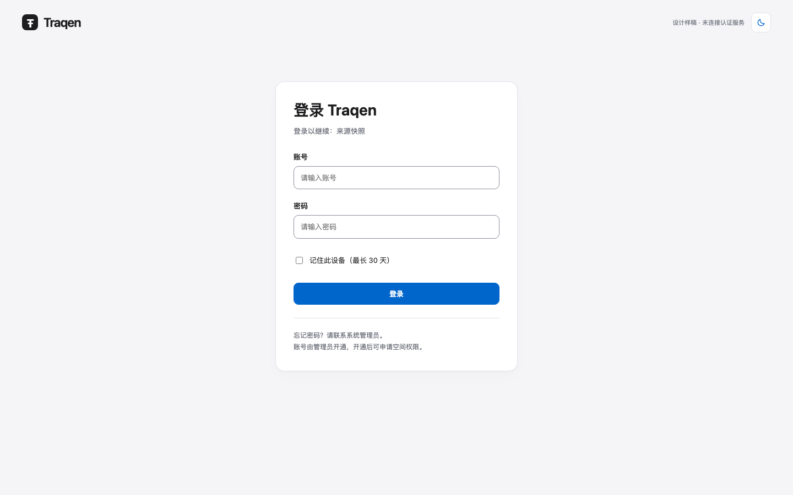

同一场景的石墨主题，内容与布局不变：

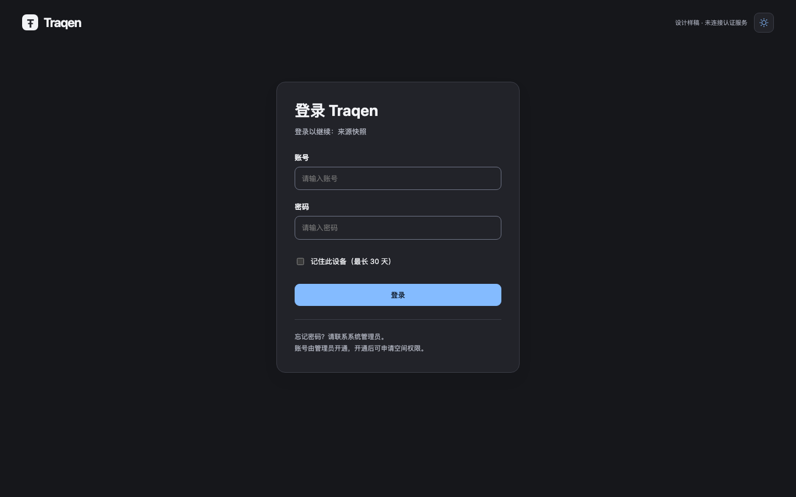

<a id="02-mfa"></a>

## 02 · 两步验证

**布局：** 延续认证卡片，顶部显示账号密码已完成、两步验证为当前步骤。

**操作：** 单一验证码输入框，支持自动填写；验证并继续；可切换单次恢复码。

**状态与边界：** 错误与已使用验证码就地提示；返回登录可换账号，不能在完成验证前显示业务外壳。

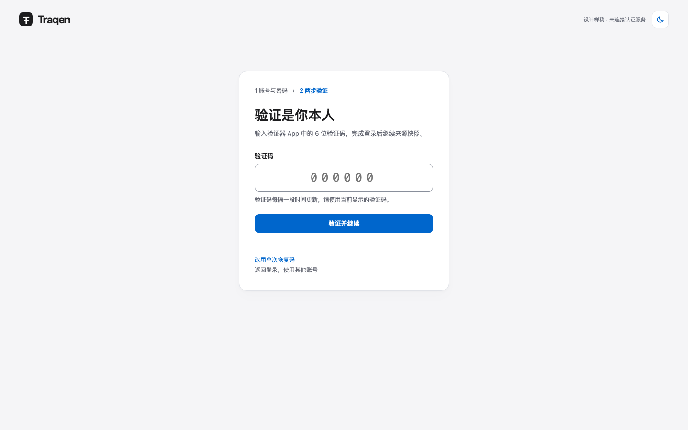

<a id="03-enrollment"></a>

## 03 · 首次绑定两步验证

**布局：** 568px 宽卡片，按添加验证器 → 保存恢复码 → 验证当前码的顺序组织。

**操作：** 二维码与手动密钥、复制／下载恢复码、验证码、确认绑定并继续。

**状态与边界：** 系统管理员绑定完成前无管理权限；图中二维码、密钥和四个恢复码位置仅为示意，不规定正式码数量。

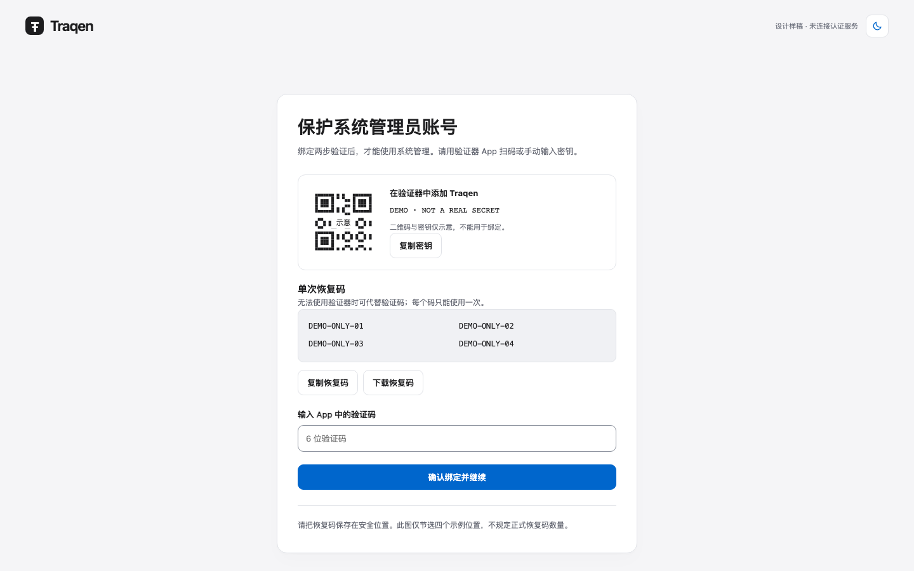

<a id="04-recovery-code"></a>

## 04 · 使用单次恢复码

**布局：** 沿用认证卡片，清楚说明一次使用一个恢复码。

**操作：** 恢复码输入、验证并继续、返回验证码验证。

**状态与边界：** 已使用或无效恢复码就地报错；都不可用时联系系统管理员，不提供万能恢复入口。

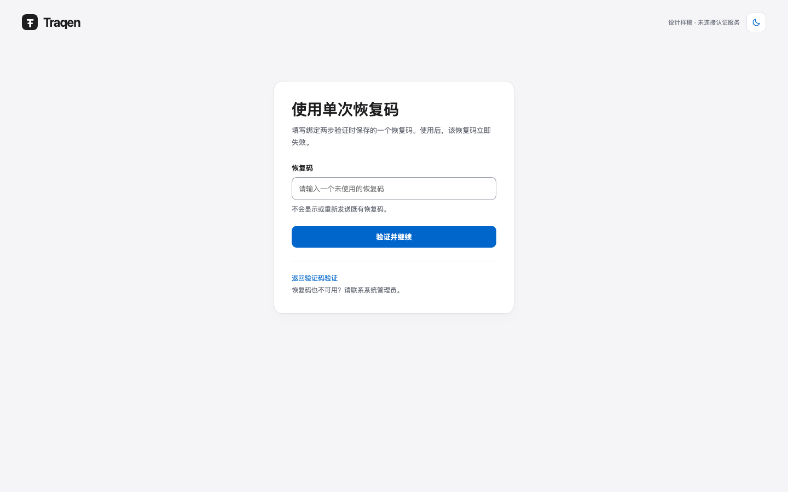

<a id="05-password"></a>

## 05 · 设置／恢复密码

**布局：** 独立认证表单，开通与恢复共用该结构。

**操作：** 一次性凭据、新密码、确认新密码；保存后返回登录。

**状态与边界：** 至少 8 个字符，不定期强制更换；凭据失效时说明联系管理员；敏感值不放入 URL、错误或日志。

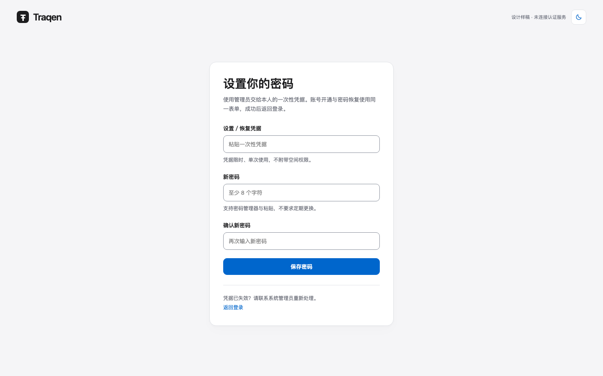

<a id="06-zero"></a>

## 06 · 零空间管理员

**布局：** 保留 F005 六入口和账号菜单；主区按我的空间／可申请空间／我的申请组织；下方解释管理员仍可管理实例。

**操作：** 申请创建空间为主动作；浏览目录、查看申请、进入全局设置为次要入口。

**状态与边界：** 普通零空间账号隐藏“你仍可管理实例”；全局配置资格持有人仍可进入 F006 全局设置；依赖空间的页面保持同一种入口态。

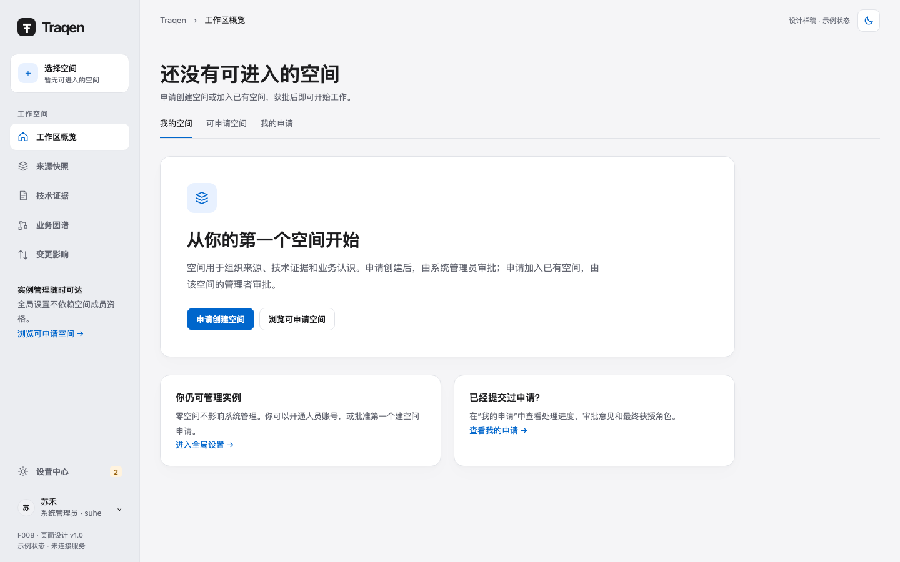

<a id="07-spaces"></a>

## 07 · 我的空间

**布局：** 复用业务外壳，空间卡片显示实际可进入空间和本人角色。

**操作：** 进入空间；按资格进入成员与权限；可申请创建或申请其他角色。

**状态与边界：** 只读与维护分开；空间管理身份不自动获得审核角色；无权或失效不能静默换到其他空间。

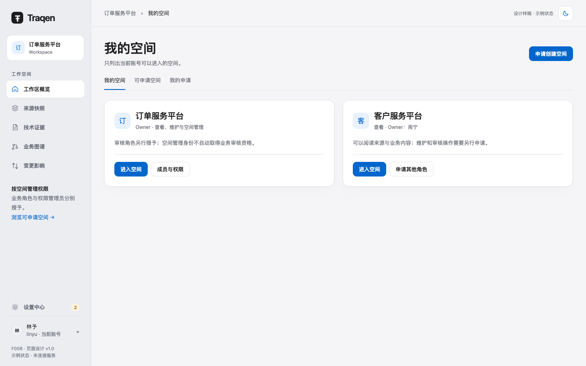

<a id="08-directory"></a>

## 08 · 可申请空间

**布局：** 目录在主区展示名称与 Owner，搜索在列表上方。

**操作：** 搜索空间、申请加入；申请创建空间为页面主动作。

**状态与边界：** 不展示业务内容；保密空间不进入目录；读取失败不冒充目录为空。

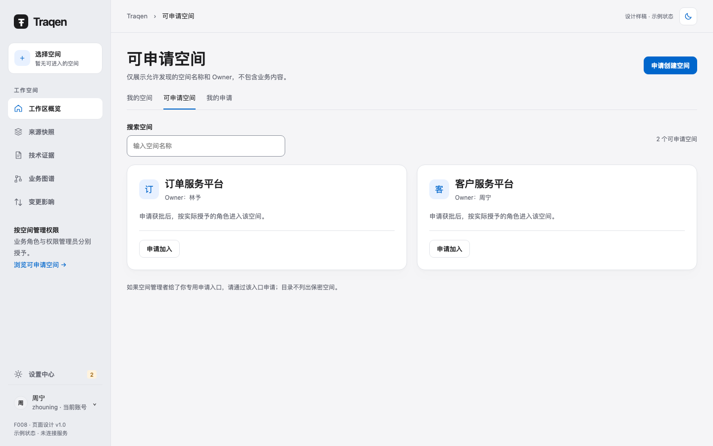

<a id="09-create"></a>

## 09 · 申请创建空间

**布局：** 主表单＋302px 提交后说明；目标结果固定显示为批准后产生 Owner。

**操作：** 空间名称、用途说明、提交申请、返回我的空间。

**状态与边界：** 字段离焦或提交后提示；失败保留输入；重复提交核对同一申请，不启动任务或资源配置。

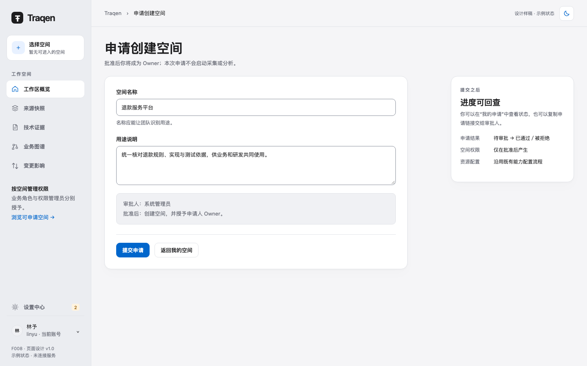

<a id="10-join"></a>

## 10 · 申请加入空间

**布局：** 先显示申请目标与审批归属，再选择角色和填写理由。

**操作：** 查看／维护／实例允许的审核角色多选；提交申请。

**状态与边界：** 保密空间必须从合法申请入口到达；D3 冲突就近说明；申请入口与链接本身不授予任何权限。

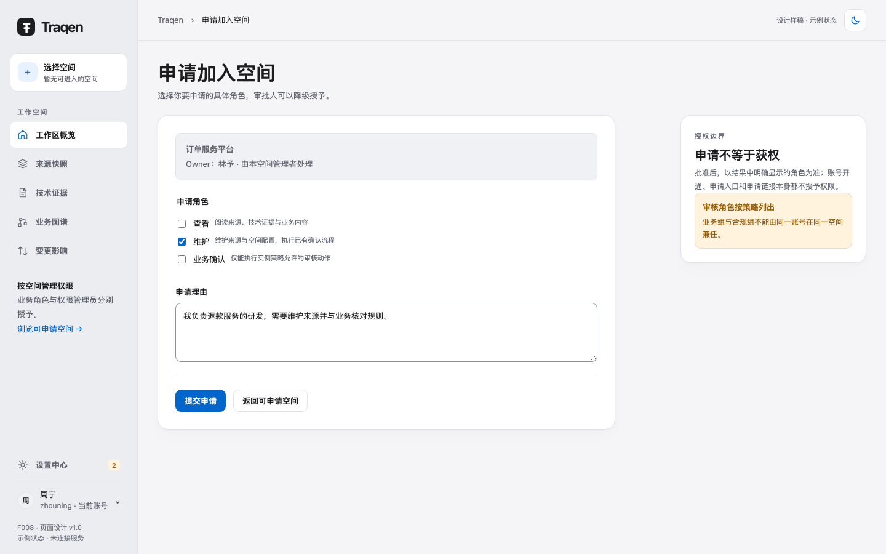

<a id="11-applications"></a>

## 11 · 我的申请

**布局：** 状态筛选＋列表＋302px 详情；主列表保留状态和实际角色，右侧展示处理时间线。

**操作：** 查看结果、复制定位链接；待审批时可撤回，拒绝或撤回后可重新申请。

**状态与边界：** 待审批／已通过／被拒绝／已撤回分别表达；实际授予与申请角色并列；历史批准不能覆盖后来撤权。

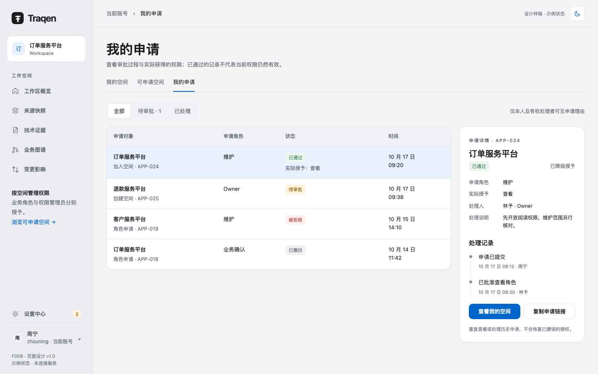

<a id="12-approval"></a>

## 12 · 成员申请审批

**布局：** 当前空间范围内的申请列表与详情；当前角色、申请角色和实际授予结果在一次判断内可见。

**操作：** 批准、降级批准、拒绝（必须填写原因）；只有一项授予动作是主动作。

**状态与边界：** D3 冲突标明原因；权限管理员涉及本人变更交给 Owner／系统管理员；并发已处理时显示最终结果，不重复授予。

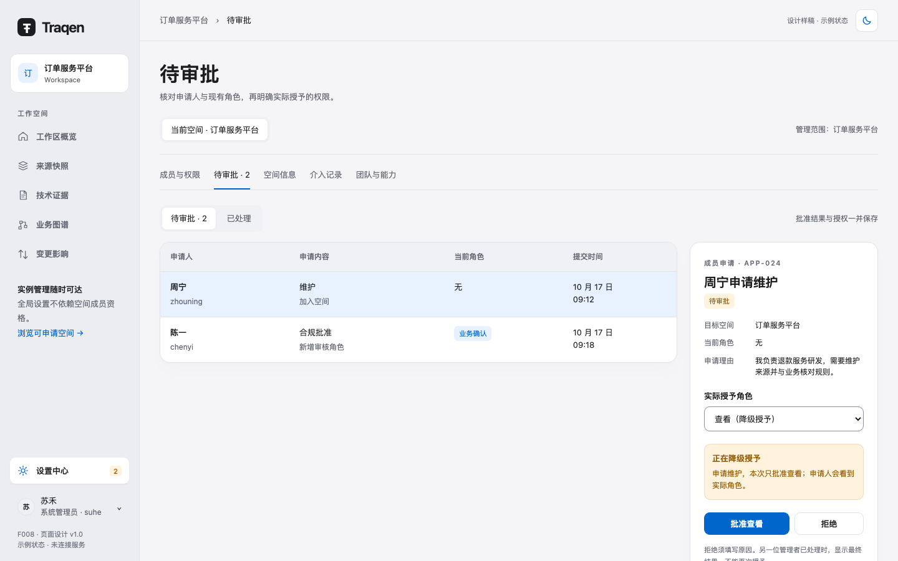

同一场景的石墨主题，内容与布局不变：

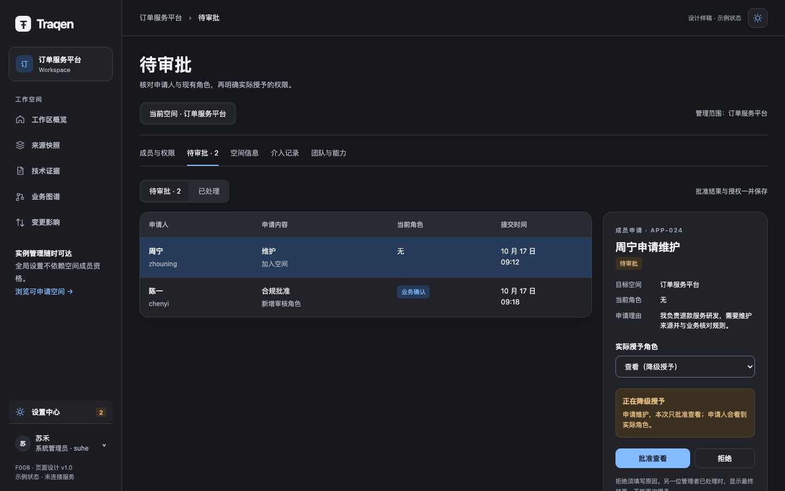

<a id="13-create-approval"></a>

## 13 · 建空间审批

**布局：** 全局范围内列出申请人、空间名称、用途与拟产生的 Owner。

**操作：** 批准创建、拒绝；管理员可处理自己的建空间申请。

**状态与边界：** 明确批准只创建空间及 Owner；不等于业务自批，不启动采集或分析；重复审批不重复创建空间。

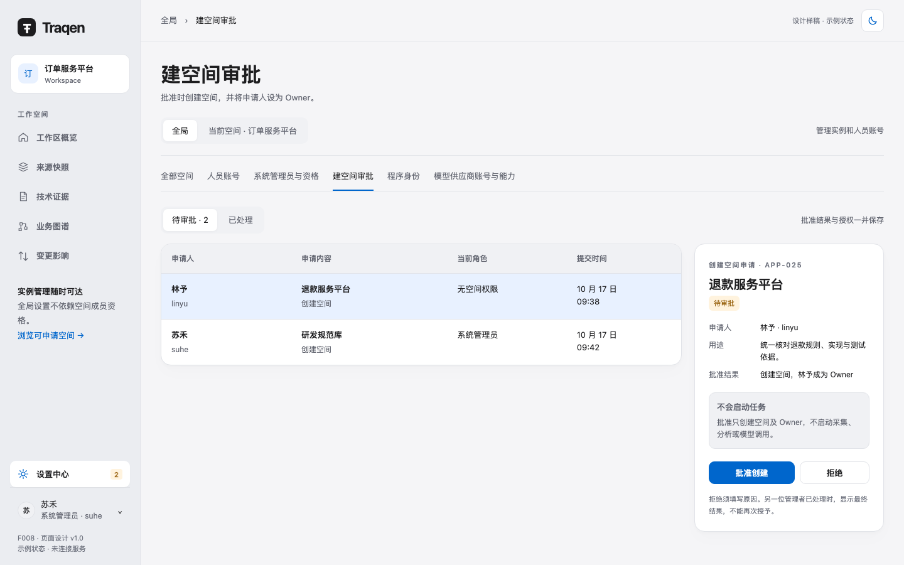

<a id="14-members"></a>

## 14 · 成员与权限

**布局：** 当前空间范围下使用成员表格和302px检查器；展示角色、授予来源、授予人、时间和变更摘要。

**操作：** 添加成员、调整角色、撤销普通角色；权限管理员任免由 Owner／系统管理员处理。

**状态与边界：** 普通成员只看允许披露的角色变更摘要；权限管理员不自动获得业务维护或审核能力；Owner 始终单一。

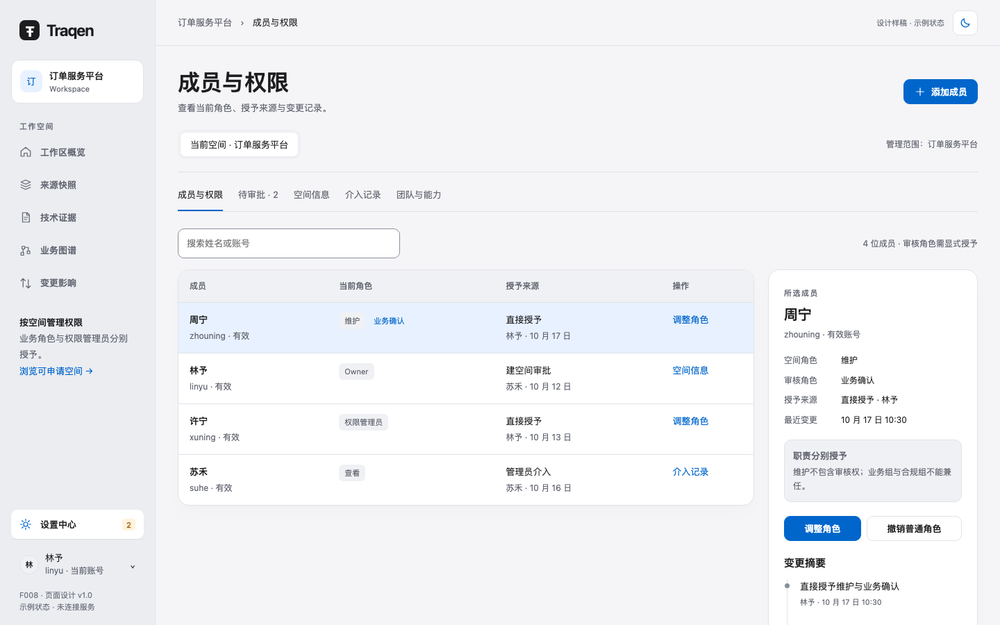

同一场景的石墨主题，内容与布局不变：

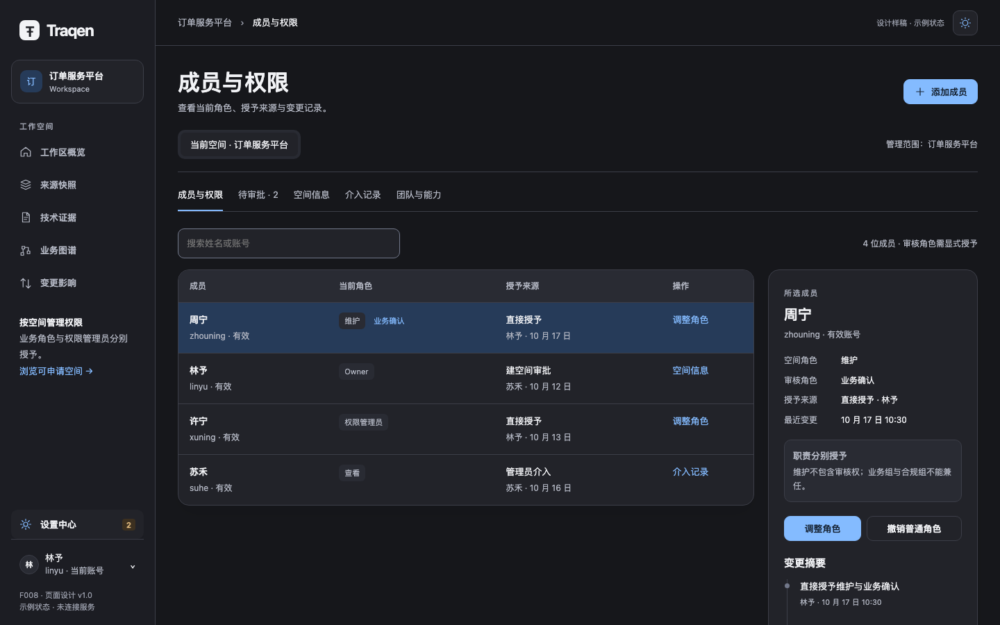

<a id="15-role-edit"></a>

## 15 · 角色编辑与冲突

**布局：** 在成员页上用具名弹窗编辑同一成员；普通空间角色、管理资格、审核角色分组。

**操作：** 保存角色变更、取消；不可选项旁写明原因。

**状态与边界：** 当前已持业务组角色时合规组不可同时选；若先撤销旧角色，需把拟变更后的集合重新核验，不能只靠前端禁用。

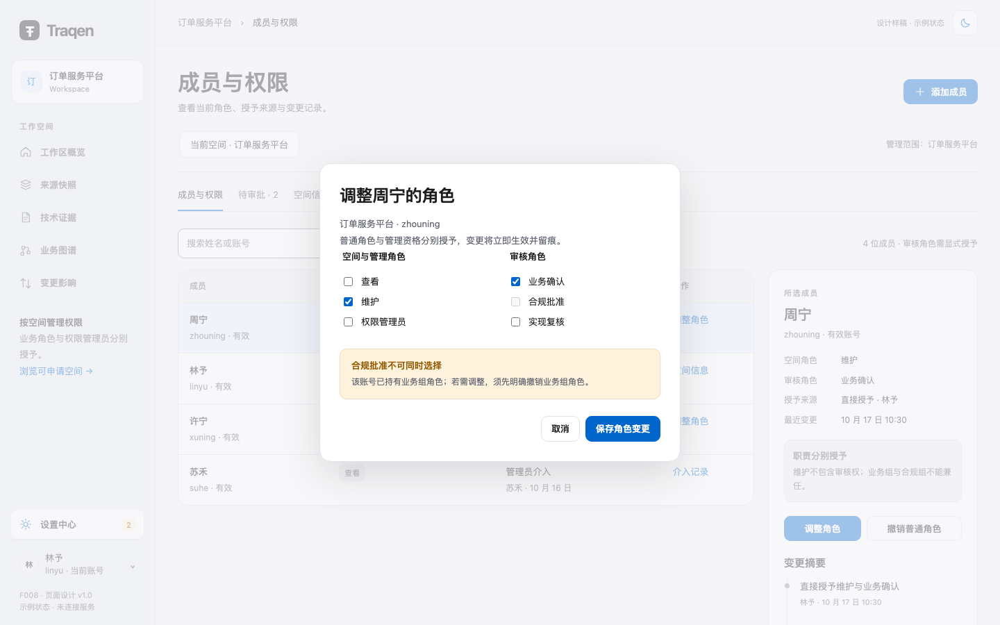

<a id="16-space-info"></a>

## 16 · 空间信息

**布局：** 左侧编辑名称和可见性，右侧独立展示 Owner 与删除生命周期。

**操作：** 保存信息、生成申请入口；Owner 转让和删除为次要动作。

**状态与边界：** 切换可见性说明对目录与申请入口的影响；删除沿用原有确认规则，不把单次点击当最终删除。

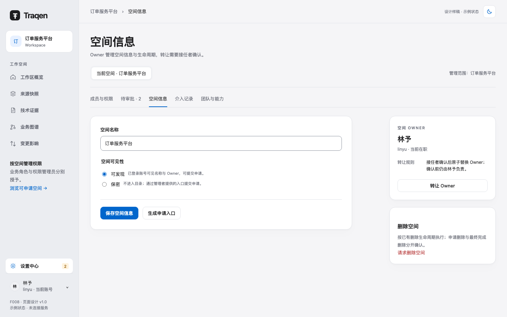

<a id="17-owner-transfer"></a>

## 17 · Owner 转让

**布局：** 弹窗明确空间与当前 Owner，再选择有效接任者。

**操作：** 发起转让、取消；接任者从通知进入确认／拒绝视图。

**状态与边界：** 确认页必须同时显示原 Owner、接任者、目标空间和替换后结果；确认前原 Owner 不变；批准时原子替换，拒绝／失效不改 Owner。

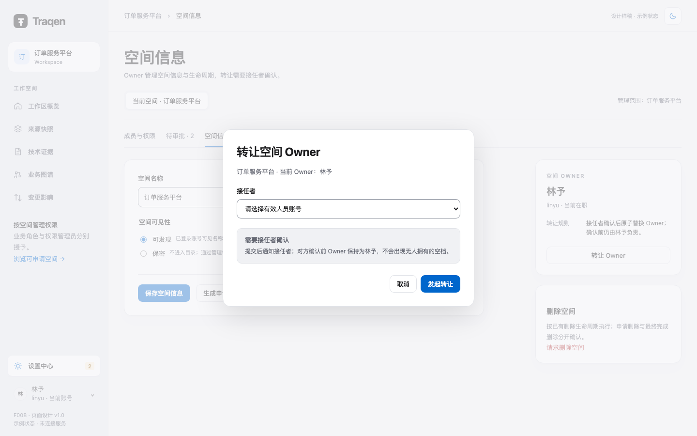

<a id="18-delete-space"></a>

## 18 · 请求删除空间

**布局：** 危险操作弹窗单独交代对象与所处生命周期。

**操作：** 输入空间名称核对、请求删除、取消；危险动作不默认聚焦。

**状态与边界：** 请求删除、取消删除和完成删除分别按已有规则呈现；失败保留上下文，不假报已经删除。

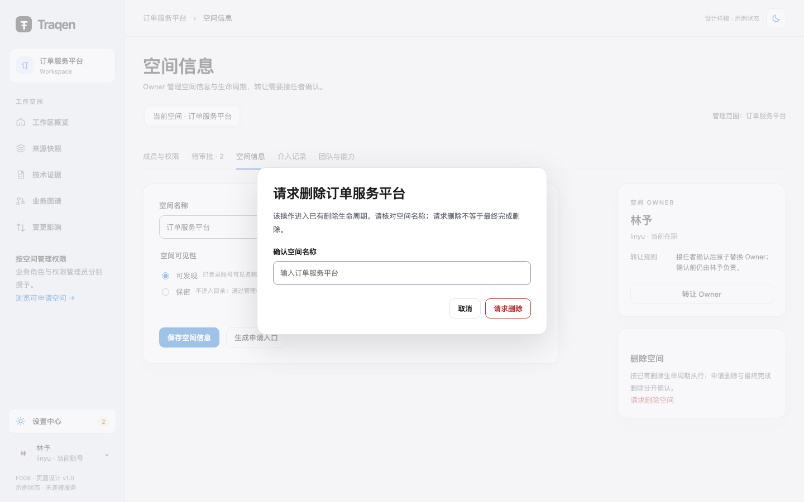

<a id="19-interventions"></a>

## 19 · 管理员介入记录

**布局：** 当前空间管理范围下按时间列出操作者、动作、范围与授权来源。

**操作：** 回查介入记录及其对象。

**状态与边界：** 管理者能看到管理员派生授权；使用时核验当前管理员资格；独立普通授权按自身规则，不与派生授权混为一条。

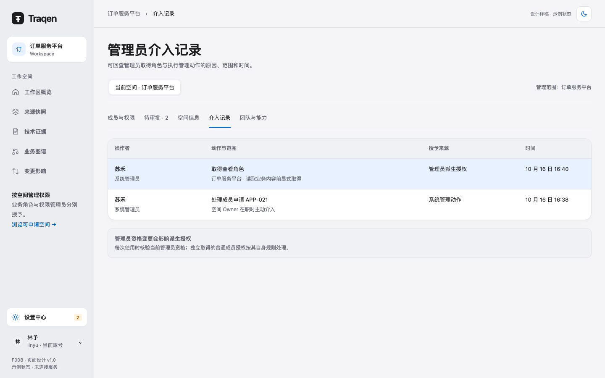

<a id="20-all-spaces"></a>

## 20 · 系统管理／全部空间

**布局：** 全局范围下的空间目录与管理检查器；列出 Owner、可见性、成员数和待审批数。

**操作：** 进入空间管理为主动作；需要业务内容时另行取得所需角色。

**状态与边界：** Owner 在职、本人非成员也能进入管理面；此处只披露管理所需信息，不提前读取业务内容。

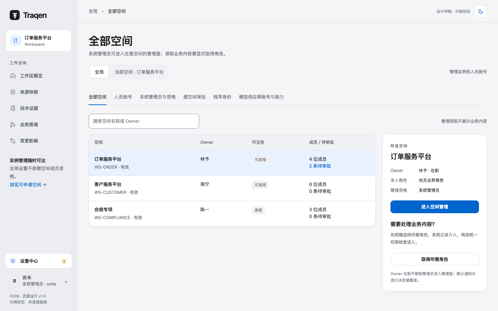

<a id="21-accounts"></a>

## 21 · 人员账号

**布局：** 全局范围下的人员表格与账号检查器；人员账号和模型供应商账号明确分开。

**操作：** 开通账号；对目标执行停用、账号恢复、两步验证重置。

**状态与边界：** 待设置密码／有效／已停用分别显示；开通不自动获得空间权限；敏感操作需要近期重新验证。

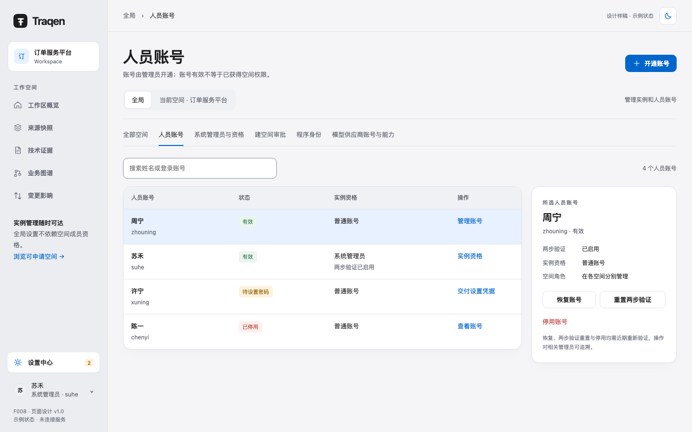

同一场景的石墨主题，内容与布局不变：

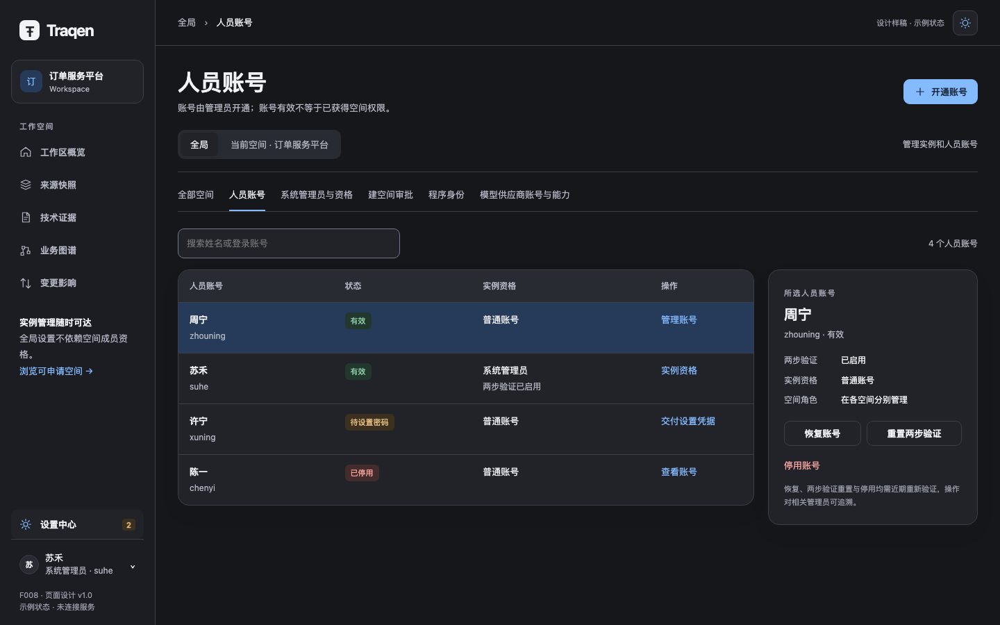

<a id="22-account-create"></a>

## 22 · 开通人员账号

**布局：** 在人员页弹窗填写显示名和登录名，说明下一步交付一次性设置凭据。

**操作：** 开通并生成设置凭据、取消；成功后进入本次凭据交付区。

**状态与边界：** 不设默认密码；交付区应支持复制及设置密码页面入口，并说明有效期和单次使用；离开后不回显明文。

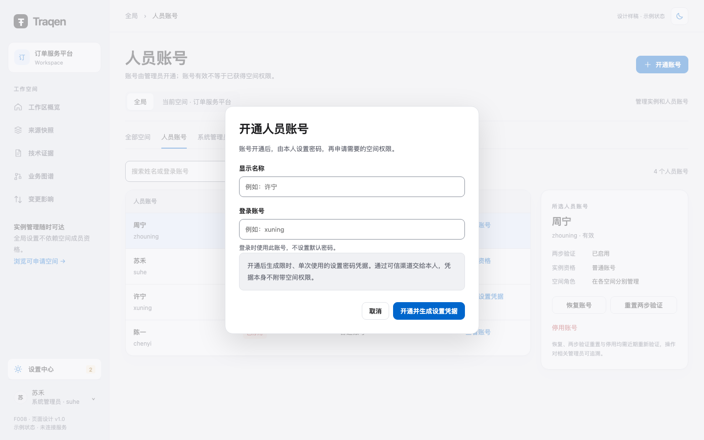

<a id="23-account-recovery"></a>

## 23 · 账号恢复

**布局：** 弹窗明确目标账号、恢复影响以及一次性凭据交付位置。

**操作：** 验证管理员身份后生成恢复凭据，通过可信渠道交给本人。

**状态与边界：** 恢复成功后旧会话与未使用凭据失效；重置两步验证与密码恢复分开说明；Owner 无权代重置他人账号。

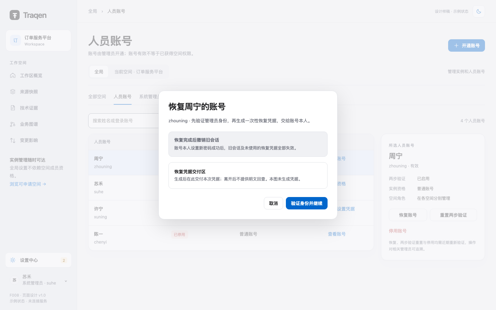

<a id="24-admins"></a>

## 24 · 系统管理员与全局配置资格

**布局：** 全局资格表格同时呈现任命、两步验证完成状态及独立的全局配置资格。

**操作：** 添加系统管理员、调整／撤销资格，提交前近期重新验证。

**状态与边界：** 待绑定人员未获得管理员权限；最后一位有效管理员的移除与停用被阻止；变更通知其他系统管理员。

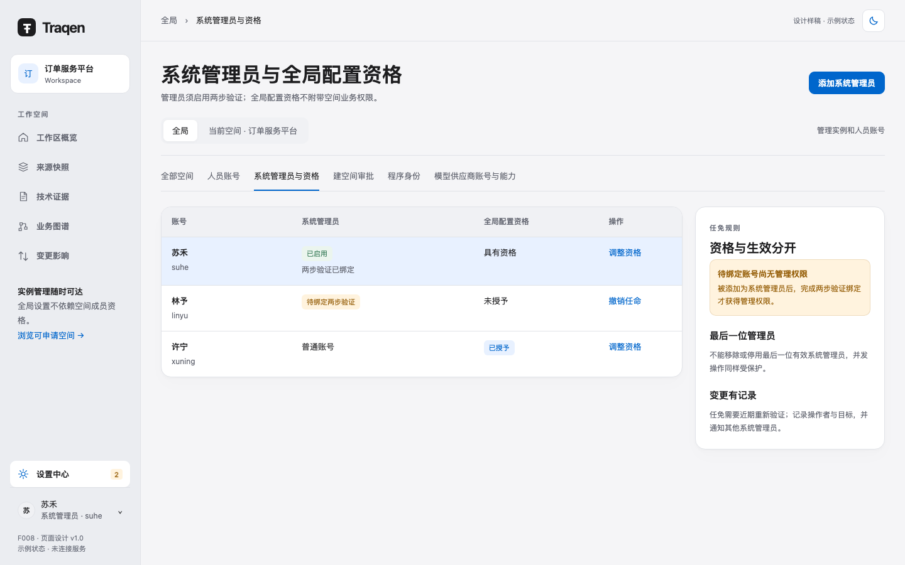

<a id="25-programs"></a>

## 25 · 程序身份

**布局：** 全局程序身份表格与受限凭据详情；不与人员账号或模型供应商账号混放。

**操作：** 创建、轮换、撤销；创建表单填写名称、明确空间、操作范围、有效期。

**状态与边界：** 新凭据仅交付时展示明文；遮罩不能回写；空间管理者另行授予成员权限；程序不能批准人员业务决定。

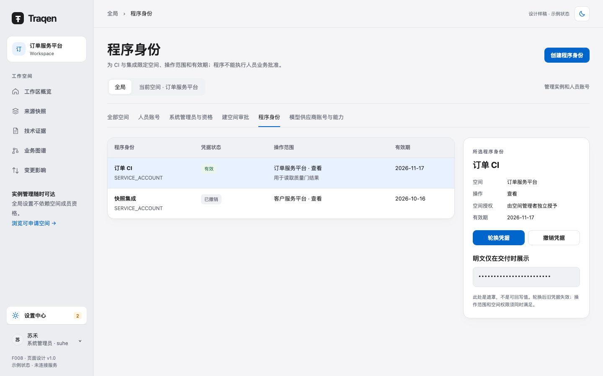

<a id="26-security"></a>

## 26 · 登录设备与账号安全

**布局：** 从侧栏底部账号进入，主区列本人会话，右侧为密码与两步验证。

**操作：** 撤销某设备、退出其他设备、退出此设备、修改密码、管理两步验证。

**状态与边界：** 本人当前设备有标记；绝对／空闲期限清楚；后台轮询不续期；过期或撤销不删除任何业务记录。

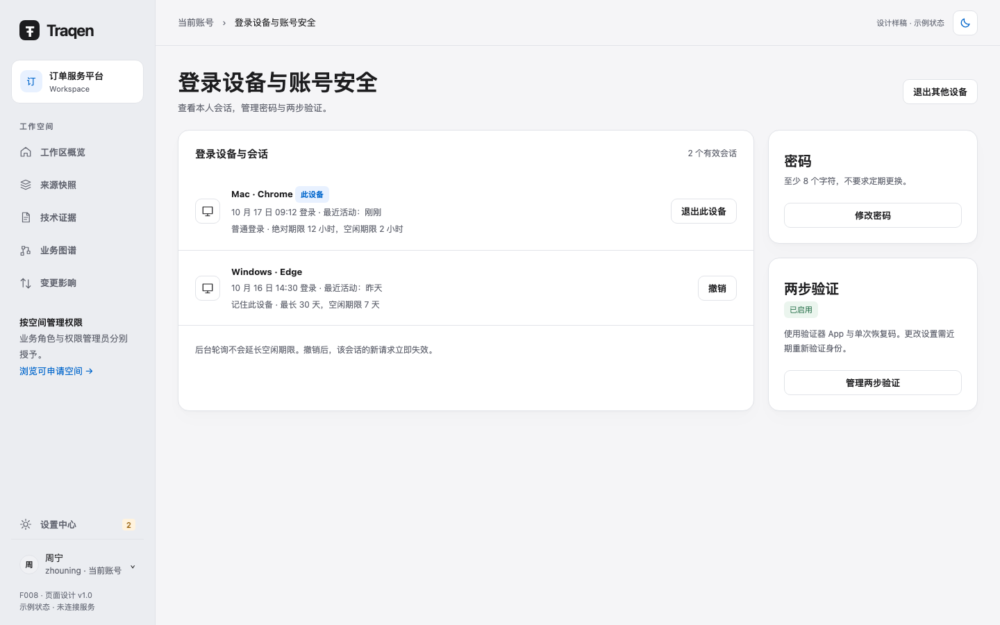

<a id="27-account-menu"></a>

## 27 · 当前账号菜单

**布局：** 菜单从侧栏底部账号区域向上展开，沿用 F005 Menu／Popover 层级。

**操作：** 我的申请、设备与会话、修改密码、两步验证、退出此设备。

**状态与边界：** 角标提示申请状态变化；键盘可开关、移动、关闭；关闭返回触发控件焦点。

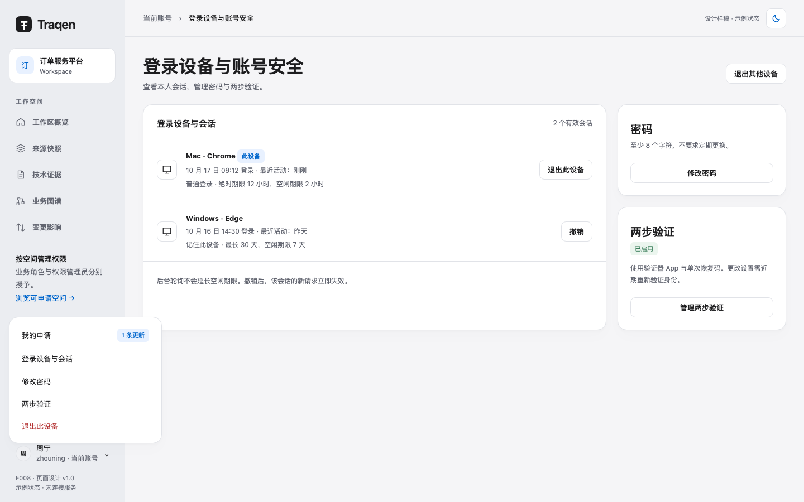

<a id="28-reauth"></a>

## 28 · 近期重新验证

**布局：** 敏感操作前在具名弹窗核对本人；不跳离原任务位置。

**操作：** 当前密码；已启用两步验证时输入验证码或恢复码；验证后继续原操作。

**状态与边界：** 取消不执行敏感操作；错误就近提示；验证成功不自动重发此前结果不明的业务写入。

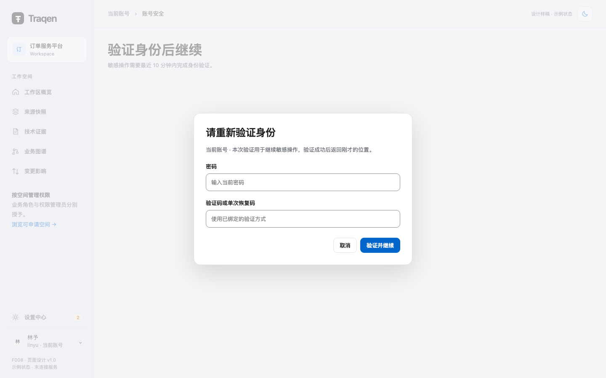

<a id="29-change-password"></a>

## 29 · 修改密码

**布局：** 个人安全范围内的简短表单，沿用账号开通／恢复的密码规则。

**操作：** 新密码、确认密码、保存；必要时进入重新验证后回到当前表单。

**状态与边界：** 至少 8 个字符；失败不清空非敏感上下文；不因密码年龄强制定期更换。

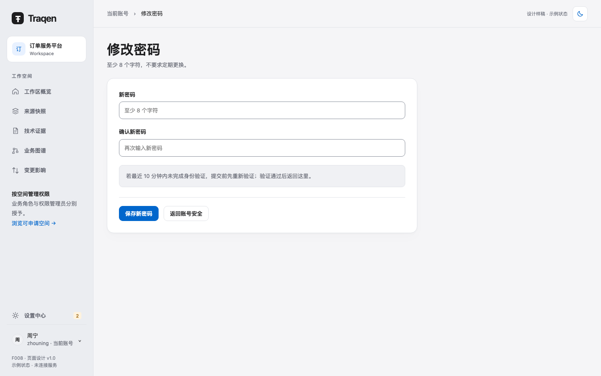

<a id="30-denied"></a>

## 30 · 可发现空间无权限

**布局：** 保留来源快照目的地，EmptyState 明确受限空间与可行下一步。

**操作：** 申请权限、返回我的空间。

**状态与边界：** 不预加载业务数据；申请后仍须等审批；不以无权冒充空间为空。

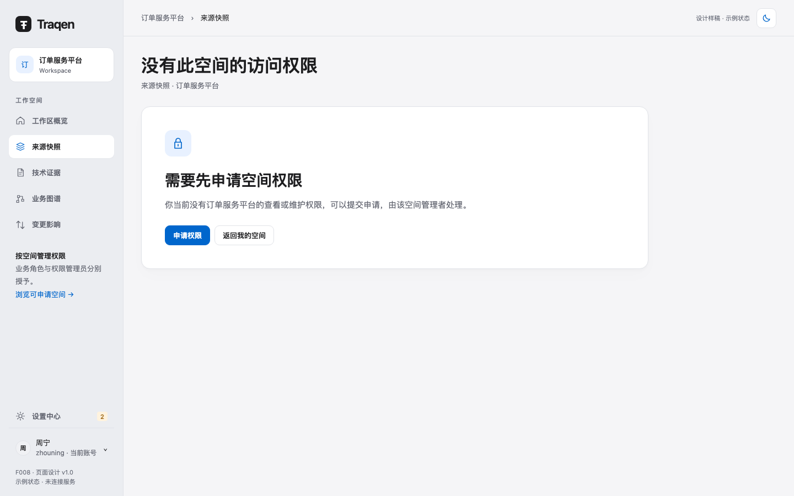

<a id="31-secret-unavailable"></a>

## 31 · 保密或不存在的空间

**布局：** 相同的“无法访问此空间”状态，不显示目标名称和存在性。

**操作：** 返回我的空间；有合法申请入口时从该入口另行申请。

**状态与边界：** 知道 ID 或收到普通定位链接不等于获得申请或读取权限；不能泄露保密空间是否存在。

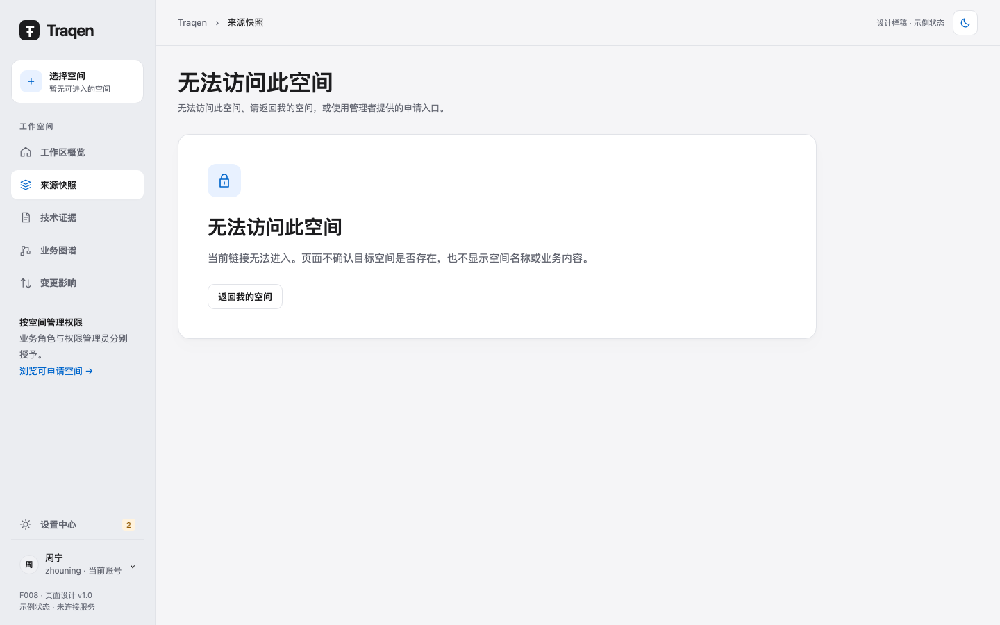

<a id="32-expired"></a>

## 32 · 会话过期

**布局：** 当前页面内容隐藏，只保留目的地页面语义；中央只显示一个重新登录提示。

**操作：** 重新登录、使用其他账号；登录后查询原任务和结果。

**状态与边界：** 多个并发失败不叠弹窗；换账号清理旧内容／缓存；不重复启动任何写操作，也不借用旧全局位置键。

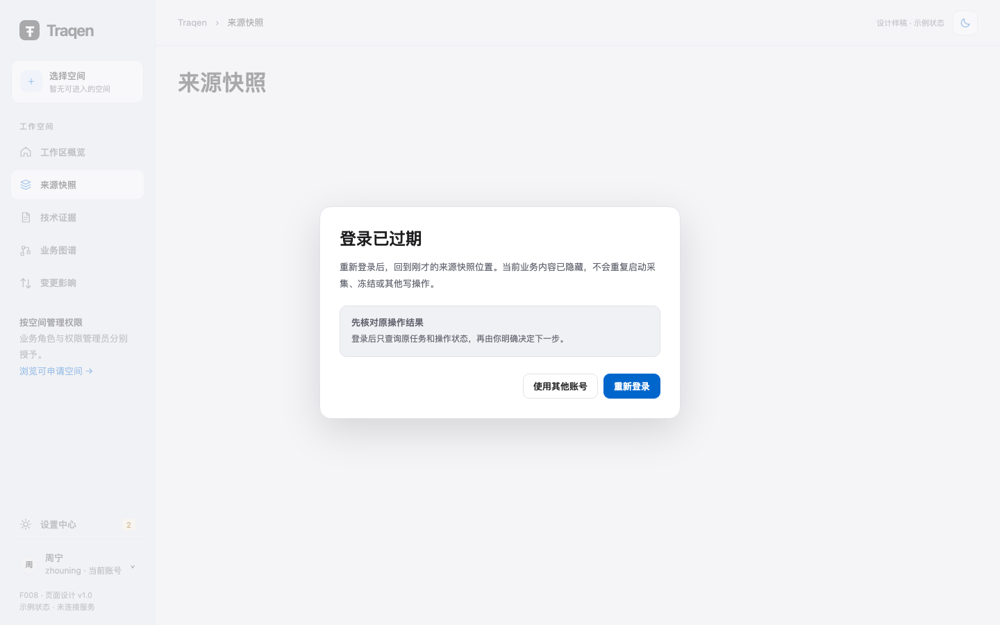

同一场景的石墨主题，内容与布局不变：

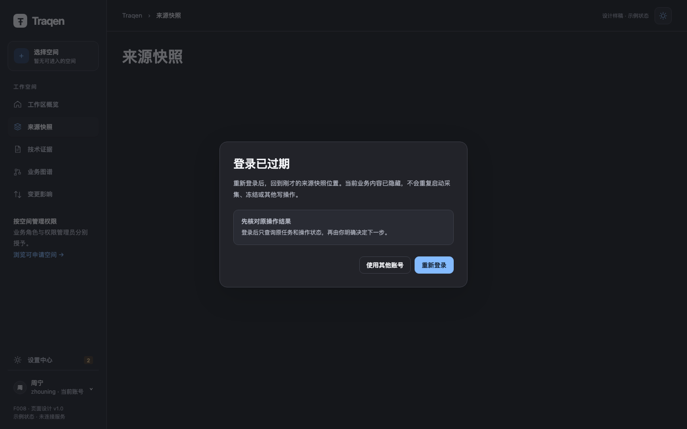

<a id="33-uninitialized"></a>

## 33 · 实例未初始化

**布局：** 认证外壳的部署说明卡片，无业务导航或注册表单。

**操作：** 重新检查初始化状态；提示在部署终端完成初始化。

**状态与边界：** 网页不抢注管理员；重启／升级／恢复不能重新打开初始化。

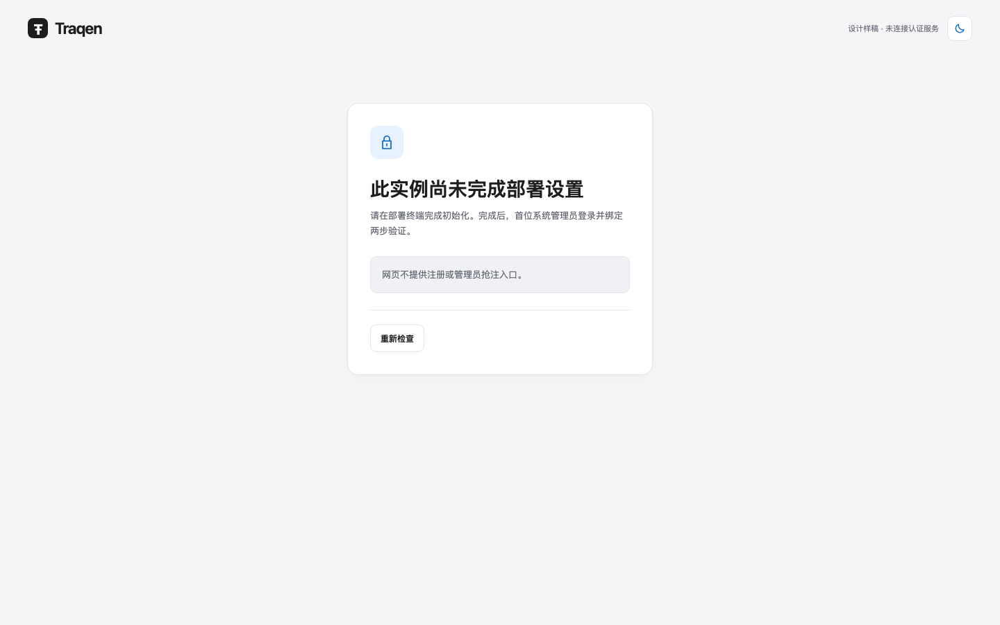

<a id="34-recovering"></a>

## 34 · 实例恢复检查

**布局：** 认证外壳内显示受限恢复原因与当前访问限制。

**操作：** 部署终端先确认可信恢复管理员；管理者核对账号授权和来源完整性。

**状态与边界：** 普通登录、程序业务访问及后台写入暂缓；这不是重新初始化，也不复活旧会话。

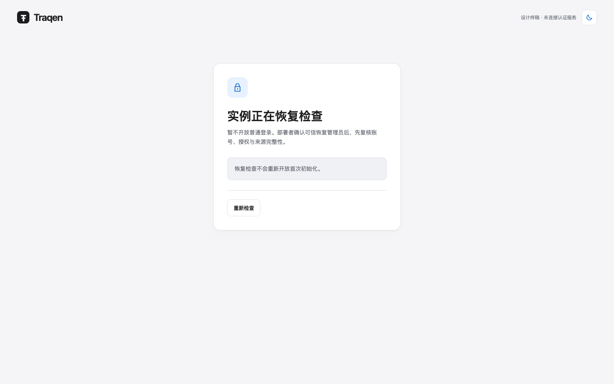

<a id="35-disabled"></a>

## 35 · 账号已停用

**布局：** 认证外壳明确账号停用，已清理业务内容。

**操作：** 联系系统管理员，或返回登录使用其他账号。

**状态与边界：** 不继续显示旧内容；不冒充密码错误或网络问题。

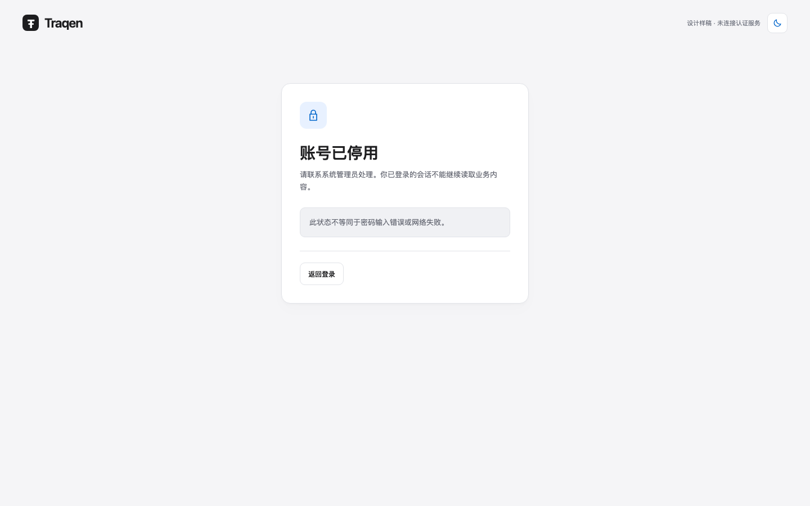

<a id="36-errors"></a>

## 36 · 加载与失败状态对照

**布局：** 同一管理任务的加载、查询无结果、网络失败、提交结果未确认四种状态并列对照。

**操作：** 重试读取、清除筛选、查询原操作，按状态给相应动作。

**状态与边界：** 对照板不是正式页面同时显示的四个状态；真实页面只显示当前请求结果；结果未知不能当作失败后自动重发。

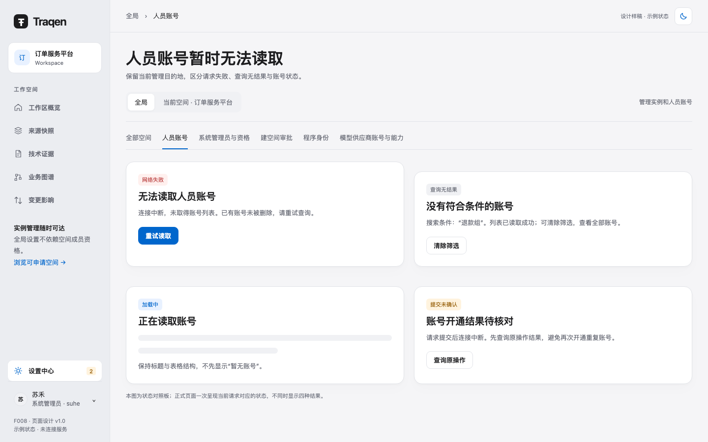

<a id="37-review-role"></a>

## 37 · 审核角色选择

**布局：** 在已有业务审核表单中新增当前角色选择，保留对象、依据、提议人和理由。

**操作：** 先显式选择当前账号持有的审核角色，再记录决定。

**状态与边界：** 不替用户选择最有利角色；服务端识别统一账号并禁止自批／伪造双签；完整审核规则仍归原业务合同。

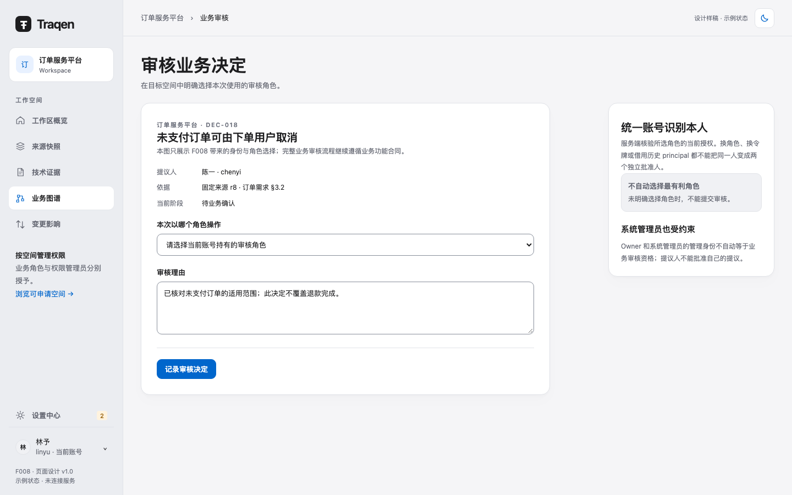

<a id="38-admin-intervene"></a>

## 38 · 管理员显式取得角色

**布局：** 从全局空间管理面进入弹窗，明确目标和派生授权来源。

**操作：** 选择所需角色，记录介入并取得角色。

**状态与边界：** 先记录授权再访问业务；管理员降权／停用后派生授权下一次使用失效；空间管理者可回查。

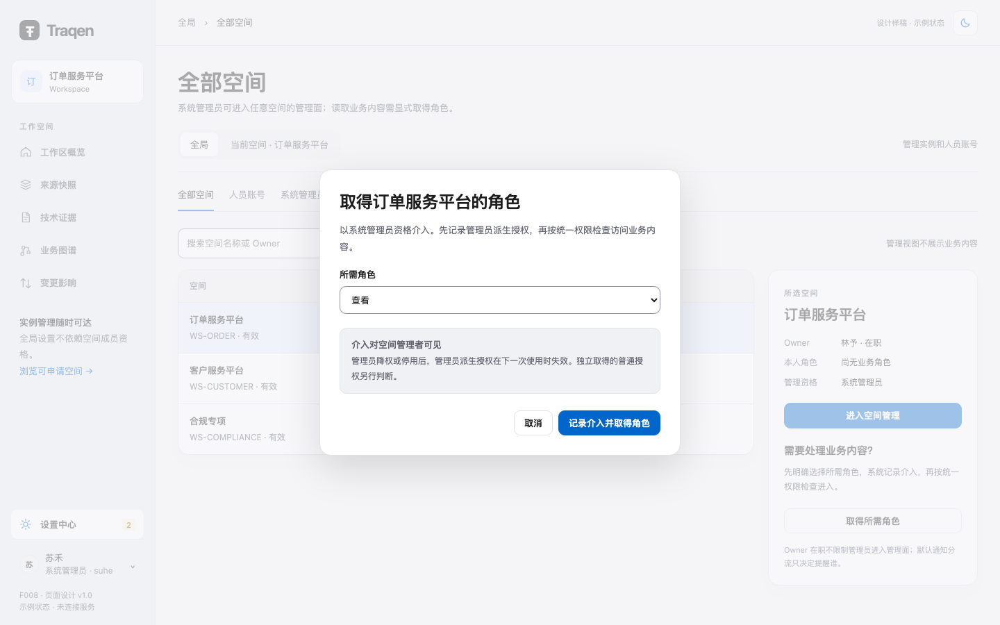

<a id="39-resources"></a>

## 39 · 与 F006 的衔接

**布局：** 只说明入口与权限衔接；完整全局资产、团队与能力页面沿用 F006。

**操作：** 有资格者进入 F006 对应范围。

**状态与边界：** 该图不是完整 F006 配置效果图；本轮不重做其业务合同。

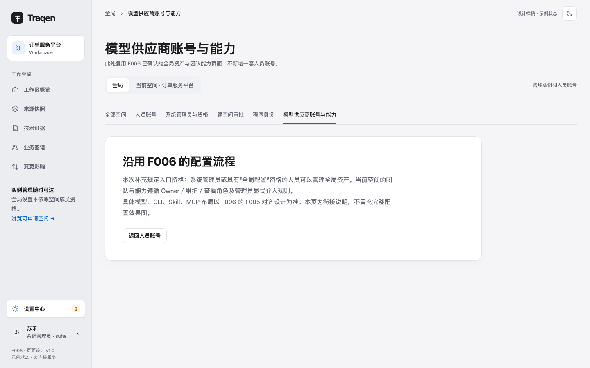

## 统一缩放与较小窗口

成员页使用同一数据、选择和结构：1440×900 为 1 倍；下图在 2560×1440 为 1.6 倍，两侧各 128px。布局归一化比较记录在 verification.json；这一项仅覆盖该样稿页面。

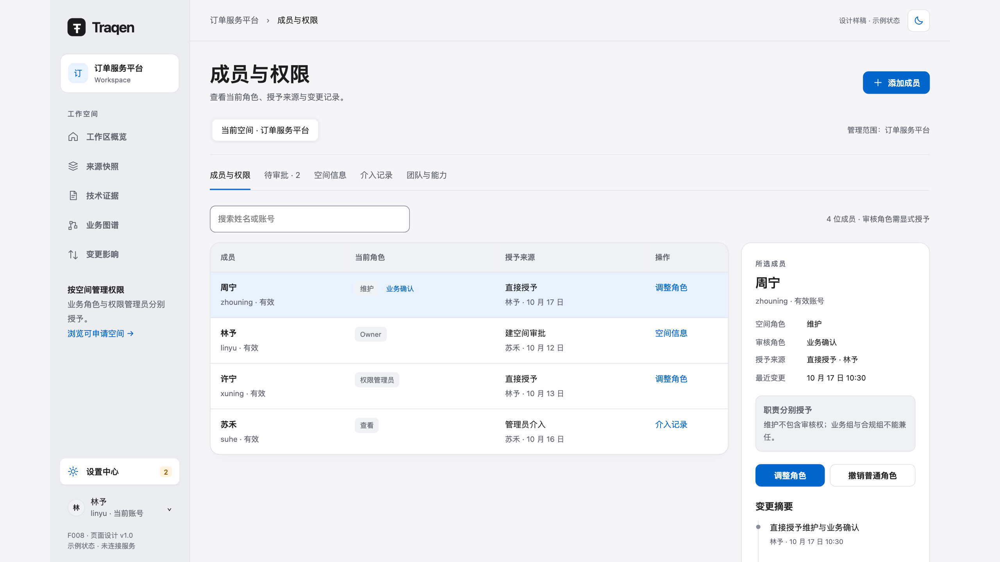

1280×800 为可达性抽样，倍率不低于 1；页面可滚动，不作为第二套设计基准。

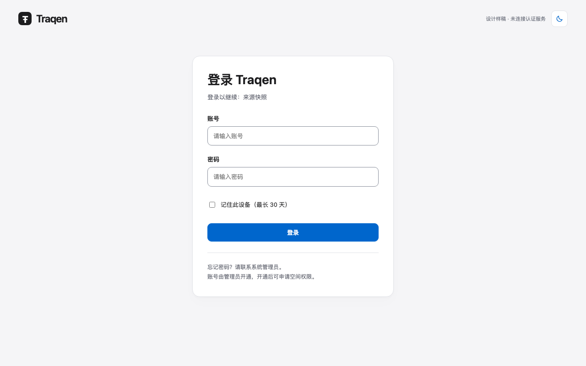

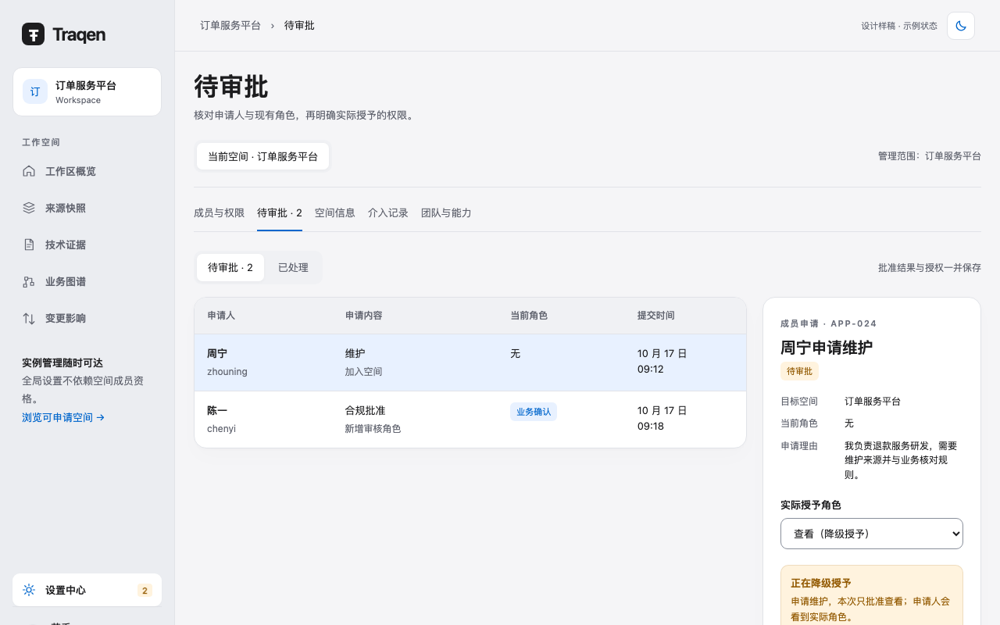

## 复现与验证范围

样稿从 `assets/index.html` 进入；查询参数 `scene` 选择本附件场景，`theme=light|dark` 选择主题。右下“设计场景目录”用于审阅时切换；`capture=1` 只隐藏这项样稿工具。URL 均是设计 fixture 参数，不是产品路由合同。

从本附件所在目录运行截图器，传入本机已有 Playwright 模块与 Chromium 可执行文件；脚本自动启动仅绑定回环地址的临时静态文件服务，结束即关闭，不接入现有运行实例：

```sh
node assets/render.mjs --playwright /ABSOLUTE/PLAYWRIGHT/index.mjs --browser /ABSOLUTE/CHROMIUM
```

输出位于 `assets/previews/`；`assets/verification.json` 保存真实浏览器版本、截图 SHA-256、来源文件摘要、主题、逻辑尺寸、CSS 视口、倍率、缩放及检查结果。`previews/SHA256SUMS` 可对账图片字节。检查包括单一页面 h1、主题、设计标识、内容表面无横向裁切、侧栏宽度、成员页两尺寸归一化及登录输入在配色切换后保留。

**仍需正式产品验证：** 服务端认证、实际角色与对象归属、审批事务、持久化与恢复、会话并发过期、真实弹窗焦点／Esc、全键盘旅程、读屏、浏览器放大，以及生产路径中的全部页面。页面设计发布和功能完成分开记录。
